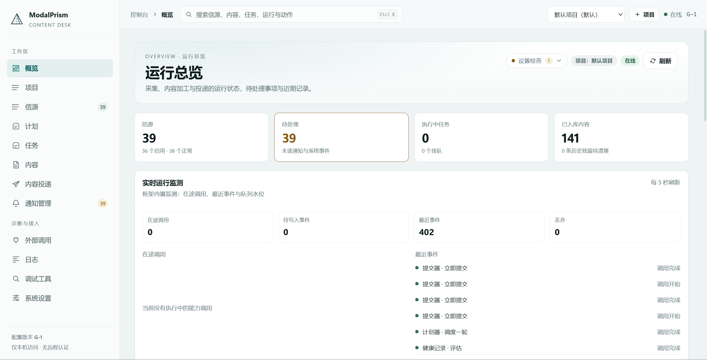
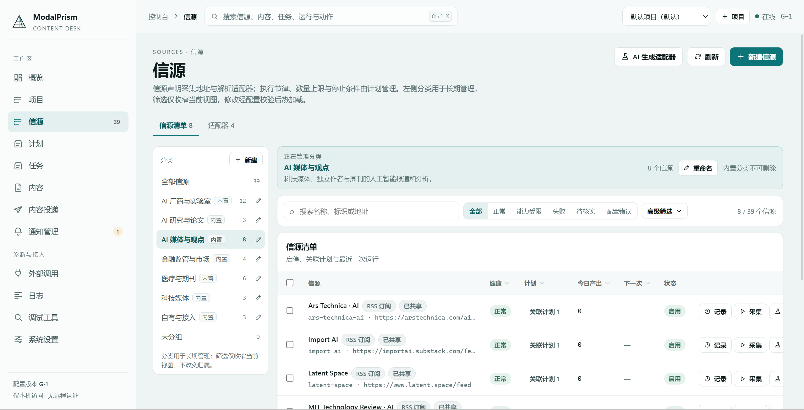
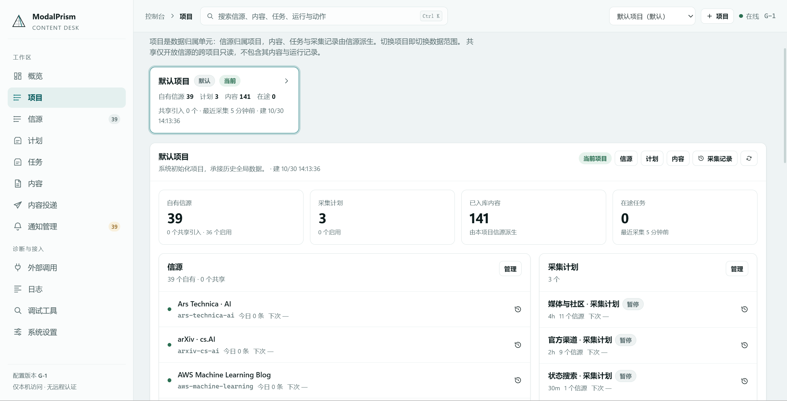
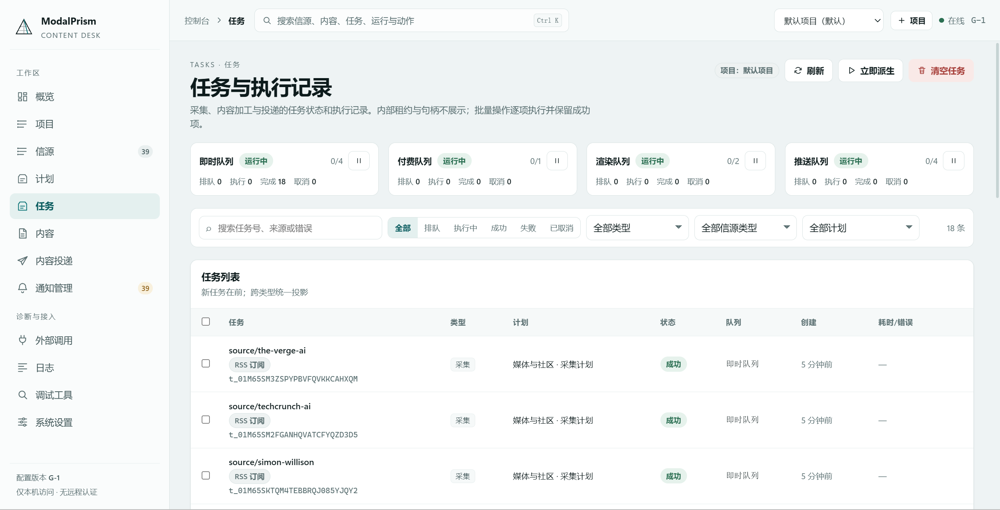
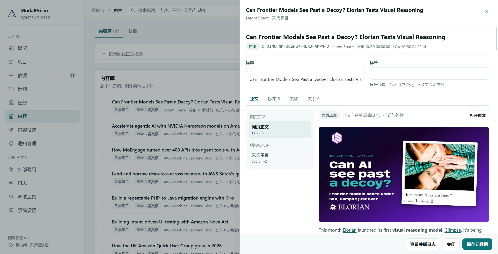
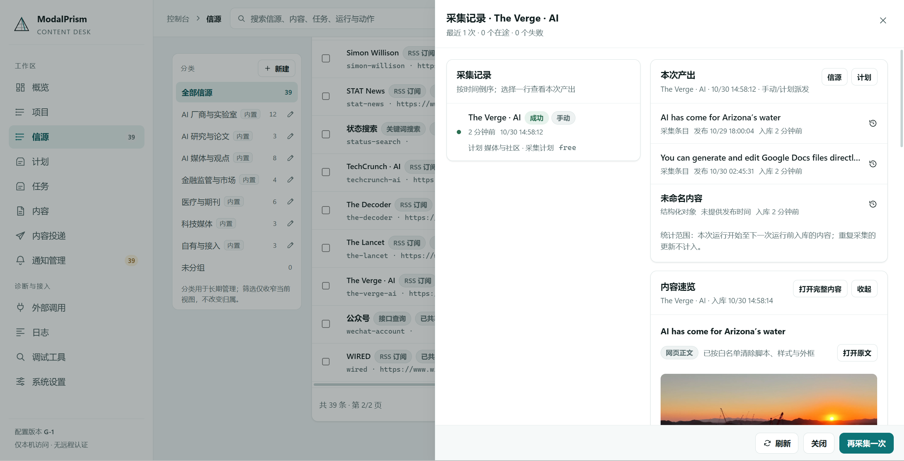
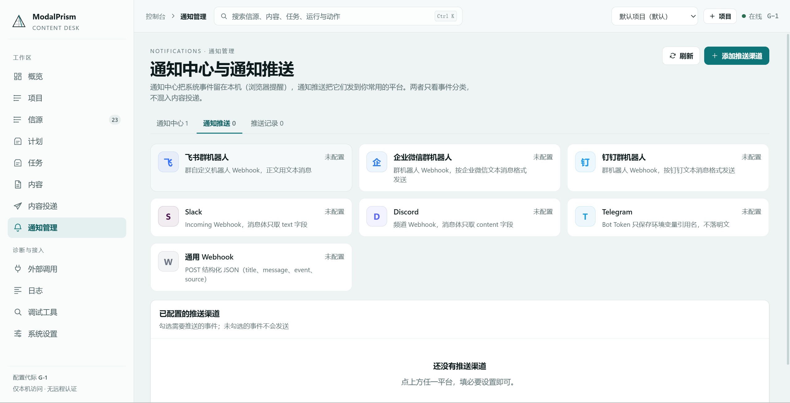

# ModalPrism

A multi-source data collection system written in Rust, with vector storage and multi-modal support: it collects data from RSS, web pages, dynamic pages, APIs, pushes, and other sources and stores it verbatim — heterogeneous multi-modal content, append-only and replayable.

Built on the [LEAF](https://github.com/MistLoom/LEAF/) framework: a lightweight Rust framework for the AI ecosystem, where one Ability serves agents, MCP, CLI, Skills, tools, and HTTP at the same time.

[](LICENSE)
[](#quick-start)
[](#architecture)

**English** · [简体中文](README.zh-CN.md)



<p align="center"><sub>Console · Overview — sources, pending events, queues, and stored content at a glance, with live runtime monitoring.</sub></p>

## Highlights

- **One-command start, lightweight runtime**: a single binary with no external services; the first run initializes storage, and one command brings up collection, delivery, and query together.
- **Built-in sources, plans ready out of the box**: 39 source configs and 3 example collection plans (disabled by default; two multi-source plans plus one query plan) ship with the repository across AI, finance, health, and technology, pre-filed into seven built-in groups (AI vendors and labs, AI research and papers, AI media and commentary, finance regulation and markets, health and journals, technology media, own and inbound). A disabled plan never collects; the examples only demonstrate cadence and quota — other sources start collecting once you create a plan for them. RSS/Atom, web list & detail pages, JS-rendered pages, open APIs, metered/paid APIs, search engines, inbound pushes, and local files all run in one process.
- **Queryable the moment it lands — no glue code**: filter, full-text, and vector search fused in one query interface, business code never writes SQL; text, structured data, images, and media are addressable resources with automatic de-duplication.
- **Multiple protocols, one capability surface**: HTTP API, MCP tools, and a SKILL script share sources, content, and config; content delivery, notification management, and runtime monitoring are served over HTTP only — see the support matrix under Public API.
- **Visual console**: twelve first-class pages — overview, projects, sources, plans, tasks, content, delivery, notifications, external calls, logs, debugging tools, settings — with source-authoring forms, sortable and filterable tables, user-defined source groups that act as a scoped workspace (seven built-in groups file the shipped sources, with batch move in and out), per-plan delivery targets, manual and automatic delivery, and per-platform notification setup, with live monitoring on the overview page.
- **Raw data kept byte-for-byte — append-only, replayable**: reprocess what you already have when a policy or recognition changes, instead of re-crawling.
- **End-to-end lineage**: every derived layer records who produced it and with what config — auditable data, traceable origins.
- **Centralized traffic governance**: rate limiting, circuit breaking, robots compliance, private-network protection; paid calls get budgets and duplicate-request merging.
- **Config as code with atomic hot-reload**: strictly validated YAML applies atomically on save; what a source fetches, how often a plan runs, and which targets new content goes to are all spelled out in the declarations.

## Console tour

Click any screenshot to open it full size.

<table>
  <tr>
    <td width="50%" valign="top"><a href="assets/sources.png"></a><br><b>Sources</b> — declarations filed into editable categories, each showing health, bound plan, today's output, and next run; start from a template or generate an adapter from the page.</td>
    <td width="50%" valign="top"><a href="assets/project.png"></a><br><b>Projects</b> — a project is the unit of data ownership: sources, plans, content, and tasks are counted per project, and switching project switches the data scope.</td>
  </tr>
  <tr>
    <td width="50%" valign="top"><a href="assets/tasks.png"></a><br><b>Tasks</b> — four queues (immediate, paid, render, push) above one unified execution history; filter by state, type, source type, or plan, then requeue or cancel.</td>
    <td width="50%" valign="top"><a href="assets/content.png"></a><br><b>Content</b> — every item keeps its raw bytes plus derived facets (web text, structured object), with versions and relations; the original is one click away.</td>
  </tr>
  <tr>
    <td width="50%" valign="top"><a href="assets/sources_record.png"></a><br><b>Collection record</b> — one run end to end: what it produced, what de-duplication skipped, and a single button to collect again.</td>
    <td width="50%" valign="top"><a href="assets/notification.png"></a><br><b>Notifications</b> — Feishu, WeCom, DingTalk, Slack, Discord, Telegram, or any webhook, each with per-event toggles and a connectivity check before saving.</td>
  </tr>
</table>

## Try it in 30 seconds

Three steps from cold start to queryable data:

1. Start the collector — the first run initializes storage; built-in sources and their plans are ready, plans start disabled, and you enable them from the Plans page after confirming the cadence (command in the [Quick start](#quick-start)).
2. Open the console at `http://127.0.0.1:5178` — all twelve pages are ready immediately.
3. Query what has landed:

```sh
curl -s "http://127.0.0.1:17880/api/v1/content/items?query=agent&limit=1"
```

```json
{
  "items": [
    {
      "id": "r_01ARZ3NDEKTSV4RRFFQ69G5FAV",
      "title": "New methods for training reliable reasoning models",
      "sourceId": "source/openai-news",
      "status": "active",
      "tags": ["ai", "research"],
      "publishedAt": "2026-09-14T04:00:00Z"
    }
  ],
  "nextCursor": "c…f"
}
```

## Positioning

Tools like Firecrawl, Crawl4AI, and RSSHub solve "extract once" or "emit a feed". ModalPrism covers the full chain — scheduling, access, adaptation, storage, delivery, and query — and turns what it collects into durable data assets.

| | ModalPrism | Firecrawl / Crawl4AI | RSSHub | Colly / Crawlee |
|---|---|---|---|---|
| Core stage | Collection + resource store + query | Web → Markdown / structured extraction | Generating RSS feeds for sites | Code-first scraping frameworks |
| Raw data | Preserved verbatim, append-only, replayable | Reduced to Markdown/JSON | Emits feeds | In-memory, transient |
| Lineage | Per-layer producer and config recorded | — | — | — |
| Storage | Unified resource store, SQLite → PostgreSQL | Bring-your-own sink | — | Bring-your-own sink |
| Query | Filter + full-text + vector | Search / extract endpoints | RSS subscription | — |
| Console | Twelve-page visual console | Hosted dashboard / none | None | None |
| Paid-API governance | Budgets, idempotent de-duplication | Credit-based (SaaS) | — | DIY |
| Adding sources | Config declaration, or templates in the console | Templates / code | Code routes | Code |
| Agent interface | Read-only MCP tools · HTTP · SKILL package | API/SDK | Feeds | — |

## Features

### One model for heterogeneous sources
Sources, accessors, and adapters are all declared in YAML; the repository ships 39 source configs and 3 example collection plans (disabled by default) spanning AI, finance, health, and technology. Accessors fetch; adapters interpret; they compose freely — the same raw payload can be processed by multiple adapters for different purposes.

### Raw data is append-only and replayable
Accessors never explain content. Saved originals stay byte-for-byte intact, so any capture can be replayed. Recognition and classification results reference the source by byte spans instead of editing it; facets grow as immutable versions; every derived layer records lineage back to the module, version, and config that produced it.

### Strata, the unified resource store
Text, structured objects, images, audio/video are unified as one addressable resource (RID), each with multiple facets (`raw`, `html`, `md`, `struct:article`, `image:cover`, …). Large objects are content-addressed, de-duplicated, and readable by byte range. Adapters have no write access; all writes go through declarative ChangeSets — cursors, data, and task acknowledgments take effect in one commit, or none.

### Filter, full-text, and vector in one query
A typed query DSL fuses metadata filtering, full-text, and vector search over consistent snapshots; business code never writes SQL. Default deployments depend on a single-file SQLite database only; switch to PostgreSQL when needed.

### Centralized egress governance
Every outbound request — including a headless browser's sub-requests — goes through one gate: per-domain rate limiting, adaptive throttle, host circuit breaking, session/proxy binding, SSRF protection, and RFC 9309 `robots.txt` handling. Paid calls have a separate governance layer: logical request keys, budget windows, idempotent receipts.

### Declarative configuration with atomic hot-reload
Sources, accessors, adapters, and policy presets are validated YAML — unknown fields fail validation, config never touches a database. Hot reload builds an immutable *version* (one snapshot per config change, exposed as `generation`) and switches atomically; in-flight tasks keep the version they were dispatched with.

### Source authoring without code
Adding a site needs no commit: start from a template (RSS/Atom, web list, search query, JSON API), fill in the address and selectors in the console, and the save goes through the same loader that validates and hot-reloads the directory. Sources, accessors, and adapters all support create, rewrite, enable/disable, delete, and batch operations; each declaration carries a reference count so the blast radius is visible before deleting.

### Content delivery
Collected content goes straight out — there is no processing stage in between. Targets come in three kinds: registered models, external APIs, and notification channels (webhook / Feishu). Manual delivery runs on the Content and Delivery pages; automatic delivery ticks targets in a plan form, and every new item is submitted to each target in order, with the result and duration kept in the delivery records. Models support `api` / `local` / `cli`, and keys are stored as environment variable names only. See Content delivery and Notifications.

### Read-only surface for agents
Collected data is exposed over MCP: typed queries, health status, source inventory, single-page fetch, and config provenance for any MCP-capable client; scenario-agnostic abstract types (`Article`, `HotList`) provide business views. Writes are hard-gated at the gateway (whitelist in the Public API section); the read-only process opens the data directory read-only.

## Architecture

```text
Config (YAML) ─► Scheduler ─► Task queue (Strata) ─► Runner
                                                    │ Accessors (via egress / paid governance)
                                                    ▼
                                             Raw envelope ─► Router ─► Search adapter ─► new items
                                                        └─► Content adapter ─► facets
                                                    │ assembled into a ChangeSet
                                                    ▼
                     Strata (relational DB + content-addressed Blob) ─► Abstract types / consumers
```

| Component | Responsibility |
|---|---|
| Scheduler | Emits access tasks from source config, cadence, and health |
| Accessor | Fetches raw data by protocol into a raw envelope; never parses |
| Egress gate | Rate limit, circuit break, robots, SSRF, session & proxy |
| Adapters | Search adapters find new items; content adapters emit facets — both read-only |
| Strata | Owns resources, facets, relations, identity, lineage, state, task queue |
| Abstract types | Business views (`Article`, `HotList`) built on Strata, owning their schema |

Boundaries: only Strata touches storage; accessors reach the network solely through the egress gate; run-time state lives in Strata, separate from read-only config.

### Runtime shapes

| Process | Description | Surface |
|---|---|---|
| `modalprism-collector` | One command: initialize storage, expose the domain API, run the collection and delivery loops | Loopback `/api/v1` on `:17880`, forward proxy `:17881`, push `:17882` |
| `modalprism-console` (Node) | Serves the SPA and proxies `/api/v1` byte-for-byte | HTTP, `127.0.0.1:17890` |
| `modalprism-agent` | Read-only surface (query / health / source inventory / provenance / type views) | MCP stdio |

## Quick start

### Build

```sh
cargo build --workspace
```

That is the complete build — no extra flags, and no system `protoc` install (the build script vendors it). Object storage defaults to an external RustFS release: it looks in the configured path and on `PATH`, and downloads a prebuilt release only if none is found; a fully offline fail-fast option is available. File-based storage and external S3-compatible backends can be selected instead; neither is needed by default.

### Start collecting

Run from the repository root; the first run initializes storage. Built-in sources and plans are ready with plans disabled — enable them on the Plans page after confirming the cadence:

```sh
cargo run -p modalprism-collector
```

### Start the console

The frontend is Vite + React + TypeScript (pnpm):

```sh
cd apps/modalprism-console && pnpm install && pnpm dev
```

Open `http://127.0.0.1:5178`; API calls go straight to the collector. Navigation has twelve pages and is hash-based: `#/overview`, `#/projects`, `#/sources`, `#/plans`, `#/tasks`, `#/content`, `#/delivery`, `#/notifications`, `#/external`, `#/logs`, `#/tools`, `#/settings`.

### Start the read-only MCP process

```sh
cargo run -p modalprism-agent
```

It uses the same data and config directories as the collector; integration details are in the Public API section.

## Declaring sources and plans

Sources are declarative entries under `config/sources/*.yaml` that state what to access and how to interpret it; cadence and item limits live in the matching plan. A shipped source:

```yaml
id: source/openai-news
kind: source
name: OpenAI News
sourceType: feed
labels:
  tier: T1
  topic: 官方
access:
  accessor: accessor/rss
  locator:
    url: https://openai.com/news/rss.xml
pipeline:
  - run: [adapter/feed-items]
project: proj_default
shared: true
admission: {}
```

Plans are `config/plans/*.yaml`: one plan can cover several sources and owns cadence, item limits, and stop conditions:

```yaml
id: plan/openai-news
kind: plan
name: OpenAI News plan
trigger:
  kind: recurring
  interval: 2h
targets:
  - source/openai-news
quota:
  perRunItems: 8
  maxAge: 365d
```

## Content delivery

Collected content goes straight out — there is no processing stage in between. Targets come in three kinds: registered models, external APIs, and notification channels (webhook / Feishu).

- **Manual delivery**: select content in the Content page and hit Deliver; the dialog only asks for targets, since the content is already fixed. The Delivery page starts from a content search and behaves the same.
- **Automatic delivery**: open a plan form and tick targets under Delivery targets (multi-select; empty means no automatic delivery), and it applies on save. From then on, every item collected by that plan is submitted to each target in order.
- **Records**: each target leaves success or failure, duration, and an output summary; manual and automatic runs stay apart, and a single delivery can be traced end to end.

Models live under `config/models/`, or can be created in Settings → User settings. The smallest one:

```yaml
# config/models/digest.yaml
name: Digest model
mode: api
endpoint: https://api.deepseek.com/v1
model: deepseek-chat
keyEnv: DEEPSEEK_API_KEY
```

Three model channels: `api` talks to a remote OpenAI-compatible endpoint (only the env var name is declared), `local` targets a loopback or LAN endpoint (Ollama, vLLM, LM Studio), `cli` pipes the prompt into a subprocess (`claude -p`, `llm`).

On the API side, `GET /delivery/targets` lists selectable targets; `GET|POST /delivery/rules` with `PATCH|DELETE /delivery/rules/{ruleId}` maintain rules; `POST /delivery/jobs` starts a delivery; `GET /delivery/records` reads records. External API endpoints live under `/delivery/endpoints` and notification channels under `/delivery/channels`. The full inventory is under Public API.

## Notifications

Notifications cover system events only and stay separate from content delivery: the notification center keeps events locally, switches them by category, and supports browser alerts; notification push sends events to Feishu, WeCom, DingTalk, Slack, Discord, Telegram, or any webhook, with the events toggled per channel (plan started, collection finished, content stored, source unhealthy, and so on) and a connectivity check before saving. Both histories are available in the console. Channels used for content delivery live on the Delivery page and are independent of these.

Feishu setup: group bot → custom bot → copy the webhook; pick keyword verification with `ModalPrism` as the keyword (signature verification is not supported). Paste it into the console's Notifications → Notification push tab, run the connectivity check, then save.

## Public API

Collector exposes one contract; the console proxies it unchanged. The three access surfaces share sources, content, and config; content delivery, notification management, and runtime monitoring are served over HTTP only. The console's External calls page lists every available method grouped by protocol (HTTP grouped by domain, searchable, curl copyable) together with a quick start and call conventions; the inventory is generated from code and diffed against the router, so a missing entry fails the build:

| Capability | HTTP API | MCP tools | SKILL script |
|---|:---:|:---:|:---:|
| System · status & health | ✓ | ✓ | ✓ |
| Sources · list & templates | ✓ | ✓ | ✓ |
| Sources · create / rewrite / enable-disable | ✓ | ✓ (whitelist) | — |
| Sources · deletes, probes & full ops | ✓ | — | — |
| Content · keyword / full-text / semantic search | ✓ | ✓ | ✓ |
| Content · read body & past versions | ✓ | ✓ | ✓ |
| Content · trace lineage & relations | ✓ | ✓ | — |
| Business views · article / hot list | ✓ | ✓ | — |
| On-demand · keyword search | ✓ | ✓ | — |
| On-demand · URL → text | ✓ | ✓ | — |
| On-demand · structured extraction | ✓ | ✓ | — |
| Delivery · manual delivery, per-plan targets & records | ✓ | — | — |
| Delivery · target inventory, external endpoints & channels | ✓ | — | — |
| External calls · protocols, full method inventory & quick start | ✓ | — | — |
| Notifications · local notification center & push platforms | ✓ | — | — |
| Monitor · call chains & runtime stats | ✓ | — | — |
| Config · provenance, diff & validation | ✓ | ✓ | — |
| Ops · query logs & events | ✓ | — | ✓ |

> ✓ = supported; MCP source writes are limited to a recoverable whitelist (see below).

### HTTP

```sh
curl -s http://127.0.0.1:17880/api/v1/system/status
curl -s "http://127.0.0.1:17880/api/v1/catalog/sources?limit=20"
curl -s "http://127.0.0.1:17880/api/v1/content/items?query=agent&limit=10"
curl -s http://127.0.0.1:17880/api/v1/operations/op_01...
curl -s -X POST http://127.0.0.1:17880/api/v1/collection/runs \
  -H 'idempotency-key: manual-1' -H 'content-type: application/json' \
  -d '{"sourceId":"openai-news","mode":"normal"}'
```

Async actions return `202`, an Operation body and `Location`. The same surface covers catalog, collection, content, delivery, notifications, search, settings, operations, observability, and monitor; there is no generic ability invoke and no raw config-file CRUD.

Projects are first-class: collected resources bind to a project; `POST /fetch` and `POST /parse` round-trip a URL to text and structured extraction.

### MCP

A separate read-only process next to the collector (start it from the Quick start) serves any MCP-capable client. Tools are named `capability.method`, e.g. `strata_read.query` (search), `type_article.project` (article view), `catalog_admin.templates` (source templates). Writes are limited to a recoverable whitelist (creating, rewriting, and toggling source/accessor/adapter declarations); destructive deletes and system settings never appear in the tool list.

### SKILL package

`skills/modalprism/` is an Agent Skill: call order, field notes, and task recipes, plus a zero-dependency HTTP client for clients without MCP:

```sh
node skills/modalprism/scripts/prism.mjs status
node skills/modalprism/scripts/prism.mjs content --query agent --limit 10
node skills/modalprism/scripts/prism.mjs sources
```

## Repository layout

```text
apps/modalprism-collector/ Collection and delivery process
apps/modalprism-console/   Console (web SPA + Node shell)
apps/modalprism-agent/     Read-only MCP process
apps/modalprism-domain/    Domain libraries (resource store, config, types, API)
frame/                     Protocol ports and host framework (HTTP / CLI / MCP / gRPC / fun)
SDK/                       Multi-language ability SDKs (Rust / TypeScript / Python / Cangjie)
abilitys/                  Shared ability packages
config/                    System config, accessors, adapters, sources, plans, presets (YAML)
skills/                    Agent Skill package
```

## License

Apache-2.0, see [LICENSE](LICENSE).
