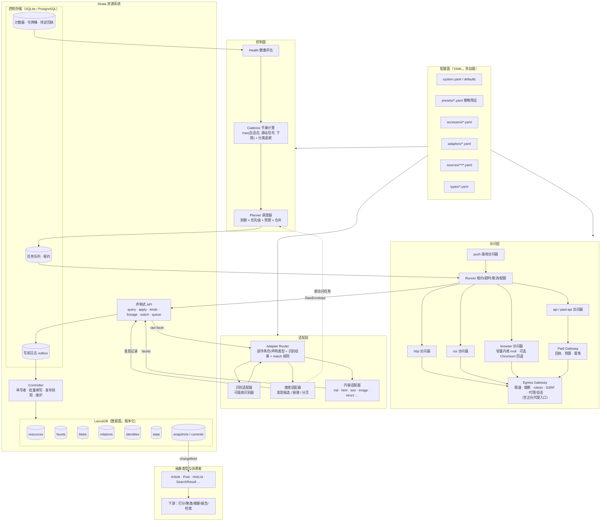
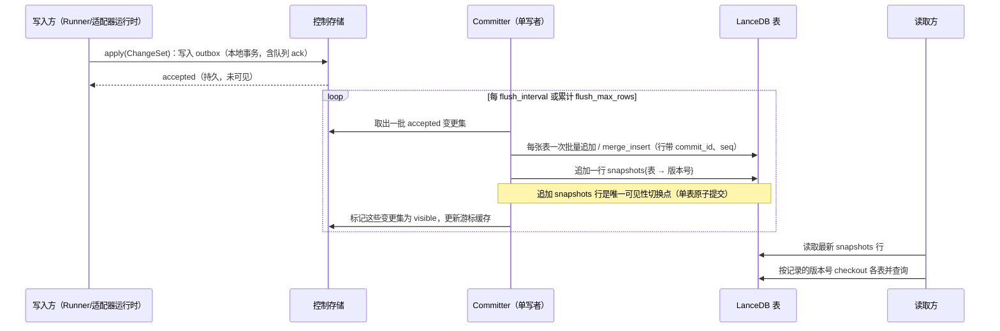
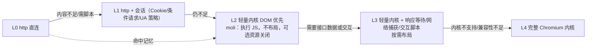
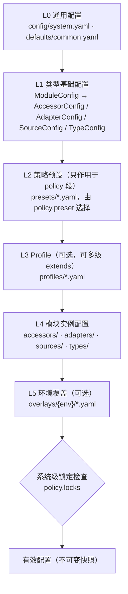
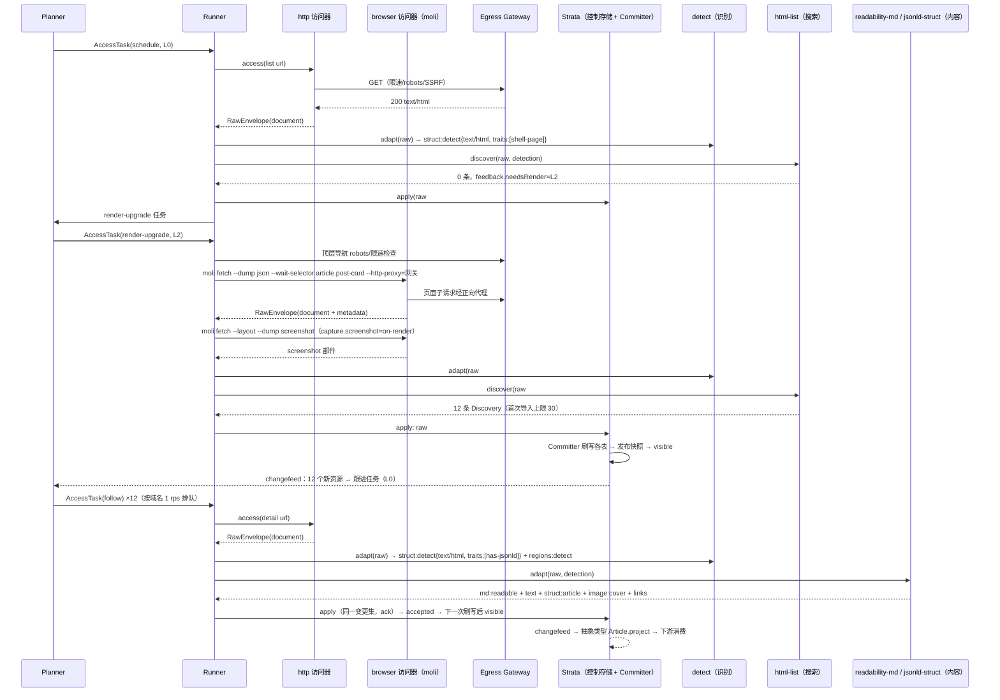

# ModalPrism 设计：访问器 → 适配器 → Strata 资源系统

| 项 | 内容 |
|---|---|
| 文档状态 | 草案 |
| 日期 | 2026-10-18 |
| 项目名 | **ModalPrism**，仓库 `MistLoom/ModalPrism`；资源系统名 **Strata** |
| 实现 | Rust + LEAF，数据面为 LanceDB Rust SDK，见第 12 节 |
| 背景材料 | `collector-design-analysis.md`（六层模型与参考架构） |

---

## 1. 目标与非目标

### 1.1 目标

1. 用统一模型接入异构信源：RSS、网页列表、动态页面、开放 API、付费 API、搜索引擎、社媒、外部推送。
2. 采集到的数据（原始数据和派生数据）进入同一个资源系统，以统一的资源 ID 标识。资源系统之外的模块不直接读写存储。
3. 原始数据按策略保存。保存下来的原始数据保持原样：结构化、非结构化、多媒体内容不篡改，可以重放。
4. 访问器和适配器可以独立扩展、自由组合。同一份原始数据可以被多个适配器加工成不同用途的资源。
5. 内置调度、自适应节奏、按类别退避、出站治理、渲染逐级升级、付费治理、游标一致性、去重和健康信号。
6. 信源和系统配置全部使用 YAML 文件，有统一的配置层级、策略预设、校验和热加载。

### 1.2 非目标

1. 不假定业务场景。系统不内置"新闻""热榜""舆情"等语义，这些由抽象类型和下游应用定义。
2. 不负责打分、聚类、摘要、报告等业务加工。它们是资源系统的消费者。
3. 不提供绕过访问控制或付费墙的能力，也不内置验证码破解。
4. 不把配置存进数据库，也不提供配置编辑界面（界面可以由外部工具基于 YAML 实现）。

---

## 2. 设计原则

| # | 原则 | 含义 |
|---|---|---|
| P1 | **原始数据自由** | 访问器只负责"取到"，不解释内容。原始数据以字节和多部件形式保存，不强制任何 schema；保存范围和时长由策略决定。 |
| P2 | **适配器按需定制** | 理解数据是适配器的职责，包括内容类型识别和分类。适配器可以任意组合、串联、并行；同一份原始数据可以有多种解读。 |
| P3 | **资源系统是唯一数据面** | 适配器之后的一切读写都通过 Strata 的声明式能力完成，以资源 ID 为锚点；业务模块不接触 LanceDB 或控制存储。 |
| P4 | **只增不改** | 资源的每个类型（facet）以不可变版本追加；分类结果以偏移区间引用原文，不修改原文。 |
| P5 | **场景无关** | 系统只提供资源、类型、关系、血缘这些通用原语；场景语义由抽象类型自行维护。 |
| P6 | **声明优先** | 信源、访问器、适配器、调度策略用 YAML 声明；数据读写用声明式查询和变更集表达。 |
| P7 | **能力驱动** | 访问器和适配器声明自身能力（渲染、付费、可合并、条件请求、产出类型、识别能力），调度和路由据此决策，不写类型判断分支。 |
| P8 | **一致性随提交** | 游标、数据、付费回执、运行记录在同一个提交里生效；失败不推进游标。 |
| P9 | **出站集中治理** | 所有对外请求经过统一的出站网关（限速、熔断、robots、代理、会话、SSRF 防护），浏览器内核的流量同样经过网关。 |
| P10 | **健康是一等公民** | 每个信源、访问器、适配器都有可观测的健康状态和期望产出节奏。 |
| P11 | **策略可配置** | 凡是存在合理取舍的行为（保存、合规、成本、证据、重算）都是配置项，由策略预设提供默认值，并可以按层覆盖或锁定。 |

---

## 3. 术语

| 术语 | 定义 |
|---|---|
| **ModalPrism** | 本文档描述的采集系统：访问器、适配器、调度与治理模块，以及资源系统 Strata。 |
| **Strata** | ModalPrism 的资源系统，详见第 5 节。 |
| 资源（Resource） | 一个可寻址的实体，用资源 ID（RID）标识。可以是一篇文章、一张图片、一次抓取的原始响应、一个信源、一次搜索结果页。 |
| 资源类型（Facet） | 同一资源的一种表现形式，例如 `raw`、`md`、`html`、`text`、`image`、`struct`、`links`、`embedding`。一个资源可以同时有多种 facet。 |
| 变体（Variant） | facet 的细分标识，例如 `struct:article`、`image:cover`、`md:readable`。 |
| 访问器（Accessor） | 按某种协议获取原始数据的模块，输出原始信封（RawEnvelope）。 |
| 原始信封（RawEnvelope） | 访问器的统一输出：多个原始部件（bytes + 媒体类型 + 角色）加传输元数据。 |
| 搜索适配器（Search Adapter） | 从原始数据或资源中发现候选条目和链接，产出发现记录，驱动后续访问。 |
| 内容适配器（Content Adapter） | 把原始数据或资源加工成目标格式的 facet；也负责内容类型识别和分类。 |
| 识别器（Detector） | 内容适配器可以挂载的可插拔能力，负责判定数据的实际类型和区间分类，见 7.3 节。 |
| 抽象类型（Abstract Type） | 基于 Strata 定义的业务类型（如 Article、HotList），自行维护自己的 schema、状态和关系。 |
| 信源（Source） | YAML 中声明的一个采集入口：访问什么、用哪些适配器、按什么节奏、采用哪套策略。 |
| 访问任务（AccessTask） | 调度器生成的一次访问请求。 |
| 变更集（ChangeSet） | 对 Strata 的一次声明式写入，原子生效。 |
| 快照（Snapshot） | Strata 中一次原子可见的状态：记录各张 Lance 表的版本号，读路径按快照读取，见 5.6 节。 |
| 控制存储（Control Store） | Strata 内部的事务型存储，承载队列、租约、写前日志、计数器等高频小写入，见 5.7 节。 |
| 暂存区（Staging） | Strata 内部按 `sha256` 内容寻址的字节暂存目录。部件字节先写入暂存区，模块间只传递引用，见 12.4 节。 |
| 策略预设（Policy Preset） | 一组策略配置的命名默认值，例如 `minimal`、`standard`、`archive`，见 10.4 节。 |

---

## 4. 整体架构



**主数据流**：

1. 调度器根据信源配置和状态生成访问任务，任务进入控制存储中的队列。
2. 访问器经出站网关取回原始数据，封装成 RawEnvelope，作为 `raw` facet 交给 Strata（是否持久化由 `policy.raw` 决定）。
3. 适配器路由按部件角色、声明的媒体类型和规则分发；需要识别时，先运行识别适配器，再按识别结果分发：
   - 搜索适配器产出发现记录，生成新的访问任务或资源占位；
   - 内容适配器产出各种 facet。
4. 所有产出以变更集提交：先写入控制存储中的写前日志（持久、未可见），再由 Committer 批量写入 LanceDB 并发布快照（可见），经 changefeed 通知抽象类型和下游消费者。

**原始数据入库**：原始数据作为 `raw` facet 进入 Strata，用于重放、审计和换适配器重新加工。保存范围（全部、仅失败、抽样、不保存）和保留期由策略配置决定，见 10.4 节。

---

## 5. 资源系统 Strata

### 5.1 名称

**Strata（地层）**。地层由不断沉积的层构成：下层不被改写，上层记录后来的变化，从剖面可以看出每一层的来源和年代。资源系统的数据组织方式与此对应：

- 最底层是访问器取回的原始数据（`raw`），只追加、不修改；
- 适配器的产出作为新的层（facet 版本）叠加在原始数据之上；
- 每一层都带有血缘信息，能追溯到产生它的适配器、配置版本和输入层。

### 5.2 资源 ID

| 项 | 规则 |
|---|---|
| 格式 | `r_` + 26 位 ULID（Crockford Base32），例如 `r_01JAF3K8Z2X7Q9M4T6V0B5N1CE` |
| 性质 | 不透明、全局唯一、按时间大致有序；一经分配永不复用 |
| 版本引用 | `r_…@<facet>[:<variant>]#v<n>`，例如 `r_01JA…@md:readable#v3` |
| 区间引用 | `r_…@raw#v1[1024..2048]`：引用某个 facet 版本的字节区间（来自识别适配器或抽取适配器的结果） |
| 命名空间 | 资源有 `ns` 字段：`data`（采集数据）、`sys`（系统状态：信源运行态、游标、健康）、`type:<name>`（抽象类型的私有数据） |
| 身份键 | 资源 ID 与身份键分离。身份键（identity key）是可计算的去重依据，由 `identities` 表映射到 RID，详见 5.11 |

RID 不由内容计算，这样同一实体的内容变化不会改变它的 ID；内容层面的去重由 facet 的内容哈希完成。

### 5.3 资源与资源类型模型

```text
Resource (RID)
 ├─ meta: ns, created_at, source_id?, labels{}
 ├─ facets (按 kind[:variant] 分组，每组是版本链)
 │   ├─ raw#v1                 访问器原始信封（多部件）
 │   ├─ html#v1                原始 HTML（来自 raw 的某个部件）
 │   ├─ md:readable#v1..v2     正文 Markdown
 │   ├─ text#v1                纯文本
 │   ├─ struct:article#v1      结构化字段（标题/作者/时间…）
 │   ├─ struct:detect#v1       识别结果（实际类型、编码、置信度）
 │   ├─ regions:detect#v1      区间分类结果（引用 raw 偏移）
 │   ├─ image:cover#v1         图片（blob 引用）
 │   ├─ links#v1               外链列表
 │   └─ embedding:bge-m3#v1    向量
 └─ relations: discovered_by → r_src, derived_from → r_raw, part_of → r_page …
```

**内置 facet 种类（kind）**，可以扩展：

| kind | 内容 | 存储形态 |
|---|---|---|
| `raw` | 原始信封（多部件字节 + 传输元数据） | 部件字节进 `blobs`，清单进 `facets` |
| `html` / `xml` | 标记文本 | 内联文本或 blob |
| `md` | Markdown | 内联文本 |
| `text` | 纯文本 | 内联文本，建立全文索引 |
| `json` / `yaml` | 原样的结构化文本 | 内联文本 |
| `struct` | 规范化后的结构化对象（必须声明 variant，例如 `struct:article`） | JSON 编码文本列；常用字段可物化为独立列 |
| `links` | 链接集合（URL、锚文本、位置区间） | 列表列 |
| `image` / `audio` / `video` / `file` | 二进制媒体 | blob + 媒体元数据 |
| `embedding` | 向量 | 向量列（按模型分表），variant 为模型名 |
| `regions` | 指向其他 facet 的区间分类结果（由识别或抽取适配器产出，variant 标明产出者） | 列表列 |

**不变量**：

1. facet 版本不可变。新内容产生新版本，内容哈希相同时不产生新版本。
2. 派生 facet 必须记录血缘（输入的 facet 版本、适配器 ID 和版本、配置代际号）。
3. 分类和抽取不修改源 facet，只通过区间引用（`regions`）或派生新 facet 表达。

### 5.4 LanceDB 能力与约束

LanceDB / Lance 的相关能力及 Strata 的对应设计如下，资料见附录 A。

| 主题 | LanceDB 能力 | Strata 的对应设计 |
|---|---|---|
| 提交语义 | Lance 用 MVCC 提供 ACID；每次提交原子地写出一个新的 manifest，形成新的表版本。冲突时按"可变基（rebasable）/ 可重试（retryable）/ 不兼容（incompatible）"三类处理。[A1] | 单表写入原子；每次写入（包括影响 0 行的写入）都会产生新版本。[A3] |
| 多表事务 | 表 API 没有跨表事务。Lance Namespace 规范定义了元数据层的 `BatchCommitTables`（原子提交多表版本），目录命名空间的实现依赖 `__manifest` 表；基于分支的多表事务处于 RFC 阶段。[A2] | Strata 不依赖多表事务能力，以快照表实现跨表可见性（5.6）。 |
| 并发写 | 支持并发写，但"写者过多会因提交重试次数有限而失败"。[A4] S3 已原生支持条件写，多写者无需外部协调；不保证 put-if-not-exists 的存储（例如开启过版本控制的腾讯 COS）需要自定义提交锁。[A5][A6] | Strata 采用单写者 Committer，避免冲突重试；对象存储选型需确认条件写支持。 |
| 版本与 time travel | `checkout(version|tag)` 只读回溯，`restore` 生成与旧版本等价的新版本（不复制数据），支持标签；标签指向的版本不会被清理。OSS 也支持分支（独立可写的历史线）。[A3][A7] | 快照可以按版本号固定读取；审计快照用标签保留；重新加工和回填可以在分支上验证。 |
| 读一致性 | 默认不自动感知其他写者的新版本；`read_consistency_interval` 控制刷新频率，`checkout_latest` 手动刷新。[A8] | 读路径按快照记录的版本号打开表，不依赖"最新版本"。 |
| merge_insert / upsert | 支持 `when_matched_update_all`、`when_not_matched_insert_all`、`when_not_matched_by_source_delete` 及条件子句；返回插入/更新/删除行数、重试次数和版本号。主键只是元数据，普通写入不强制唯一。连接键需要标量索引，否则需全列扫描。[A9] | 身份键和 blob 去重使用"不存在才插入"语义的 merge_insert，并在键列建 BTree 索引。 |
| 更新 | `update` 按 SQL 过滤修改行；不支持更新嵌套列；被更新的行移出现有索引，直到重建或优化。[A9] | 数据表只追加；需要改动的状态集中在控制存储。 |
| 二进制与 blob | 普通 `binary` 列可直接存媒体字节。Blob API 对大对象提供懒加载：旧格式用 `lance-encoding:blob` 元数据，文件格式 2.2 起为 Blob v2，支持内联、打包 sidecar、独立 `.blob` 文件和外部 URI 引用，阈值可按列配置；`take_blobs` 返回可流式、可寻址读取的文件句柄。向量/全文/混合查询不能物化 blob 列。[A10][A11] | 二进制统一放在 `blobs` 表的 blob 列，物理布局由 Lance 按阈值决定；向量和全文查询的表不含 blob 列。 |
| 多模态 | 原始字节、元数据和向量可以存在同一张表。[A10] | 媒体、正文与向量均在 Strata 内，不需要外部对象存储服务。 |
| 索引 | 向量：IVF（PQ/SQ/RQ/Flat 量化）、IVF_HNSW；全文：BM25 FTS，分词器支持 `icu`、`ngram`、`jieba/*`（中文）、`lindera/*`；标量：BTree、Bitmap、LabelList、FM（子串）。[A12][A13] OSS 中索引不自动更新，新数据在优化前以暴力扫描补齐。[A14] | 索引按列选型（5.5）；索引增量更新纳入 Committer 的维护任务。 |
| schema 演进 | 支持增加列（SQL 表达式或空列）、修改列（重命名、类型、可空）、更新字段元数据、删除列；每次操作产生新版本，一般不重写全部数据。[A15] | `struct:*` 的常用字段可以后续物化为独立列。 |
| compaction 与 cleanup | 频繁写入产生大量小 fragment 和版本；OSS 需要手动执行 `optimize()`，它包含 compaction、清理旧版本（默认保留 7 天）和索引增量更新。compaction 不立即释放空间，清理后才释放。`delete_unverified` 只能在确认无进行中事务时使用。[A14][A16] | 维护任务由 Committer 串行执行，保留期是策略配置（`policy.versions`）。 |
| 小批量写入 | 官方建议避免逐行插入，每次 `add` 都会产生新 fragment 和新版本。[A4][A16] | 高频小写入先进入控制存储，由 Committer 批量刷写。 |
| 对象存储 | 支持本地磁盘、S3 及兼容存储（MinIO 需配置 region 和 endpoint）、GCS、Azure Blob、腾讯 COS 等；对象存储延迟在数百毫秒级。[A5][A6] | 数据面可以放在对象存储；控制存储放在低延迟本地或数据库。 |
| SDK | LanceDB 提供 Python、TypeScript（Node）、Rust SDK，以及 Enterprise 的 REST 和 Java 客户端 [A17][A18]。Rust SDK `lancedb` 0.40.0 固定依赖 `lance` 13.0.0，`Table` 提供 Blob v2 的读取接口（`blob_columns`、`fetch_blobs`、`fetch_blob_files`、`fetch_blob_ranges`），`lance::blob` 提供 Blob v2 的建列与写入接口 [A20]–[A24] | Strata 使用 Rust SDK，接口对应见 12.5 |

### 5.5 LanceDB 表设计

所有数据表都是 Lance 表，**只追加**（墓碑和标签以追加新行表达，读取时取最新）。

| 表 | 主要列 | 说明 |
|---|---|---|
| `resources` | `rid`, `ns`, `source_id`, `created_at`, `seq` | 资源注册，只在创建时写入 |
| `resource_marks` | `rid`, `labels`(list<string>, `k=v`), `tombstone`(bool), `reason`, `seq` | 标签与墓碑的追加记录，按 `rid` 取 `seq` 最大的一行 |
| `facets` | `rid`, `kind`, `variant`, `version`, `content_hash`, `media_type`, `size`, `body_text`(large_utf8), `body_struct`(JSON 文本), `blob_ref`, `media`(struct), `lineage`(struct), `commit_id`, `seq`, `created_at` | facet 版本表，`(rid, kind, variant, version)` 唯一（由 Committer 保证） |
| `blobs` | `sha256`, `size`, `media_type`, `data`(Blob v2 列), `created_at`, `seq` | 内容寻址二进制；只在不存在时插入 |
| `relations` | `src_rid`, `rel`, `dst_rid`, `attrs`(JSON 文本), `commit_id`, `seq` | 资源关系边 |
| `identities` | `identity_key`, `rid`, `scheme`, `commit_id`, `seq` | 身份键到 RID 的映射；只在不存在时插入 |
| `state` | `scope`, `key`, `value`(JSON 文本), `commit_id`, `seq` | 需要与数据同时可见的状态：游标、渲染级别记忆、已完成回执；按 `(scope, key)` 取最新 |
| `snapshots` | `snapshot_seq`, `table_versions`(map<string, uint64>), `commit_ids`(list), `kind`(data/maintenance), `config_generation`, `published_at` | 快照记录，见 5.6 |
| `embeddings_<model>` | `rid`, `facet_version`, `vector`, `seq` | 按模型分表，只有向量与键，便于建 ANN 索引 |

`seq` 是 Committer 分配的单调递增序号，用于增量消费和"取最新"。

**索引**（类型依据 [A12][A13]）：

| 列 | 索引 | 说明 |
|---|---|---|
| `facets.rid`、`facets.content_hash`、`identities.identity_key`、`blobs.sha256`、`relations.src_rid`、`relations.dst_rid`、各表 `seq` | BTree | 高基数等值和范围查询；也是 merge_insert 连接键的前提 |
| `facets.kind`、`facets.variant`、`resources.ns`、`relations.rel` | Bitmap | 低基数过滤 |
| `resource_marks.labels` | LabelList | `array_contains_any/all` 过滤 |
| `facets.body_text` | FTS | 分词器由 `strata.fts.tokenizer` 配置；中文内容可选 `jieba/default`（需要模型文件）或 `icu`、`ngram` |
| `embeddings_<model>.vector` | IVF_PQ 或 IVF_HNSW_SQ | 小规模数据（约 10 万行以内）可以不建索引，直接暴力检索 [A4] |

Lance 表的创建参数（`new_table_data_storage_version`、`new_table_enable_v2_manifest_paths` 等）在 `system.yaml` 的 `strata.lance` 段配置。Blob v2 需要文件格式 2.2 及以上 [A11]，Strata 建表时显式指定 2.2（12.5）；对象存储上版本数多时，v2 manifest 路径可以减少列举开销 [A5]。

### 5.6 提交与一致性

#### 5.6.1 写前日志 + 单写者 + 版本向量快照

LanceDB 仅支持单表原子提交，且每次写入都产生新版本 [A1][A3]，因此 Strata 由单写者批量刷写各表，并以向快照表追加一行作为跨表可见性切换点。



1. **接收**：`apply(ChangeSet)` 在控制存储的本地事务中写入 outbox，同时完成队列确认、租约释放和待定回执状态变化，返回 `accepted`。此时数据已持久但不可见。
2. **批量刷写**：Committer 是每个 Strata 部署唯一的写者（多实例部署时通过控制存储中的租约选主）。它按 `policy.commit.flush_interval` 或 `flush_max_rows` 取出一批变更集，对每张受影响的表执行**一次**批量写入：追加类表直接 `add`，`identities`、`blobs` 使用 `merge_insert(...).when_not_matched_insert_all()` 实现"不存在才插入"。
3. **发布快照**：所有表写入成功后，Committer 向 `snapshots` 表追加一行，记录本批写入后各表的版本号。这是单表的原子提交 [A1]，也是唯一的可见性切换点。之后把对应变更集标记为 `visible`。
4. **读取**：读取方取最新（或 `asOf` 指定的）快照行，按其中的版本号 `checkout` 各表 [A3]。同一次查询看到的所有表处于同一个快照，无需按批次过滤。快照行在读取方本地缓存，刷新间隔由 `strata.read.refresh_interval` 配置（对应 `read_consistency_interval` 的语义 [A8]）。
5. **崩溃恢复**：如果 Committer 在步骤 2 和 3 之间崩溃，部分表已经产生了快照之外的新版本。读取方只按快照版本读取，这些行不可见。重启后 Committer 对这些表执行 `restore` 到快照记录的版本（生成等价新版本、不复制数据）[A3]，再从 outbox 重放未可见的变更集。变更集带 `idempotencyKey`，facet 按内容哈希去重，重放不会产生重复。
6. **维护**：compaction、索引增量更新和版本清理（`optimize()`）由 Committer 在两次刷写之间串行执行 [A14]，完成后发布一行 `kind=maintenance` 的快照，使后续读取使用整理后的版本。

**游标的两种视图**：调度器按 `accepted` 的游标推进下一次访问（outbox 是持久的，最终一定可见）；对外读取以 `visible` 为准。这样批量刷写的延迟不会造成重复抓取，也不会出现"游标推进、数据丢失"。

**版本数量控制**：每次刷写产生"受影响表数 + 1"个版本。版本数由刷写间隔和保留期共同决定，例如 10 秒刷写、6 张表、保留 3 天时约为 15 万个版本。刷写间隔、保留期和审计标签都是策略配置（`policy.commit`、`policy.versions`），预设见 10.4。

#### 5.6.2 一致性保证

| 保证 | 说明 |
|---|---|
| 原子可见 | 一个变更集的全部写入（facets、relations、identities、state、回执）在同一个快照中可见，或都不可见 |
| 持久确认 | `apply` 返回 `accepted` 后，进程崩溃不会丢失该变更集 |
| 单调读 | 同一读取句柄观察到的快照序号单调不减 |
| 可重放 | 任一快照都可以按版本号重新打开；在保留期或标签保护范围内可以 time travel |
| 调用选项 | `apply(cs, ApplyOpts { wait, timeout })`，`wait` 为 `WaitFor::Accepted`（默认）或 `WaitFor::Visible`；预览和测试场景使用 `Visible` |

### 5.7 控制存储

LanceDB 的每次 `update` 都产生新版本和删除文件 [A9]，没有行级锁出队语义，并发更新会触发冲突重试 [A4]，因此任务队列、租约和计数器这类高频小写入由 Strata 内部的**控制存储**承载。控制存储不对业务模块开放：

| 承载内容 | 说明 |
|---|---|
| 任务队列与租约 | `free` / `paid` / `render` / `push` 队列；出队使用行级锁（PostgreSQL 的 `FOR UPDATE SKIP LOCKED`，SQLite 单进程内串行出队） |
| 写前日志（outbox） | 已接收、未可见的变更集，见 5.6.1 |
| 待定回执 | 付费调用前的 `pending` 占位和 `unknown` 状态；完成后的回执随数据进入 LanceDB 的 `state` |
| 计数器与令牌桶 | 出站限速、熔断状态、连续失败次数、预算计数 |
| 节奏与健康热数据 | `next_at`、健康状态；按 `policy.state.snapshot_interval` 定期快照到 LanceDB `state` 表用于审计和分析 |
| Committer 租约 | 多实例部署时保证单写者 |

| 后端 | 适用 | 说明 |
|---|---|---|
| `sqlite` | 单机部署（默认） | WAL 模式，嵌入式，无额外服务 |
| `postgres` | 多实例部署 | 行级锁出队、跨实例租约 |

后端选择在 `system.yaml` 的 `strata.control_store` 中配置，变更需要重启。控制存储中的数据可以由 LanceDB 中的快照和 outbox 重放恢复，丢失时只影响在途任务和计数器，不影响已可见的数据。

### 5.8 多模态存储

| 数据 | 策略 |
|---|---|
| 文本类（md/text/html/json/yaml） | 不超过 `strata.inline_text_max`（默认 4 MiB）时内联在 `facets.body_text`；超过时转存 blob |
| 结构化（struct） | `facets.body_struct` 存 JSON 编码（schema 自由）；需要高频过滤的字段通过 `add_columns` 物化为独立列，再由 Committer 回填 [A15] |
| 二进制（image/audio/video/file/raw 部件） | 内容寻址：`sha256` 作为 blob ID，统一写入 `blobs.data`（Blob v2 列）。Lance 按列阈值把数据放在数据文件内联、打包 sidecar 或独立 `.blob` 文件 [A11]；阈值在 `strata.blob` 中配置。`policy.media.mode=reference` 时只登记外部 URI，不下载字节 |
| 向量 | 写入 `embeddings_<model>` 表，建 ANN 索引 |
| 媒体元数据 | 宽高、时长、EXIF、MIME 存在 `facets.media` 结构列 |

blob 的引用计数由 `facets` 反查得到。清理任务删除无引用且超过保留期的 blob 行，空间在 Lance 版本清理后释放 [A14]；被保留快照引用的 blob 对象不会被清理 [A11]。读取大对象使用懒加载句柄（Rust SDK 的 `fetch_blob_files`，12.5），不把整段字节读入内存。

### 5.9 声明式 API

Strata 对外只暴露两类操作：**查询（Query）**和**变更集（ChangeSet）**，另外提供一组便捷方法。接口以 Rust 示意，trait 中的异步方法按 `async_trait` 形式实现以便作为 trait 对象使用；这些 trait 在进程内由 `crates/strata-client` 实现，对外经 `strata_read`、`strata_write`、`strata_queue` 三个 Ability 提供（12.3）。

```rust
// ---------- 标识 ----------
pub struct Rid(String);                           // "r_" + ULID

pub enum FacetKind {
    Raw, Html, Xml, Md, Text, Json, Yaml, Struct, Links,
    Image, Audio, Video, File, Embedding, Regions,
    Other(String),                                // 允许扩展
}

pub enum VersionSel { Latest, Exact(u64) }

pub struct FacetRef { pub rid: Rid, pub kind: FacetKind, pub variant: Option<String>, pub version: VersionSel }
pub struct SpanRef  { pub facet: FacetRef, pub start: u64, pub end: u64 }   // 字节区间

// ---------- 便捷方法与声明式核心 ----------
#[async_trait]
pub trait Strata: Send + Sync {
    /// 某个资源下存在的资源类型清单
    async fn kinds(&self, rid: &Rid, include_variants: bool) -> Result<Vec<FacetSummary>>;
    /// 是否存在某类型
    async fn has(&self, rid: &Rid, kind: &FacetKind, variant: Option<&str>) -> Result<bool>;
    /// 读取 facet；lazy=true 时 blob 只返回句柄
    async fn get(&self, r: &FacetRef, lazy: bool) -> Result<Option<Facet>>;
    /// 读取字节区间（不复制原文，返回只读共享缓冲）
    async fn slice(&self, r: &SpanRef) -> Result<bytes::Bytes>;
    /// 按身份键解析 RID
    async fn resolve(&self, identity_key: &str) -> Result<Option<Rid>>;
    /// facet 版本历史
    async fn history(&self, r: &FacetRef) -> Result<Vec<FacetVersion>>;
    /// 血缘：向上（来源）或向下（派生）
    async fn lineage(&self, r: &FacetRef, dir: LineageDir, depth: u32) -> Result<LineageGraph>;
    /// 关系邻接
    async fn related(&self, rid: &Rid, rel: Option<&str>, dir: EdgeDir) -> Result<Vec<Relation>>;

    fn query(&self, q: Query) -> BoxStream<'_, Result<Row>>;
    async fn apply(&self, cs: ChangeSet, opts: ApplyOpts) -> Result<CommitResult>;
    /// 订阅已可见的变更（changefeed，按快照序号推进）
    fn watch(&self, filter: WatchFilter, from: Option<SnapshotCursor>) -> BoxStream<'_, Result<CommitEvent>>;

    /// 控制面（由控制存储承载，仅运行时与调度器使用）
    fn queue(&self) -> &dyn TaskQueue;
}

#[async_trait]
pub trait TaskQueue: Send + Sync {
    async fn enqueue(&self, tasks: Vec<AccessTask>) -> Result<()>;
    async fn lease(&self, queue: QueueName, n: usize, lease_for: Duration) -> Result<Vec<AccessTask>>;
    async fn extend(&self, task_id: &TaskId, lease_for: Duration) -> Result<()>;
    async fn nack(&self, task_id: &TaskId, retry_at: Timestamp, error: ErrorInfo) -> Result<()>;
    // 成功确认随 apply 的 ChangeSet 一起完成（ChangeSet.ack）
}

pub enum WaitFor { Accepted, Visible }
pub struct ApplyOpts { pub wait: WaitFor, pub timeout: Option<Duration> }   // 默认 Accepted

pub struct CommitResult {
    pub commit_id: CommitId, pub status: WaitFor, pub snapshot: Option<u64>, pub duplicate: bool,
}

pub struct FacetSummary {
    pub kind: FacetKind, pub variant: Option<String>, pub latest: u64, pub versions: u32,
    pub media_type: Option<String>, pub size: Option<u64>, pub updated_at: Timestamp,
}
```

**查询**以数据结构描述"要什么"，执行计划由 Strata 决定（标量过滤、全文、向量、关系展开）：

```rust
#[derive(Serialize, Deserialize)]
#[serde(rename_all = "camelCase")]
pub struct Query {
    pub from: QueryFrom,                          // Resources | Facets | Relations
    pub r#where: Option<Expr>,                    // 结构化表达式，不接受拼接字符串
    pub has_facets: Vec<FacetSelector>,           // 资源必须具备的 facet
    pub select: Vec<SelectItem>,                  // 字段名或 FacetSelector
    pub expand: Vec<Expand>,                      // { rel, dir, depth }
    pub search: Option<Search>,                   // { text, vector, variant, k }
    pub as_of: Option<AsOf>,                      // Snapshot(u64) | Time(Timestamp) | Tag(String)：按快照读取
    pub order_by: Vec<OrderBy>,
    pub limit: Option<u32>,
    pub cursor: Option<String>,
}
```

示例（YAML 形式的查询声明，也可以作为 API 参数）：

```yaml
from: resources
where: { all: [ { eq: [ns, data] }, { gte: [updated_at, "2026-10-18T00:00:00+08:00"] } ] }
hasFacets: [ { kind: struct, variant: article }, { kind: md, variant: readable } ]
select: [ rid, { kind: struct, variant: article, fields: [title, published_at] } ]
expand: [ { rel: discovered_by, dir: out } ]
limit: 50
```

**变更集**描述"期望状态"，Strata 负责幂等落地：

```rust
#[derive(Serialize, Deserialize)]
#[serde(rename_all = "camelCase")]
pub struct ChangeSet {
    pub producer: Producer,                       // { module, version, config_generation }
    pub idempotency_key: Option<String>,          // 同一个键重复提交时返回首次结果
    pub ack: Option<TaskId>,                      // 与本变更集同事务确认的访问任务
    pub ops: Vec<Op>,
}

pub enum Target { Rid(Rid), Alias(String) }      // 已有 RID，或同一变更集内的局部别名

#[derive(Serialize, Deserialize)]
#[serde(tag = "op", rename_all = "camelCase")]
pub enum Op {
    /// 解析或创建资源，绑定局部别名
    Ensure { identity: String, ns: Option<String>, labels: BTreeMap<String, String>, r#as: String },
    /// 内容哈希相同则 no-op
    PutFacet { target: Target, kind: FacetKind, variant: Option<String>, body: Body,
               media_type: Option<String>, lineage: LineageInput },
    Link { src: Target, rel: String, dst: Target, attrs: Option<serde_json::Value> },
    Label { target: Target, set: BTreeMap<String, String>, unset: Vec<String> },
    /// 乐观并发
    SetState { scope: String, key: String, value: serde_json::Value, expect_version: Option<u64> },
    Tombstone { target: Target, reason: String },
}

pub enum Body {
    Text(String),                                 // md / text / html / json / yaml
    Struct(serde_json::Value),                    // struct:*
    Staged(PartRef),                              // 暂存区中的二进制，见 12.4
    External { uri: String },                     // policy.media.mode=reference
}
```

`ensure` 与 `putFacet` 可以在同一个变更集中通过局部别名（`as`，即 `Target::Alias`）引用尚未分配的 RID，适配器因此不需要先查后写。

### 5.10 版本

1. **facet 版本**：每个 `(rid, kind, variant)` 是一条递增版本链。`putFacet` 时如果内容哈希等于最新版本，不产生新版本。
2. **快照序号**：每个快照有单调递增的 `snapshot_seq`，用于增量消费（`watch`）和 `asOf` 查询。
3. **Lance 表版本**：快照记录各表的 Lance 版本号，`asOf` 通过 `checkout` 打开对应版本 [A3]。可回溯范围受 `policy.versions.snapshot_retain`（映射为 `OptimizeAction::Prune` 的 `older_than`）限制；需要长期保留的快照按 `policy.versions.audit_tag` 打标签，标签保护的版本不会被清理 [A7]。
4. **facet 保留**：按 kind 配置保留的版本数和时长（`policy.versions.facet_keep`），由清理任务以删除旧 facet 行实现，空间在 Lance 版本清理后释放。
5. **分支**：重新加工、批量回填、schema 变更可以先在 Lance 分支上执行和验证，再在主线上重放 [A19]。分支不会自动合并到主线，Strata 只把分支作为验证环境。

### 5.11 关系、身份与血缘

**关系**（`relations` 表，内置关系名，可以扩展）：

| rel | 含义 |
|---|---|
| `discovered_by` | 资源由某个信源或搜索结果页发现 |
| `derived_from` | facet 所属资源派生自另一个资源，例如图片资源派生自文章 |
| `part_of` / `has_part` | 组成关系，例如页面中的条目、线程中的帖子 |
| `links_to` | 内容中的超链接 |
| `same_as` | 身份合并：多个 RID 是同一个实体 |
| `duplicate_of` | 内容近似重复 |
| `fetched_as` | 业务资源与其 raw 资源的对应关系 |

**身份键**（多级回退，越靠前越可靠）：

1. 外部稳定 ID：`ext:<scheme>:<id>`，例如 `ext:x:1846…`、`ext:doi:10.…`；
2. 规范化 URL：`url:<canonical>`（去掉跟踪参数，规范 host 和路径，片段按配置保留）；
3. 来源内哈希：`src:<source_id>:<hash(locator+title)>`。

一个资源可以挂多个身份键。不同身份键解析到不同 RID 时，写入 `same_as` 关系，并按 `policy.identity.merge_primary` 选出主 RID：`earliest`（最早创建）、`external-id-first`（持有外部稳定 ID 的优先，其次最早创建）或 `manual`（只记录关系，等待人工指定）。URL 规范化中的跟踪参数清单和片段处理同样由 `policy.identity` 配置。

**墓碑**：被删除或被拒绝的资源在 `resource_marks` 追加 `tombstone=true`，身份键仍保留映射。之后再次发现同一身份时，`ensure` 返回带墓碑标记的 RID，适配器据此跳过，防止"复活"（参考 miniflux 的 entry_tombstones）。

**血缘**（`facets.lineage`）：

```yaml
lineage:
  producer: { module: adapter/readability-md, version: 1.4.0, config_generation: 37 }
  inputs:
    - r_01JA…@raw#v1[0..18233]      # 区间引用
  params_hash: 9f3c…                 # 适配器有效配置的哈希
  commit_id: c_01JA…
```

配置哈希进入血缘后，适配器配置变化可以被检测到，并据此触发重新加工（参考 changedetection.io 的配置 hash 判定）。

---

## 6. 访问器（Accessor）

### 6.1 职责与边界

- **做**：按协议获取数据；处理传输层细节，包括连接、重定向、压缩、字符集声明、条件请求、分页协议、会话和渲染；输出最原始的数据。
- **不做**：解析业务内容、抽取字段、判断去重。HTML 不转 Markdown，JSON 不做映射，Feed 不拆条目。

### 6.2 统一接口

```rust
#[async_trait]
pub trait Accessor: Send + Sync {
    fn id(&self) -> &str;                         // 例如 "http"、"rss"、"browser"、"paid-api"
    fn version(&self) -> &str;
    fn capabilities(&self) -> &AccessorCapabilities;
    fn validate(&self, spec: &serde_json::Value) -> ValidationResult;
    /// 一次访问可以产出多个信封（分页、推送批次、浏览器多个网络响应）
    fn access<'a>(&'a self, req: AccessRequest, ctx: &'a AccessContext)
        -> BoxStream<'a, Result<RawEnvelope, AccessError>>;
}

pub struct AccessorCapabilities {
    pub protocols: Vec<String>,                   // "http"、"https"、"ws"、"cdp"、"push" …
    pub conditional: bool,                        // 支持 ETag / Last-Modified
    pub render: bool,                             // 执行脚本、生成 DOM
    pub layout: bool,                             // 能按需布局：截图、PDF、坐标输入
    pub capture_network: CaptureNetwork,          // None | Trace | MatchedBody | AllBodies
    pub interact: bool,                           // 能执行交互脚本或自动化会话
    pub paid: Option<PaidCapability>,             // { service }：走付费网关
    pub batchable: bool,                          // 多个请求可以合并
    pub inbound: bool,                            // 被动接收（push）
}

pub struct AccessRequest {
    pub task_id: TaskId,
    pub source_id: SourceId,
    pub locator: Locator,                         // Url | Query | ApiEndpoint | PushChannel
    pub spec: serde_json::Value,                  // 访问器专属配置（来自 YAML 的 spec 段）
    pub cursor: Option<serde_json::Value>,        // 上次成功的游标
    pub hints: AccessHints,                       // etag、last_modified、render_level
    pub policy: Arc<EffectivePolicy>,             // 生效的策略（捕获、截图、robots 口径等），见 10.4
    pub deadline: Instant,
}

pub struct AccessContext {
    pub egress: Arc<dyn EgressGateway>,           // 只能经此发起对外请求
    pub paid: Arc<dyn PaidGateway>,
    pub sessions: Arc<dyn SessionPool>,           // cookie / 代理 / 指纹
    pub staging: Arc<dyn Staging>,                // 部件字节写入暂存区，见 12.4
    pub cancel: CancellationToken,
    pub telemetry: Telemetry,                     // 日志与指标
}
```

### 6.3 原始信封（RawEnvelope）

一次访问可能得到多种模态：页面 HTML、页面发出的 JSON 接口响应、截图、附件和媒体文件。信封以**多部件**形式保存，任何部件都不丢失。

```rust
pub struct RawEnvelope {
    pub envelope_id: EnvelopeId,
    pub locator: Locator,                         // 请求目标
    pub final_locator: Option<Locator>,           // 重定向后的最终目标
    pub transport: Transport,
    pub parts: Vec<RawPart>,
    pub cursor_candidate: Option<serde_json::Value>, // 访问器建议的下一游标（如分页 token），由结果变更集决定是否生效
    pub signals: Signals,                         // retry_after、ttl、cache_max_age
}

pub struct Transport {
    pub protocol: String,
    pub status: Option<u16>,
    pub headers: Vec<(String, String)>,           // 保留顺序与重复项
    pub started_at: Timestamp,
    pub duration: Duration,
    pub bytes_in: u64,
    pub not_modified: bool,                       // 条件请求命中 304
    pub render_level: Option<RenderLevel>,        // 实际使用的渲染级别
    pub engine: Option<EngineInfo>,               // 浏览器内核及版本，例如 moli 1.1.18
    pub receipt_id: Option<ReceiptId>,            // 付费回执
}

pub struct RawPart {
    pub part_id: PartId,
    pub role: PartRole,                           // Document | Subresource | NetworkResponse | NetworkTrace | Screenshot
                                                  // | Print | Rendition | Attachment | Media | Metadata | Other(String)
    pub media_type: String,                       // 以服务端声明为准；实际类型由识别适配器判定，不回写信封
    pub charset: Option<String>,
    pub locator: Option<Locator>,                 // 子资源或网络响应的地址
    pub bytes: PartRef,                           // 原始字节在暂存区中的内容寻址引用（sha256 + size），见 12.4
    pub meta: serde_json::Map<String, serde_json::Value>, // 部件级元数据（例如截图尺寸、请求方法）
}
```

- `rendition` 部件是浏览器内核直接给出的派生形式（例如 Markdown、语义树），只在策略开启时保存，并在 `meta.derivedBy` 中标明产出内核。它不替代 `document`，适配器可以使用也可以忽略。
- 请求头和 Cookie 中的敏感字段按 `policy.raw.redact_headers` 在落库前脱敏。

部件字节在访问时写入 Strata 的暂存区，信封只携带引用（12.4）。信封写入 Strata 时成为 `raw` facet：每个部件进入 blob，清单和传输元数据进入 `facets.body_struct`。`policy.raw.store` 不为 `all` 时，未保存的信封只在本次处理期间存在于内存，处理结束即释放。适配器通过 `SpanRef` 或部件 ID 读取，不需要复制。

### 6.4 内置访问器

| 访问器 | 协议与能力 | 原始输出 | 参考 |
|---|---|---|---|
| `http` | HTTP/1.1、HTTP/2；条件请求；重定向策略；压缩 | `document` 部件（响应体），以及响应头 | jina reader 的直连引擎、crawlee HttpCrawler |
| `rss` | 基于 `http`，增加 Feed 协议能力：条件请求、RFC 5005 分页归档、WebSub 订阅回调 | 一份或多份 `document`（Feed 原文） | miniflux、FreshRSS |
| `browser` | 执行 JavaScript 的无头浏览器访问。默认内核为 moli，可配置 Chromium 类内核作为兼容性回退，见 6.5 | `document`（序列化 DOM 或原始下载字节）、`metadata`（最终 URL、状态码、响应头、重定向链）、`network-response`、`network-trace`、`screenshot`、`print`、`rendition` | moli、browserless、Playwright |
| `api` | 通用 HTTP API：方法、请求体、认证引用、分页模板（offset、cursor、link） | 每页一个 `document`（JSON/XML 原文） | AIHOT 的 json_list、Singer tap 思路 |
| `paid-api` | `api` + 付费网关（回执、预算、幂等），可以合并请求 | 同 `api`，信封带 `receiptId` | AIHOT 的回执层 |
| `search` | 调用元搜索或搜索 API（例如自托管 SearXNG），或经 `browser` 访问搜索结果页 | 搜索结果原文（JSON/HTML） | searxng、gpt-researcher 的 retriever |
| `push` | 被动接收：HTTP webhook 和推送接口，按来源 token 鉴权、限流、幂等键 | 每个推送批次一个信封 | huginn webhook |
| `file` | 本地文件或对象存储（用于导入和回放） | 文件原文 | — |

### 6.5 浏览器访问器

#### 6.5.1 内核：moli

浏览器访问器的默认内核为 [lexmount/moli](https://github.com/lexmount/moli)（Apache-2.0/MIT 双许可，Rust 实现）。其能力如下 [B1][B2][B3]：

| 维度 | moli 的实际能力 |
|---|---|
| 定位 | 面向 AI Agent 的无头浏览器，独立内核，不是 Chromium 封装。组件：libcurl（网络）、html5ever（HTML 解析）、V8（JavaScript）、Servo/Stylo（选择器与样式）、Taffy + Parley（布局）、CPU 软件渲染 |
| 运行时 | 流式 HTML 解析、原生 DOM、V8、模块/定时器/事件、iframe 和 worker、CSS 级联、Fetch/XHR/WebSocket、Cookie、WebCrypto、按 profile 隔离的存储（localStorage、IndexedDB、OPFS） |
| 成本模型 | "结构优先、像素按需"：默认 `LayoutPolicy::Mock`，不做真实布局和绘制；`--layout` 才启用真实布局、命中测试、坐标输入、截图。图片、字体、音视频等可选资源默认不加载，需要逐类开启（`--image`、`--font`、`--media` 等）或用 `--resource` 全部开启 |
| 接入方式 | ① CLI 单次抓取 `moli fetch`；② 自动化服务 `moli serve`，同一端点提供 CDP、WebDriver Classic、WebDriver BiDi，Playwright 可用 `connectOverCDP` 直接连接 |
| 输出 | `html`、`markdown`、`json`（含 `final_url`、`status`、`title`、可重复的响应头、主导航重定向链、序列化 HTML；原始下载时给出 `body_base64`）、`semantic_tree` / `semantic_tree_text`；开启布局后可输出视口截图、整页截图、PDF；`--with-frames` 包含 iframe 内容 |
| 就绪判定 | `--wait-until done | load | domcontentloaded | networkidle | domstable`、`--wait-selector`、`--wait-script`、`--wait-response-url(-regex)`、`--wait-response-body(-regex)`、`--wait-response-json(-regex)`、`--delay-ms`；`--timeout` 默认 25 秒 |
| 网络观察 | `--dump json --trace-network` 输出网络追踪；`--trace-matched-response-body` 附带匹配到的接口响应体 |
| 交互 | `--eval` / `--eval-file` 在页面就绪后执行脚本，等待 Promise 和后续导航后再导出；复杂交互通过 `moli serve` 的 CDP/BiDi 会话完成 |
| 会话与网络策略 | `--cookie-file`、`--profile-dir`（持久状态和默认 HTTP 缓存）、`--http-cache-dir`、`--http-proxy`、`--http-no-proxy`、`--http-host-resolve`、UA 覆盖、`-H` 自定义头（只作用于首个导航请求）、`--block-private-networks`、`--block-cidrs`、Web Bot Auth 请求签名 |
| 兼容性 | 官方基准：192 个公开 URL 的混合抓取中有效页面 103 个（53.6%），Chrome Headless 为 101 个（52.6%），中位内存 73 MiB 对 773 MiB；Lexbench 1,308 个可比任务中通过率 81.9%，Chrome 为 99.8%；单任务中位 CPU 时间和峰值内存约为 Chrome 的 15% 和 13% [B1] |
| 明确边界 | 没有 GUI、GPU 合成和多帧保留绘制；不追求与 Chrome 像素一致，不提供高保真 Canvas/WebGL/媒体播放；不支持的协议路径返回明确错误，不伪造结果 [B1] |
| 分发 | GitHub Releases 安装脚本，Linux、macOS、Windows；未发布到 crates.io、npm、PyPI |

浏览器访问器据此遵循以下约束：

1. **L2 默认使用轻量内核**。纯 DOM 抽取不触发布局，资源成本约为 Chrome 的一成多。
2. **配置 Chromium 回退**。依赖 Canvas/WebGL、像素级效果或 moli 未实现协议路径的页面，由 L4 的 Chromium 内核处理。
3. **网络经代理治理**。moli 用内置的 libcurl 发起全部请求，出站治理通过网关的正向代理入口实现（6.7）。
4. **不承担反检测职能**。拦截页、登录墙、空壳页视为失败（见 1.2）。

#### 6.5.2 接入形态

| 形态 | 机制 | 适用 | 隔离与资源 |
|---|---|---|---|
| `cli`（默认） | 每个任务启动一次 `moli fetch`，以 `--dump json` 取结构化结果，按需追加截图或 PDF 调用 | 列表页、详情页的 DOM 抽取；按接口响应就绪的页面 | 进程级隔离，任务结束即回收；并发数由 `limits.concurrency` 控制 |
| `cdp` | 维护 `moli serve` 进程池，经 CDP 或 WebDriver BiDi 驱动（可直接使用 Playwright 客户端） | 多步交互、需要在同一会话内连续访问、需要逐个获取接口响应体 | 池有大小、排队上限、单进程任务数上限（到达后回收）、健康检查（参考 browserless） |

两种形态共用同一组 spec 字段，访问器按任务需要选择：带 `interact` 脚本或 `capture.network=all-bodies` 的任务走 `cdp`，其余走 `cli`。`all-bodies` 依赖 CDP 网络域的响应体获取，moli 对该能力的覆盖度需要验证（见第 13 节）。

#### 6.5.3 输出映射

| moli 输出 | RawPart | 保存条件 |
|---|---|---|
| `json.html`（序列化 DOM） | `document`，`text/html` | 总是 |
| `json.body_base64`（原始下载） | `document`，按响应声明的媒体类型 | 总是 |
| `json.final_url`、`status`、`headers`、`redirect_chain`、`title` | `metadata`（JSON）；同时填充 `transport` 和 `finalLocator` | 总是 |
| `json.network`（`--trace-network`） | `network-trace` | `policy.capture.network` ≥ `trace` |
| 匹配的接口响应体（`--trace-matched-response-body` 或 CDP） | `network-response` | `policy.capture.network` ≥ `matched-body` |
| `screenshot` / `screenshot_full` | `screenshot`（PNG） | 按 `policy.capture.screenshot` |
| `pdf` | `print`（PDF） | 信源显式要求 |
| `markdown`、`semantic_tree_text` | `rendition` | `policy.capture.renditions` 中列出 |

`transport.engine` 记录内核名称和版本，进入血缘，内核升级后可以据此筛选需要重新加工的数据。

#### 6.5.4 spec 字段

```rust
#[derive(Serialize, Deserialize)]
#[serde(rename_all = "camelCase", deny_unknown_fields)]
pub struct BrowserAccessorSpec {
    pub engine: Engine,                           // Moli（默认）| Chromium
    pub mode: Option<BrowserMode>,                // Cli | Cdp | Auto，默认 Auto
    pub wait: Option<WaitSpec>,
    pub js: Option<bool>,                         // 默认 true；false 对应 --disable-js
    pub frames: Option<bool>,                     // 对应 --with-frames
    pub layout: Option<bool>,                     // 截图、PDF、坐标交互时自动开启
    pub resources: Vec<ResourceKind>,             // Image | Font | Audio | Video | Media | TextTrack
    pub eval: Option<String>,                     // 就绪后执行的交互脚本（导出前）
    pub session: Option<SessionRef>,              // { profile, cookie_file }：引用会话池中的 profile
    pub fallback: Option<Fallback>,               // { engine: Chromium, on: [Unsupported | Thin | Blocked] }
}

#[derive(Serialize, Deserialize)]
#[serde(rename_all = "camelCase", deny_unknown_fields)]
pub struct WaitSpec {
    pub until: Option<WaitUntil>,                 // Done | Load | DomContentLoaded | NetworkIdle | DomStable
    pub selector: Option<String>,
    pub script: Option<String>,
    pub response_url: Option<String>,
    pub response_url_regex: Option<String>,
    pub response_json: Option<String>,            // 形如 data.status=ok
    #[serde(with = "humantime_serde")]
    pub delay: Option<Duration>,                  // 只在没有可观察信号时使用
}
```

### 6.6 渲染逐级升级

渲染是访问器层的一种策略，不是某个信源的固定属性。信源声明 `render: auto | never | always`，默认 `auto`；可达到的最高级别由 `policy.render.max_level` 限制。



- **升级判据**分两类：
  - 适配器反馈：内容适配器或搜索适配器返回 `feedback.quality` 为 `thin` / `blocked` / `empty`，或关键字段缺失（`missing`），并给出 `needsRender`；
  - 内核信号：moli 对不支持的协议路径返回明确错误 [B1]，访问器把它归类为 `unsupported`，直接升级到 L4（`policy.render.fallback_engine` 为 `none` 时记为劣化，不升级）。
- **级别记忆**：每个 `(source, host)` 记住最近成功的最低级别（存在 Strata 的 `state` 表），下次直接从该级别开始，并按 `policy.render.downgrade_probe` 定期尝试降级。
- **截图与级别无关**：截图由 `policy.capture.screenshot` 决定（例如仅失败时截图作为证据），需要时在当前级别开启布局。
- **渲染资源隔离**：浏览器进程以独立池运行，有并发上限、排队上限、单任务超时和健康检查；Runner 只持有调用句柄。L4 的 Chromium 可以使用自托管的 CDP 服务（例如 browserless）。

### 6.7 出站网关（Egress Gateway）

所有访问器的对外请求必须经过出站网关。网关提供两种入口：

| 入口 | 使用者 | 治理粒度 |
|---|---|---|
| 库调用 | `http`、`rss`、`api`、`search` 等由系统自身发起请求的访问器 | 每个请求：完整 URL、方法、头、响应 |
| 正向代理（HTTP CONNECT） | 浏览器内核。moli 通过 `--http-proxy` 指向网关 [B3]，Chromium 通过代理参数指向网关 | 顶层导航由访问器先经库调用完成 robots 与限速检查；子请求按目标主机限速、熔断和 SSRF 过滤（HTTPS 子请求只可见主机名） |

浏览器访问器同时开启 moli 的 `--block-private-networks` 和 `--block-cidrs` 作为第二道 SSRF 防线 [B3]。

| 能力 | 规则 |
|---|---|
| SSRF 防护 | 每一跳都解析 DNS 并拒绝私网和保留地址；是否放开由 `policy.egress.private_networks` 决定；携带凭据的请求只允许同源重定向 |
| 按域名限速 | 以注册域（eTLD+1）为键的令牌桶，默认 `1 req/s`、突发 3、并发 2；可以按 host 覆盖；令牌桶状态在控制存储 |
| 自适应节流 | 按响应延迟和 429/503 比例动态调整该域的速率（参考 scrapy AutoThrottle） |
| 主机熔断 | 连续失败或错误率超过阈值时打开熔断，冷却期按指数增长（参考 searxng 的 engine 挂起、jina reader 的 circuitBreakerHosts） |
| robots.txt | 行为由 `policy.robots` 决定：遵守模式、豁免类别、缓存时长、robots 不可达时的处理和 Crawl-delay 口径，见 10.4.3 |
| Retry-After | 收到时写入该域的冷却时间和信源节奏信号 |
| 会话池 | Cookie、代理、UA 作为会话对象，按域绑定并轮换；浏览器会话映射为 moli 的 `--profile-dir` 或 Cookie 文件；会话被封后退役 |
| 请求身份 | UA 字符串和联系信息由 `policy.egress.identity` 配置；可选启用 Web Bot Auth 签名（moli 原生支持 [B3]），向支持该机制的站点声明可验证的爬虫身份 |
| 预算钩子 | 渲染和带宽也可以设预算（每日渲染次数、出站字节） |

### 6.8 付费网关（Paid Gateway）

适用于按调用计费的 API、渲染服务和模型服务：

1. **逻辑请求键**：`hash(service, endpoint, normalized params, window)`。同一个键在窗口内至多真实发送一次，重放直接返回已保存的响应。
2. **调用前落占位**：先在控制存储写入 `pending` 回执（本地事务，立即持久），再发起调用；响应原文作为 raw facet 进入后续流程。
3. **结果未知不重发**：超时或连接中断导致结果未知的回执标记为 `unknown`。处理方式由 `policy.paid.unknown_receipt` 决定：`retry-once`（冷却期后放行一次，之后等待人工）或 `manual`（直接等待人工）。
4. **预算**：按服务设分钟、小时、天三级上限，超出时抛出预算错误。预算错误不计入信源失败，任务延后执行。
5. **合并请求**：声明了 `batchable` 的访问器由调度器把多个信源合并为一次调用，例如多个账号合并为一次搜索；结果按归属规则拆回各信源。
6. **回执与数据同时可见**：`completed` 回执作为 `state`（scope=`receipt`）写入同一个变更集，与数据在同一个快照中可见。

---

## 7. 适配器（Adapter）

### 7.1 分类

| 类别 | 输入 | 输出 | 典型实现 |
|---|---|---|---|
| **搜索适配器**（Search Adapter） | raw facet 或已有资源 facet | **发现记录**：候选条目（定位符、提示字段、身份键）、分页或下一页定位、可选的资源占位 | Feed 条目拆分、网页列表选择器、JSON 列表映射、搜索结果解析、站点地图、热榜列表 |
| **内容适配器**（Content Adapter） | raw facet 或已有资源 facet | 目标格式的 facet（md、text、struct:*、image、links、regions 等） | 内容识别、正文抽取（Readability 类）、HTML 转 Markdown、JSON-LD 抽取、媒体下载登记、区间分类、结构映射 |

两类适配器使用同一套运行时和配置基类，差别在输出契约。

### 7.2 接口

```rust
pub trait AdapterBase: Send + Sync {
    fn id(&self) -> &str;
    fn version(&self) -> &str;
    fn role(&self) -> AdapterRole;                // Search | Content
    fn consumes(&self) -> &[InputSelector];       // 接受哪些输入（facet kind、部件角色、声明或识别出的媒体类型）
    fn produces(&self) -> &[OutputDecl];          // 声明产出（search 为 discovery；content 为 facet kind:variant）
    fn deterministic(&self) -> bool { true }
    fn validate(&self, spec: &serde_json::Value) -> ValidationResult;
}

#[async_trait]
pub trait SearchAdapter: AdapterBase {
    /// 可选：低成本探测是否能处理该输入（只读前若干 KB），用于声明类型不可靠时
    async fn probe(&self, _input: &AdapterInput, _spec: &serde_json::Value) -> Option<Probe> { None }
    fn discover<'a>(&'a self, input: &'a AdapterInput, spec: &'a serde_json::Value, ctx: &'a AdapterContext)
        -> BoxStream<'a, Result<Discovery, AdapterError>>;
}

#[async_trait]
pub trait ContentAdapter: AdapterBase {
    async fn probe(&self, _input: &AdapterInput, _spec: &serde_json::Value) -> Option<Probe> { None }
    async fn adapt(&self, input: &AdapterInput, spec: &serde_json::Value, ctx: &AdapterContext)
        -> Result<ContentOutput, AdapterError>;
}

pub struct Probe { pub accept: bool, pub confidence: f32 }

pub struct AdapterInput {
    pub facet: FacetRef,                          // 主输入（通常是 raw 或 html）
    pub parts: Option<Vec<PartId>>,               // 限定 raw 中的部件
    pub view: ReadonlyView,                       // 只读、零拷贝的数据视图（内部为 bytes::Bytes）
    pub detection: Option<DetectionView>,         // 识别结果（来自识别适配器的 struct:detect / regions:detect）
    pub source: Arc<SourceRuntimeView>,           // 信源配置的只读视图
    pub resource: Option<Rid>,                    // 内容适配器的目标资源
}

pub struct Discovery {
    pub locator: Locator,                         // 下一步要访问的目标
    pub identity: Vec<String>,                    // 身份键（多级）
    pub hints: DiscoveryHints,                    // title、published_at、author、summary、rank、extra
    pub span: Option<SpanRef>,                    // 该条目在输入中的区间（不复制原文）
    pub follow: Follow,                           // No | Yes { accessor, render, priority }
    pub materialize: Vec<FacetDraft>,             // 条目自带内容时直接落 facet
}

pub struct ContentOutput {
    pub facets: Vec<FacetDraft>,                  // { kind, variant, body, media_type, derived_from: Vec<SpanRef> }
    pub links: Vec<LinkDraft>,                    // { rel, target, attrs }
    pub feedback: Option<Feedback>,               // 渲染升级和健康信号依据
}

pub struct Feedback {
    pub needs_render: Option<RenderLevel>,
    pub quality: Option<Quality>,                 // Ok | Thin | Blocked | Empty
    pub missing: Vec<String>,
}

pub struct AdapterContext {
    pub strata: Arc<dyn StrataReader>,            // 只读能力；写入统一由运行时把输出转成 ChangeSet
    pub detectors: Arc<DetectorRegistry>,         // 可插拔识别器，适配器可以按需调用
    pub cancel: CancellationToken,
    pub telemetry: Telemetry,
}
```

**约束**：

1. 适配器**没有写权限**。运行时把 `Discovery` 和 `ContentOutput` 统一转换成 ChangeSet 并提交。这样预览模式和正式运行行为一致，也便于测试和重放。
2. 适配器必须是确定性的：相同输入加相同配置得到相同输出。非确定性的适配器（例如调用 LLM 抽取）必须声明 `deterministic: false`，并经付费网关缓存。
3. 适配器可以读取 Strata，例如查询已有身份以决定是否需要详情补齐，但不能绕过运行时写入。

### 7.3 内容识别与分类

内容类型识别和分类是内容适配器的职责，不依赖外部系统。系统提供一个可插拔的**识别器**接口，内容适配器可以挂载一个或多个识别器，也可以完全自行实现。

```rust
#[async_trait]
pub trait Detector: Send + Sync {
    fn id(&self) -> &str;
    fn version(&self) -> &str;
    /// 判定实际类型；只读视图，可以只读取前若干 KB
    async fn detect(&self, view: &ReadonlyView, declared: &Declared) -> Result<Detection>;  // Declared { media_type, charset, role }
    /// 可选：区间分类，例如定位正文、JSON-LD、内嵌脚本数据、图片引用
    fn regions<'a>(&'a self, _view: &'a ReadonlyView, _wanted: &'a [String])
        -> Option<BoxStream<'a, Result<RegionHit>>> { None }
}

pub struct RegionHit { pub r#type: String, pub start: u64, pub end: u64, pub confidence: f32 }

pub struct Detection {
    pub media_type: String,                       // 实际类型，例如 application/rss+xml
    pub charset: Option<String>,
    pub confidence: f32,                          // 0..1
    pub traits: Vec<String>,                      // 例如 ["shell-page", "challenge-page", "has-jsonld"]
}
```

| 组件 | 说明 |
|---|---|
| 内置识别器 `detector/basic` | 魔数与签名、BOM 与字符集声明、XML 根元素、JSON 结构、HTML 元信息、拦截页和空壳页特征 |
| 插件识别器 | 以 `plugin:<id>` 注册，可以替换或补充内置识别器，例如更强的区间分类或多语言识别 |
| 识别适配器 `adapter/detect` | 一个普通的内容适配器：调用配置的识别器，产出 `struct:detect`（实际类型、编码、特征）和可选的 `regions:detect` |

识别结果作为 facet 持久化，重放时直接复用，不重复识别。识别器选择由 `policy.classify.detector` 配置（`basic`、`plugin:<id>` 或 `off`）。`traits` 中的 `shell-page`、`challenge-page` 等特征同时作为渲染升级和健康信号的依据。

### 7.4 路由与组合

同一份原始数据可以有不同用途：

- RSS Feed 原文同时交给"Feed 条目拆分"（搜索）和"Feed 全文提取"（内容）两个适配器；
- 页面 HTML 同时交给"正文抽取"、"JSON-LD 抽取"、"外链发现"三个适配器。

路由按三级依据分发：

1. **部件角色和声明类型**：直接来自信封（`part_role`、`declared`），零成本。
2. **识别结果**：规则中引用 `detected` 或 `traits` 时，运行时先执行 `adapter/detect`，再按其结果分发。没有规则引用识别结果时，不运行识别。
3. **适配器探测**：候选适配器实现了 `probe` 时，规则可以写 `run_if_accepts`，由适配器自行判断是否处理。

```yaml
pipeline:
  - when: { part_role: document, detected: [application/rss+xml, application/atom+xml] }
    run: [feed-items, feed-fulltext]
  - when: { part_role: document, detected: [text/html] }
    run: [readability-md, jsonld-struct, link-discovery]
  - when: { part_role: network-response, declared: [application/json] }
    run: [json-list]
  - when: { traits: [has-images] }
    run: [media-register]
  - when: { part_role: document }
    run_if_accepts: [site-specific-extractor]
```

- 同一个 raw facet 只识别一次，所有适配器共享 `struct:detect`。
- 适配器可以串联：`after: readability-md` 表示以前一个适配器的输出 facet 作为输入。运行时按依赖关系构建 DAG，同一层的适配器并行执行。

### 7.5 搜索适配器的发现语义

1. 每条 Discovery 先经过**准入规则**（信源声明的 URL 前缀、分类、噪声词、发布时间窗口、首次导入上限；首次导入上限的默认值来自 `policy.backfill`）。
2. 再按身份键执行 `ensure`：
   - 新身份：创建资源占位（只有 `struct:discovery` facet），并生成访问任务（如果 `follow` 不为 false）；
   - 已有身份：只写一条 `discovered_by` 关系（多来源发现计数），必要时更新提示字段；
   - 墓碑身份：跳过。
3. 条目自带全文时（例如 Feed 的 `content:encoded`），用 `materialize` 直接产出 facet，不再访问原文。

---

## 8. 抽象类型（Abstract Type）

### 8.1 定位

抽象类型是基于 Strata 实现的业务抽象，例如 `Article`、`Post`、`HotList`、`HotListEntry`、`SearchResult`、`Video`、`PageSnapshot`、`Story`。系统不限制抽象类型的表达方式。抽象类型：

- **自行维护**自己的 schema、状态和关系；
- 数据全部存放在 Strata，以 `struct:<type>` facet、`type:<name>` 命名空间的私有资源和关系表达；
- 通过 changefeed 订阅输入，通过 ChangeSet 写入输出。

### 8.2 接口

```rust
#[async_trait]
pub trait AbstractType: Send + Sync {
    fn name(&self) -> &str;                       // "Article"
    fn version(&self) -> &str;
    fn schema(&self) -> &SchemaRef;               // JSON Schema 或 Arrow schema，由类型自己定义
    /// 哪些资源属于该类型
    fn selector(&self) -> &Query;                 // 例如 has_facets: struct:article
    /// 从资源的 facets 投影出类型视图（只读、可缓存）
    async fn project(&self, rid: &Rid, s: &dyn StrataReader) -> Result<Option<serde_json::Value>>;
    /// 响应变更，维护自身状态（例如聚合、计数、排名快照）
    async fn on_commit(&self, _ev: &CommitEvent, _s: &dyn StrataReader) -> Result<Option<ChangeSet>> { Ok(None) }
}
```

### 8.3 示例

```yaml
# types/hotlist.yaml
id: type/hotlist
name: 热榜快照
kind: abstract-type
spec:
  selector: { hasFacets: [ { kind: struct, variant: hotlist.snapshot } ] }
  schema: schemas/hotlist.snapshot.json
  state:
    keep_snapshots: 288                 # 每 5 分钟一期，保留 24 小时
    derive:
      - name: rank_delta                # 与上一期比较排名变化
      - name: new_entries               # 新上榜条目
```

`HotList` 用快照资源（每期一个 RID，`part_of` 指向榜单资源）加条目关系表达排名变化。`Article` 用 `struct:article` 加 `md:readable` 加 `image:cover` 的投影表达。两者的存储形态不同，Strata 不需要知道它们的语义。

---

## 9. 调度与可靠性

### 9.1 任务模型

```rust
pub struct AccessTask {
    pub task_id: TaskId,
    pub source_id: SourceId,
    pub accessor: String,                         // 访问器模块 id，例如 accessor/http
    pub locator: Locator,
    pub spec: serde_json::Value,
    pub reason: TaskReason,                       // Schedule | Follow | RenderUpgrade | Detail | Manual | Replay
    pub priority: i32,                            // 实时 > 跟进 > 回填
    pub queue: QueueName,                         // Free | Paid | Render | Push
    pub lease_until: Timestamp,
    pub attempt: u32,
    pub batch_key: Option<String>,                // 可合并任务的分组键
    pub generation: u64,                          // 派发时的配置代际号，见 10.7
}
```

任务队列由 Strata 的控制存储承载（5.7），通过 `strata.queue` 接口访问。每个队列独立设置并发、速率和预算。任务成功时，确认随结果变更集在同一个本地事务中完成（`ChangeSet.ack`），不会出现"数据已接收、任务被重复派发"。

### 9.2 调度

1. **到期扫描**：Planner 每 30 秒扫描到期的信源（`next_at <= now`），按优先级和最早到期排序，受各队列容量约束。
2. **租约**：派发时在控制存储中加租约（默认等于任务超时的 1.5 倍），并把 `next_at` 推后，防止重复派发；任务完成后再写入真实的下次时间。
3. **合并**：同一 `batchKey` 中任一成员到期时整组派发（参考 X 账号分片）。
4. **跟进任务**：搜索适配器产出的跟进任务进入同一个队列体系，按域名限速自然排队。

### 9.3 自适应节奏

```text
next_interval = clamp(
  max( adaptive(yield_7d), source_signal(ttl, retry_after, cache_max_age), floor(kind, paid) ),
  floor, ceiling )
adaptive(y)   = 1440 / (y_per_day × k)      # k 默认 3
```

- 产出按近 7 天新增资源数计算（只计入首次发现，回填不计）。
- 源站信号取 RSS `ttl`、`Retry-After`、`Cache-Control: max-age`、`Expires` 中的最大值（参考 miniflux）。
- 下限和上限在类型基础配置中声明；付费访问器的下限更高。
- 节奏状态存在控制存储，每日重算一次，并在每次成功后按信号即时修正；按 `policy.state.snapshot_interval` 快照到 LanceDB `state` 表。

### 9.4 按类别退避

| 错误类别 | 判定 | 处理 | 计入健康 |
|---|---|---|---|
| 瞬时（transient） | 网络错误、超时、5xx、429 | 任务内重试 1 次（不超过截止时间）；之后按 `interval × 2^n` 退避，上限 6 小时；遵守 Retry-After | 是（degraded） |
| 永久（permanent） | 404、410、401、403、DNS 不存在、TLS 不可恢复 | 不重试，立即标记 `failing`；节奏降到上限；需要人工确认或 24 小时后探测一次 | 是（failing） |
| 配置（config） | 配置校验失败、适配器 spec 不合法 | 不派发，直到配置修复（热加载后自动恢复） | 是（misconfigured） |
| 劣化（degraded-yield） | 成功但产出为 0、选择器未命中、内容质量 `thin`/`blocked` | 不退避；累计计数，超过阈值告警；触发渲染升级判定 | 是（suspect） |
| 预算（budget） | 付费网关预算耗尽 | 延后到预算窗口恢复；不计失败 | 否 |
| 停机（shutdown） | 进程停止 | 释放租约，不记失败 | 否 |

适配器和访问器返回的错误携带类别（`ErrorClass::Transient`、`Permanent`、`Config`、`Budget`），未分类的错误按瞬时处理（参考 crawlee 的 `NonRetryableError`）。

### 9.5 游标与数据一致性

- 游标属于信源状态，存在 `state`（scope=`cursor`, key=`<source_id>`）。
- 访问器只提供 `cursorCandidate`。运行时在**所有适配器成功之后**，才把候选游标作为 `setState` 操作放进结果变更集，与数据一起提交（5.6.1）。
- 任一环节失败时不提交变更集，游标不变，下次从相同位置继续。
- 调度使用 `accepted` 视图的游标，对外读取使用 `visible` 视图的游标；二者的差异只存在于批量刷写的间隔内。
- 条件请求的验证器（ETag、Last-Modified）与配置哈希绑定：信源配置变化时丢弃验证器，强制完整读取一次（参考 AIHOT 的 configHash）。

### 9.6 去重

| 层级 | 机制 |
|---|---|
| 任务级 | 同一 `(source, locator)` 在租约期内只派发一次 |
| 请求级 | 付费网关的逻辑请求键；出站网关可选 HTTP 缓存 |
| 身份级 | 多级身份键加 `identities` 映射；`same_as` 合并；墓碑防复活 |
| 内容级 | facet 内容哈希相同则不产生新版本；blob 内容寻址 |
| 近似重复 | 由 `policy.dedupe.near_duplicate` 选择 `off`、`simhash` 或 `embedding`，对应的内容适配器写入 `duplicate_of` 关系（不删除数据） |

### 9.7 健康信号

每个信源、访问器、适配器在控制存储中维护以下健康信号，并定期快照到 LanceDB `state`（scope=`health`）：

| 信号 | 说明 |
|---|---|
| `status` | `ok` / `degraded` / `failing` / `suspect` / `misconfigured` / `paused` |
| `consecutive_failures` | 连续失败次数（按类别分别计数） |
| `last_ok_at` / `last_error` | 最近成功时间和最近错误 |
| `expected_period` | 期望多久至少有一次新增；超过即 `suspect`（参考 huginn 的 expected_update_period） |
| `yield_trend` | 近 7 天产出与前 28 天均值之比；骤降（< 0.3）即 `suspect` |
| `selector_miss` | 搜索适配器关键规则连续未命中次数（参考 changedetection.io 的 consecutive_filter_failures） |
| `blocked_rate` | 识别结果带 `challenge-page` / `shell-page` 特征的比例 |
| `render_level` | 当前记忆的渲染级别及内核（moli / chromium） |
| `cost_7d` | 付费和渲染成本 |

健康阈值（`expected_period` 默认值、`yield_trend` 骤降比例、连续失败阈值）在 `policy.health` 中配置。健康结果反馈给调度器（节奏和熔断），并通过 changefeed 对外发布告警事件。

---

## 10. 配置体系

### 10.1 原则

1. 信源声明和系统配置全部是 YAML 文件，不存数据库；运行期状态（游标、健康、节奏）存在 Strata，二者严格分离。
2. **统一字段，统一位置**：所有模块配置都基于类型基础配置实现。基础配置已有的字段只在顶层出现一次，名称固定；模块独有的字段放在 `spec` 段；策略性字段统一放在 `policy` 段。
3. 默认值来自通用配置和策略预设，可以通过 profile 复用，逐级覆盖；合规类字段可以在系统级锁定。
4. 校验严格：未知字段报错，类型和取值范围按 schema 检查，引用（访问器 ID、适配器 ID、profile、预设）必须存在。

### 10.2 配置层级



**基础类定义**（字段名与位置在所有模块中保持一致）：

```rust
#[derive(Serialize, Deserialize)]
#[serde(rename_all = "camelCase")]                // 未知字段由 10.5 的 JSON Schema 校验拒绝
pub struct ModuleConfig {                         // 所有模块共有
    pub id: String,                               // 全局唯一，格式 <kind>/<name>
    pub kind: ModuleKind,                         // Accessor | Adapter | Source | AbstractType | Profile | Preset | System
    pub name: String,                             // 人类可读名称（统一用 name，不使用 label/title）
    pub description: Option<String>,
    #[serde(default = "default_true")]
    pub enabled: bool,
    #[serde(default)]
    pub labels: BTreeMap<String, String>,         // 批量管理用标签（统一用 labels，不使用 tags/meta）
    #[serde(default)]
    pub extends: Vec<String>,                     // 继承的 profile，按顺序合并
    pub policy: Option<PolicyConfig>,             // 策略段，见 10.4；可以只写需要覆盖的键
    #[serde(default)]
    pub spec: serde_json::Map<String, serde_json::Value>, // 模块独有字段，只能放在这里
}

pub struct RuntimeLimits {                        // 访问器、适配器、信源共用的运行限制
    pub timeout: Duration,                        // 统一用 timeout，不使用 timeoutMs/deadline
    pub concurrency: u32,
    pub retry: RetryPolicy,                       // { attempts, backoff: Exponential | Fixed, base, max }
}

pub struct AccessorConfig {
    #[serde(flatten)] pub base: ModuleConfig,     // kind = Accessor
    pub implementation: String,                   // 实现标识，例如 builtin:http、builtin:browser、plugin:xxx
    pub limits: RuntimeLimits,
    pub egress: EgressRef,                        // { profile, proxy }
    pub paid: Option<PaidRef>,                    // { service, budget }
}

pub struct AdapterConfig {
    #[serde(flatten)] pub base: ModuleConfig,     // kind = Adapter
    pub implementation: String,
    pub role: AdapterRole,                        // Search | Content
    pub limits: RuntimeLimits,
    pub consumes: Vec<InputSelector>,
    pub produces: Vec<OutputDecl>,
}

pub struct SourceConfig {
    #[serde(flatten)] pub base: ModuleConfig,     // kind = Source
    pub access: AccessDecl,                       // { accessor, locator, spec, render: Auto | Never | Always }
    pub pipeline: Vec<PipelineRule>,
    pub schedule: ScheduleDecl,                   // { interval, floor, ceiling, adaptive, expected_period, batch_key }
    pub admission: AdmissionDecl,                 // { allow_url_prefixes, deny_url_prefixes, published_after,
                                                  //   initial_backfill: { limit, max_age }, noise }
}
```

`spec` 的 schema 由各模块实现提供，并以 `$schema` 注册到校验器。基础字段或策略字段放进 `spec` 会被拒绝：校验器检查 `spec` 的键是否与基础字段、`policy` 的顶层键同名。

### 10.3 合并与覆盖规则

| 类型 | 规则 |
|---|---|
| 标量 | 后层覆盖前层 |
| 映射（map） | 深度合并 |
| 列表 | 默认整体替换；对象形式 `{ $append: [...] }` 追加、`{ $prepend: [...] }` 前插、`{ $remove: [...] }` 按值删除 |
| 删除 | 显式写 `null` 删除继承来的键（不允许删除必填字段） |
| 合并顺序 | L0 → L1 默认值 → L2 选中的预设 → `extends` 中的 profile（从左到右）→ 模块实例 → 环境 overlay |
| 冲突 | 同一层中同一 `id` 出现两次时报错 |
| 引用 | `${env:NAME}` 读取环境变量；`${secret:path}` 读取密钥提供方；`${ref:accessor/http#limits.timeout}` 引用其他配置的值（解析期完成，不允许循环） |

**预设的选择与覆盖**：

1. **选择**：`policy.preset` 可以写在 `system.yaml`（全局默认）、profile 或模块实例中，取**最靠近模块的一处**：实例 > profile（多个 profile 时取最后一个声明了 `preset` 的）> `system.yaml`。环境 overlay 也可以改写 `policy.preset`。
2. **位置**：选中的预设在合并链中固定处于 L2，即位于类型基础默认值和所有 profile 中间。因此 profile 和实例中显式写出的 `policy` 键总是覆盖预设，预设只提供基线。
3. **作用范围**：预设只包含 `policy` 段，不能设置 `spec`、`limits`、`schedule` 等其他字段。
4. **预设继承**：预设可以 `extends` 另一个预设（例如 `archive` 继承 `standard`），继承链在 L2 内部先合并成一个整体。
5. **锁定**：`system.yaml` 中的 `policy.locks` 列出被锁定的策略路径。合并完成后，如果某模块对锁定路径的取值与 `system.yaml`（含其环境 overlay）中的取值不同，整个配置快照校验失败，不会静默忽略。只有 `system.yaml` 及其 overlay 可以修改锁定值。
6. **作用域**：每个策略键有允许出现的最低层级（见 10.4.1 的"作用域"列）。只能全局生效的键（例如 Lance 版本保留）直接写在信源、访问器或 profile 中会报错；预设中的系统作用域键只在该预设被 `system.yaml` 选中时生效，被模块选中时忽略。
7. **溯源**：`modalprism-config explain <id>` 输出每个策略键的最终值和来源（预设名、文件、行号）。

### 10.4 策略与预设

#### 10.4.1 策略项

| 路径 | 取值 | 含义 | 作用域 |
|---|---|---|---|
| `raw.store` | `all` / `on-failure` / `sampled` / `none` | 原始信封是否入库：全部、仅处理失败或劣化时、按比例抽样、不入库 | 信源 |
| `raw.sample_rate` | 0..1 | `sampled` 时的抽样比例 | 信源 |
| `raw.retain` | Duration / `forever` | 原始 facet 的保留时长 | 信源 |
| `raw.max_part_size` | Size | 单个部件超过该值只登记元数据，不保存字节 | 信源 |
| `raw.redact_headers` | 列表 | 落库前脱敏的请求/响应头 | 系统 |
| `media.mode` | `reference` / `download` | 媒体只登记外部引用，或下载入库 | 信源 |
| `media.kinds` | `image` / `audio` / `video` / `file` 列表 | 允许下载的媒体种类 | 信源 |
| `media.max_size` | Size | 单个媒体的下载上限 | 信源 |
| `versions.facet_keep` | 按 kind 的版本数或时长 | facet 版本保留 | 信源 |
| `versions.snapshot_retain` | Duration | Lance 旧版本保留期（`OptimizeAction::Prune` 的 `older_than`），即 time travel 窗口 | 系统 |
| `versions.audit_tag` | `none` / `daily` / `weekly` | 定期给快照打标签，标签版本不被清理 | 系统 |
| `commit.flush_interval` / `commit.flush_max_rows` | Duration / 整数 | Committer 刷写节奏，决定可见延迟和版本数量 | 系统 |
| `state.snapshot_interval` | Duration | 控制存储中的健康、节奏数据快照到 LanceDB 的间隔 | 系统 |
| `robots.mode` | `obey` / `obey-with-exemptions` / `ignore` | robots 遵守模式，见 10.4.3 | 信源 |
| `robots.exemptions` | 类别列表 | 允许豁免的类别 | 系统定义类别，信源引用 |
| `robots.cache_ttl` | Duration | robots.txt 缓存时长 | 系统 |
| `robots.on_unreachable` | `rfc9309` / `allow` / `disallow` | robots.txt 不可达时的处理 | 系统 |
| `robots.crawl_delay` | `honor` / `ignore` / `cap:<Duration>` | Crawl-delay 口径 | 信源 |
| `render.max_level` | `L0`..`L4` | 允许升级到的最高渲染级别 | 信源 |
| `render.fallback_engine` | `none` / `chromium` | 轻量内核不支持时是否回退 | 信源 |
| `render.downgrade_probe` | Duration / `never` | 尝试降级的周期 | 信源 |
| `capture.screenshot` | `never` / `on-failure` / `on-render` / `always` | 截图作为证据的时机 | 信源 |
| `capture.network` | `off` / `trace` / `matched-body` / `all-bodies` | 网络捕获粒度 | 信源 |
| `capture.renditions` | `markdown` / `semantic_tree_text` 列表 | 是否保存浏览器内核的派生形式 | 信源 |
| `egress.private_networks` | `deny` / `allow` | 是否允许访问私网地址 | 系统 |
| `egress.identity` | `{ user_agent, contact, web_bot_auth }` | 请求身份声明 | 系统 |
| `paid.unknown_receipt` | `retry-once` / `manual` | 结果未知的付费调用如何处理 | 访问器 |
| `reprocess.on_adapter_change` | `none` / `latest` / `window:<Duration>` | 适配器配置或内核版本变化后的重新加工范围 | 适配器、信源 |
| `identity.merge_primary` | `earliest` / `external-id-first` / `manual` | `same_as` 合并时主 RID 的选择规则 | 系统 |
| `identity.strip_params` / `identity.fragment` | 列表 / `drop` / `keep` | URL 规范化口径 | 系统 |
| `dedupe.near_duplicate` | `off` / `simhash` / `embedding` | 近似重复检测 | 信源 |
| `backfill.initial` | `{ limit, max_age }` | 首次导入上限的默认值 | 信源 |
| `classify.detector` | `basic` / `plugin:<id>` / `off` | 内容识别器 | 适配器、信源 |
| `health.*` | 阈值 | 期望周期、产出骤降比例、连续失败阈值 | 信源 |

#### 10.4.2 预设

内置四套预设，存放在 `config/presets/`，可以复制修改或新增：

| 策略 | `minimal` | `standard`（默认） | `archive` | `debug` |
|---|---|---|---|---|
| 定位 | 资源受限、只要结果 | 生产常规 | 完整留存、可审计可重放 | 开发调试、排障 |
| `raw.store` | `on-failure` | `all` | `all` | `all` |
| `raw.retain` | 3d | 30d | `forever` | 3d |
| `raw.max_part_size` | 5MiB | 50MiB | 1GiB | 50MiB |
| `media.mode` / `max_size` | `reference` | `download`，image，20MiB | `download`，全部种类，1GiB | `reference` |
| `versions.facet_keep` | 只保留最新 | raw 1、md 全部、其他 5 | 全部 | 只保留最新 |
| `versions.snapshot_retain` | 1d | 3d | 7d | 1d |
| `versions.audit_tag` | `none` | `none` | `daily` | `none` |
| `commit.flush_interval` | 30s | 10s | 10s | 1s |
| `robots.mode` | `obey` | `obey-with-exemptions` | `obey-with-exemptions` | `obey` |
| `robots.crawl_delay` | `honor` | `cap:30s` | `honor` | `honor` |
| `render.max_level` | L2 | L3 | L4 | L4 |
| `render.fallback_engine` | `none` | `none` | `chromium` | `chromium` |
| `capture.screenshot` | `never` | `on-failure` | `on-render` | `always` |
| `capture.network` | `off` | `off` | `matched-body` | `all-bodies` |
| `capture.renditions` | — | — | `markdown` | `markdown`、`semantic_tree_text` |
| `reprocess.on_adapter_change` | `none` | `latest` | `window:30d` | `latest` |
| `dedupe.near_duplicate` | `off` | `simhash` | `simhash` | `off` |
| `state.snapshot_interval` | 1h | 15m | 5m | 1m |

`archive` 继承 `standard`，`debug` 继承 `standard`，`minimal` 独立定义。`raw.store` 不为 `all` 时，未入库的数据无法重放，`reprocess` 只能作用于已保存的输入。

#### 10.4.3 robots 口径

| 模式 | 行为 |
|---|---|
| `obey` | 所有经出站网关的请求都检查 robots.txt，不允许豁免 |
| `obey-with-exemptions` | 默认遵守；属于 `robots.exemptions` 列出类别的请求可以豁免，信源必须写明 `robots_reason`，每次豁免访问记入审计 |
| `ignore` | 不检查 robots.txt；必须写明 `robots_reason`；可以被系统级锁定禁止 |

豁免类别由 `system.yaml` 定义，信源只能引用已定义的类别：

| 类别 | 口径 |
|---|---|
| `feed` | 发布方公开声明的 RSS/Atom/JSON Feed 地址（页面 `<link rel="alternate">` 或站点明示） |
| `api` | 发布方提供并有使用条款的公开 API，或已签约授权的接口 |
| `user-requested` | 由用户逐条手动提交的单个 URL，不跟进链接，类比用户代理行为 |
| `authorized` | 持有书面授权的站点，授权编号写入 `robots_reason` |

`robots.on_unreachable` 默认 `rfc9309`：robots.txt 返回 4xx 视为允许，5xx 或网络错误视为全部禁止，直到下次成功获取。浏览器子请求不单独检查 robots，只检查顶层导航。

### 10.5 校验

1. **解析**：YAML 1.2 安全子集（禁用自定义标签和任意对象构造）。
2. **结构**：由基础类、`policy` 和模块 `spec` 的 schema 合成 JSON Schema（Draft 2020-12），`additionalProperties: false`。
3. **语义**：引用存在、ID 唯一、`role` 与 `produces` 匹配、Duration 和 URL 合法、`robots.mode` 为 `ignore` 或使用豁免时必须写 `robots_reason`、豁免类别必须已定义、付费访问器必须关联预算、策略键不得出现在低于其作用域的层级、锁定路径不得被改写。
4. **全量快照校验**：一次加载的所有文件作为一个整体校验，任何错误都使整个新快照失效。
5. **工具**：提供 `modalprism-config validate|diff|explain <id>` 命令。`explain` 输出某个模块的有效配置及每个字段的来源层（预设名、文件和行号）。
6. 可选：用 CUE（cue-lang/cue）作为高级约束层，用于跨文件约束。

### 10.6 目录布局

```text
config/
├── system.yaml                 # L0：全局（Strata 连接、控制存储、暂存区、Lance 参数、出站默认、时区、预设选择、锁定）
├── defaults/
│   ├── common.yaml             # L0：通用默认（limits、retry）
│   ├── accessor.yaml           # L1：AccessorConfig 默认值
│   ├── adapter.yaml            # L1：AdapterConfig 默认值
│   └── source.yaml             # L1：SourceConfig 默认值
├── presets/                    # L2：策略预设
│   ├── minimal.yaml
│   ├── standard.yaml
│   ├── archive.yaml
│   └── debug.yaml
├── profiles/                   # L3
│   ├── gentle-crawl.yaml
│   ├── official-blog.yaml
│   └── paid-social.yaml
├── accessors/                  # L4
│   ├── http.yaml
│   ├── rss.yaml
│   ├── browser.yaml
│   └── paid-x.yaml
├── adapters/
│   ├── search/
│   │   ├── feed-items.yaml
│   │   └── html-list.yaml
│   └── content/
│       ├── detect.yaml
│       ├── readability-md.yaml
│       └── jsonld-struct.yaml
├── sources/                    # 可以任意分组；文件名不影响 id
│   ├── official/
│   ├── media/
│   └── social/
├── types/
├── schemas/                    # 模块 spec、policy 与抽象类型 schema
└── overlays/                   # L5
    ├── dev/
    └── prod/
```

### 10.7 热加载

1. **监听**：监听 `config/` 目录的文件事件，防抖 2 秒后触发加载。也支持 SIGHUP 和管理命令触发。
2. **构建快照**：解析全部文件 → 合并 → 全量校验 → 生成不可变快照，代际号 `generation` 加 1。
3. **原子切换**：校验通过后原子替换当前快照指针；校验失败时保留旧快照，记录错误并发出告警。
4. **在途任务**：已派发的任务继续使用派发时的快照（任务携带 `generation`）；新任务使用新快照。
5. **变更分级**：
   - 可热更新：信源增删改、适配器 spec、节奏、准入规则、限速参数、信源和适配器作用域的策略（含预设切换）；
   - 需要重启组件：Strata 连接、控制存储后端、暂存区目录、Lance 表创建参数、访问器实现标识、浏览器内核二进制版本。这些值构成 LEAF Expose 的实例集合与绑定期配置（12.6），变更后需要重新 bootstrap。

   需要重启的变更在切换时只记录并提示，不生效。系统作用域的策略（例如 `versions.snapshot_retain`、`commit.*`）在下一次维护或刷写周期生效。
6. **副作用**：配置哈希变化时，相关信源的条件请求验证器失效；适配器配置哈希或浏览器内核版本变化时，按 `policy.reprocess.on_adapter_change` 触发重新加工。
7. **审计**：每个代际的差异摘要写入 Strata（`ns=sys`），血缘中记录 `config_generation`。

### 10.8 配置示例

```yaml
# config/system.yaml  (L0，节选)
kind: system
strata:
  lance:
    uri: ${env:STRATA_LANCE_URI}            # 本地路径或 s3://bucket/strata
    storage_options: { region: ${env:S3_REGION}, endpoint: ${env:S3_ENDPOINT} }
    new_table_data_storage_version: "2.2"  # Blob v2 所需的文件格式，显式指定
    new_table_enable_v2_manifest_paths: true
  control_store:
    backend: sqlite                         # sqlite | postgres
    path: ./var/strata-control.db
  read: { refresh_interval: 2s }
  fts: { tokenizer: jieba/default }
  blob: { inline_size_threshold: 64KiB, dedicated_size_threshold: 16MiB }
  staging: { dir: ./var/staging, ttl: 24h }
policy:
  preset: standard                          # 全局默认预设
  locks: [robots.mode, egress.private_networks]
  robots:
    mode: obey-with-exemptions              # 被锁定：下层不能设为 ignore
    exemptions: [feed, api, user-requested, authorized]
  egress:
    private_networks: deny
    identity: { user_agent: "ModalPrismBot/0.2 (+https://example.org/bot)", web_bot_auth: off }
```

```yaml
# config/presets/standard.yaml  (L2)
id: preset/standard
kind: preset
name: 标准
policy:
  raw: { store: all, retain: 30d, max_part_size: 50MiB,
         redact_headers: [authorization, cookie, set-cookie, proxy-authorization] }
  media: { mode: download, kinds: [image], max_size: 20MiB }
  versions: { facet_keep: { raw: 1, md: all, default: 5 }, snapshot_retain: 3d, audit_tag: none }
  commit: { flush_interval: 10s, flush_max_rows: 10000 }
  state: { snapshot_interval: 15m }
  robots: { cache_ttl: 24h, on_unreachable: rfc9309, crawl_delay: "cap:30s" }
  render: { max_level: L3, fallback_engine: none, downgrade_probe: 7d }
  capture: { screenshot: on-failure, network: off, renditions: [] }
  paid: { unknown_receipt: retry-once }
  reprocess: { on_adapter_change: latest }
  identity: { merge_primary: external-id-first, fragment: drop,
              strip_params: ["utm_*", spm, fbclid, gclid] }
  dedupe: { near_duplicate: simhash }
  backfill: { initial: { limit: 30, max_age: 365d } }
  classify: { detector: basic }
  health: { expected_period: 7d, yield_drop_ratio: 0.3, failure_threshold: 5 }
```

```yaml
# config/presets/archive.yaml  (L2)
id: preset/archive
kind: preset
name: 归档
extends: [preset/standard]
policy:
  raw: { retain: forever, max_part_size: 1GiB }
  media: { kinds: [image, audio, video, file], max_size: 1GiB }
  versions: { facet_keep: { default: all }, snapshot_retain: 7d, audit_tag: daily }
  robots: { crawl_delay: honor }
  render: { max_level: L4, fallback_engine: chromium }
  capture: { screenshot: on-render, network: matched-body, renditions: [markdown] }
  reprocess: { on_adapter_change: "window:30d" }
  state: { snapshot_interval: 5m }
```

```yaml
# config/profiles/gentle-crawl.yaml  (L3)
id: profile/gentle-crawl
kind: profile
name: 温和抓取
labels: { tier: default }
egress:
  profile: per-domain-1rps
policy:
  robots: { crawl_delay: honor }
  render: { max_level: L2 }
spec: {}
```

```yaml
# config/accessors/browser.yaml  (L4)
id: accessor/browser
kind: accessor
name: 无头浏览器
implementation: builtin:browser
extends: [profile/gentle-crawl]
labels: { cost: medium }
limits:
  timeout: 30s
  concurrency: 8
spec:
  engine: moli
  mode: auto                                # cli | cdp | auto
  moli:
    binary: ${env:MOLI_BIN}
    version: "1.1.18"                       # 固定版本，写入信封 transport.engine
    serve: { pool_size: 4, max_queue: 64, recycle_after: 200 }
    flags: [--block-private-networks]       # 第二道 SSRF 防线
  chromium:
    cdp_endpoint: ${env:CHROMIUM_CDP_ENDPOINT}  # L4 回退，仅 policy.render.fallback_engine=chromium 时使用
  defaults:
    wait: { until: done }
    js: true
    frames: false
    resources: []                           # 可选资源默认全部关闭
```

```yaml
# config/sources/official/example-blog.yaml  (L4)
id: source/example-blog
kind: source
name: Example 官方博客
labels: { tier: T1, lang: en, owner: example }
extends: [profile/gentle-crawl]
policy:
  preset: archive                           # 该信源采用归档预设
  raw: { retain: 180d }                     # 覆盖预设中的 forever
  media: { kinds: [image] }                 # 覆盖预设，只下载图片
access:
  accessor: accessor/http
  locator: { url: "https://example.com/blog/" }
  render: auto
  spec:
    browser:                                # 升级到浏览器时使用的就绪条件
      wait: { selector: "article.post-card" }
pipeline:
  - when: { part_role: document, detected: [text/html] }
    run: [adapter/html-list]
    spec:
      adapter/html-list:
        item: "article.post-card"
        link: "a.post-link"
        title: "h2"
        published_at: { selector: "time", attr: datetime }
  - for: follow                             # 跟进的详情页
    run: [adapter/readability-md, adapter/jsonld-struct]
schedule:
  adaptive: true
  floor: 15m
  ceiling: 2h
  expectedPeriod: 7d
admission:
  allowUrlPrefixes: ["https://example.com/blog/"]
  initialBackfill: { limit: 30, maxAge: 365d }
```

```yaml
# config/sources/feeds/example-feed.yaml  (L4，使用 robots 豁免)
id: source/example-feed
kind: source
name: Example Feed
policy:
  preset: minimal
  robots:
    mode: obey-with-exemptions              # 与锁定值一致，允许
    exempt_as: feed
    robots_reason: "站点首页 <link rel=alternate> 公开声明的 Feed 地址"
access:
  accessor: accessor/rss
  locator: { url: "https://example.com/feed.xml" }
pipeline:
  - run: [adapter/feed-items]
```

`modalprism-config explain source/example-blog` 的策略部分输出示例：

```text
policy.preset                 = archive          sources/official/example-blog.yaml:7
policy.raw.store              = all              presets/standard.yaml:6 (via archive)
policy.raw.retain             = 180d             sources/official/example-blog.yaml:8
policy.media.kinds            = [image]          sources/official/example-blog.yaml:9
policy.robots.mode            = obey-with-exemptions  system.yaml:19 (locked)
policy.capture.screenshot     = on-render        presets/archive.yaml:12
policy.render.max_level       = L2               profiles/gentle-crawl.yaml:10 (profile 覆盖预设)
policy.versions.snapshot_retain = 3d             presets/standard.yaml:8 (system scope; 全局预设)
```

系统作用域的键以全局选中的预设为准：`archive` 中的 `snapshot_retain: 7d` 被信源选中时不生效，实际值来自 `system.yaml` 选中的 `standard`。

---

## 11. 端到端示例

场景：`source/example-blog` 首次运行。列表页需要脚本渲染才能看到条目，详情页可以直连获取。信源采用 `archive` 预设（`raw.store=all`，截图 `on-render`），渲染上限被 profile 限制为 L2。



运行后，`kinds("r_…detail")` 返回：

```yaml
- { kind: raw,    latest: 1, mediaType: multipart/x-raw-envelope }
- { kind: html,   latest: 1, mediaType: text/html }
- { kind: md,     variant: readable,         latest: 1 }
- { kind: text,   latest: 1 }
- { kind: struct, variant: article,          latest: 1 }
- { kind: struct, variant: discovery,        latest: 1 }
- { kind: struct, variant: detect,           latest: 1 }
- { kind: regions, variant: detect,          latest: 1 }
- { kind: image,  variant: cover,            latest: 1 }
- { kind: links,  latest: 1 }
```

之后的运行中，列表页直接从记忆的 L2 开始；按 `render.downgrade_probe`（7 天）尝试降级到 L0 一次。详情页内容变化时只产生新的 facet 版本，资源 ID 不变。

---

## 12. 实现技术栈

### 12.1 选型

| 层 | 选型 | 说明 |
|---|---|---|
| 语言 | Rust（edition 2024） | 与 LEAF 工作区一致 [C1] |
| 能力运行时 | LEAF | 各模块实现为 Ability，经同一个 Gateway 调用，按声明投影到 CLI、HTTP、MCP、gRPC、LLM tools、Skill 和进程内 Fun [C1][C5] |
| 数据面 | `lancedb` 0.40.0（打开 `remote` feature），`lance` 13.0.0 | LanceDB Rust SDK；`lancedb` 0.40.0 固定依赖 `lance` =13.0.0，未打开 `remote` feature 时不能编译。Strata 直接依赖同一版本的 `lance` 以使用 Blob v2 的建列与写入接口 [A20][A21] |
| 列式数据 | `arrow-array` / `arrow-schema` 58 | 与 `lancedb` 0.40.0 的依赖版本一致 [A20] |
| 异步运行时 | tokio | `lancedb` 依赖 tokio；应用的循环、监听和定时也使用 tokio |
| 控制存储 | sqlx（SQLite / PostgreSQL） | 对应 5.7 的两种后端 |
| HTTP 客户端 | reqwest | 出站网关的库调用入口 |
| 浏览器 | moli 二进制（CLI / `moli serve`），Chromium（CDP） | 以子进程或 CDP 连接接入，见 6.5 |
| 共享字节 | `bytes::Bytes` | 进程内零拷贝传递部件与区间 |

依赖版本在 `Cargo.lock` 中锁定。LEAF 的 git 提交写在 `docs/specs/leaf-integration.md`。

### 12.2 工程布局

工程是独立仓库中的 Cargo workspace，目录沿用 LEAF 的 `ability/` 与 `apps/` 布局 [C2][C4]。领域库不依赖 LEAF。Ability crate 只依赖 `ability-sdk`，负责参数解析、调用领域库和返回结果。集成要求见 `docs/specs/leaf-integration.md`。

```text
modalprism/
├── crates/                         # 领域库，不依赖 LEAF
│   ├── strata-model/               # RID、FacetRef、SpanRef、ChangeSet、Query、AccessTask 等类型
│   ├── strata-store/               # LanceDB 表、控制存储、暂存区、Committer 逻辑
│   ├── strata-client/              # Strata / StrataReader / TaskQueue trait 的进程内实现
│   ├── egress/                     # 出站网关：库调用入口 + 正向代理
│   ├── paid/                       # 付费网关
│   ├── accessors/                  # Accessor trait 与内置访问器
│   ├── adapters/                   # SearchAdapter / ContentAdapter / Detector trait 与内置实现
│   ├── planner/                    # Planner、Cadence、Health 计算
│   └── config/                     # YAML 加载、合并、校验、explain
├── ability/                        # 一 crate 一 Ability
│   ├── strata_read/  strata_write/  strata_queue/  committer/
│   ├── planner/  runner/  health/  config/  config_inspect/
│   ├── egress/  paid_gateway/
│   ├── accessor_http/  accessor_rss/  accessor_browser/  accessor_api/
│   ├── accessor_paid_api/  accessor_search/  accessor_push/  accessor_file/
│   ├── adapter_detect/  adapter_feed_items/  adapter_html_list/  adapter_json_list/
│   ├── adapter_readability_md/  adapter_jsonld_struct/  adapter_link_discovery/  …
│   └── type_article/  type_hotlist/  …
└── apps/
    ├── modalprism-collector/           # 采集运行时
    └── modalprism-agent/               # 面向 Agent 的只读表面
```

每个 Ability 目录遵循 LEAF 的包布局：`ability.yml`、`build.rs`、`src/logic/`（业务）、`src/generated/`（codegen 产出），以及按协议的 `cli/`、`mcp/`、`tools/`、`grpc/`、`skill/` 目录下的 `info.yml` [C4]。

### 12.3 模块到 Ability 的映射

| Ability（实例 id） | 对应模块 | 形态 | 方法 | 声明的协议 |
|---|---|---|---|---|
| `strata_read` | Strata 读路径（5.9 的读取方法与 changefeed 轮询） | Factory，`stateful: true` | `kinds` `has` `get` `slice` `resolve` `history` `lineage` `related` `query` `changes` | `fun` `http` `grpc` `mcp` `tools` `cli` `skill` |
| `strata_write` | Strata 写入 | Factory，`stateful: true` | `apply` | `fun` `grpc` |
| `strata_queue` | 任务队列（控制存储） | Factory，`stateful: true` | `enqueue` `lease` `extend` `nack` | `fun` |
| `committer` | Committer（单写者） | Factory，`stateful: true` | `flush` `maintain` `recover` `status` | `fun` `cli` |
| `planner` | Planner + Cadence | Factory，`stateful: true` | `tick` `trigger` `next` | `fun` `cli` `http` |
| `runner` | Runner | Factory，`stateful: true` | `run_task` | `fun` |
| `health` | Health | Factory，`stateful: true` | `evaluate` `status` | `fun` `cli` `http` `mcp` `tools` |
| `config` | 配置加载与快照切换 | Factory，`stateful: true` | `load` `generation` | `fun` `cli` |
| `config_inspect` | 配置校验与溯源 | Factory | `validate` `diff` `explain` | `fun` `cli` `mcp` `tools` |
| `egress` | 出站网关的治理查询 | Factory，`stateful: true` | `check` `status` | `fun` `cli` |
| `paid_gateway` | 付费网关 | Factory，`stateful: true` | `reserve` `complete` `status` | `fun` `cli` |
| `accessor_<name>` | 内置访问器（6.4） | Factory | `validate` `access` | `fun` `cli` |
| `adapter_<name>` | 搜索适配器、内容适配器（含 `adapter_detect`） | Handler | `validate` `probe`，以及 `discover`（搜索）或 `adapt`（内容） | `fun` `cli` |
| `detector_<id>` | 插件识别器（7.3） | Handler | `detect` `regions` | `fun` |
| `type_<name>` | 抽象类型（第 8 节） | Handler | `project` `on_commit` | `fun` `mcp` `tools` |

规则：

1. **方法契约**。每个方法在 `ability.yml` 中声明 `description` 和 JSON Schema 形式的 `input`，取值形态与 `crates/strata-model` 中类型的 serde 表示一致，由 CI 比对。同一角色的 Ability 使用相同的方法 id 和输入 schema，例如所有访问器都提供 `validate` 和 `access`。
2. **Factory 与绑定期配置**。持有连接或进程内状态的 Ability 使用 Factory 模式，由 Expose 中 `abilities.<id>.config` 给出的绑定期配置构造实例（Lance URI、控制存储、暂存区目录、moli 二进制路径等）[C3][C4]。
3. **实现标识到实例**。配置中的 `implementation: builtin:<name>` 对应实例 `accessor_<name>` 或 `adapter_<name>`；`plugin:<id>` 对应实例 `<id>`，插件 Ability 必须实现同角色的方法契约。多个配置模块可以共用一个实现，例如 `accessor/paid-x` 与其他付费信源共用 `accessor_paid_api`；模块配置（`spec`、`limits`、生效策略）随方法参数传入，不按配置模块创建实例。
4. **Ability 间调用**。固定依赖使用 typed client，例如 Runner 提交结果：

   ```rust
   use StrataWriteExt;
   let result = ctx.strata_write().apply(args).await?;
   ```

   按任务动态选择的访问器和适配器经 `ctx.call` 以实例 id 调用 [C1][C4]。Ability 只依赖对方的 client 契约，不依赖对方 Provider。
5. **只读与写入分离**。Expose 以实例为单位决定加载与可见性，不裁剪方法 [C3]，因此读、写、控制面拆成不同的 Ability（`strata_read` / `strata_write` / `strata_queue`，`config_inspect` / `config`），对外表面只加载只读实例。
6. **单写者**。`committer` 只在一个进程中加载，并持有控制存储中的 Committer 租约（5.7）。
7. **循环由组合根持有**。LEAF 不提供定时或后台任务。Planner 节拍、Runner 工作者、Committer 刷写和维护、健康评估、配置监听是组合根进程中的任务，按节拍经 Gateway 调用对应方法（12.6）。Ability 的 `on_lifecycle(Started)` 返回后，实例才进入 Ready。
8. **本仓库 Ability 的链接**。`WorkspaceCatalog::discover` 与编译期注册表只覆盖 LEAF 仓库内的能力。本仓库的 Provider 由组合根 install 后再 load。组合根直接依赖 `frame-core` 与 `ability-core`。`stateful: true` 的 Ability 在一个进程内只有一个实例。端口可见性、二进制传递和事件语义见 `docs/specs/leaf-integration.md`。

`strata_read` 的声明示例：

```yaml
framework_version: "1"
id: strata_read
protocols: [fun, http, grpc, mcp, tools, cli, skill]
depends: []
stateful: true
factory: true
methods:
  - id: query
    description: 按声明式查询读取资源、facet 或关系，结果按快照一致
    input:
      type: object
      properties:
        query: { type: object }              # Query，见 5.9
      required: [query]
  - id: kinds
    description: 列出资源下存在的 facet 种类与版本
    input:
      type: object
      properties:
        rid: { type: string }
        include_variants: { type: boolean }
      required: [rid]
  - id: changes
    description: 读取指定快照序号之后的已可见变更
    input:
      type: object
      properties:
        after_snapshot: { type: integer }
        filter: { type: object }
        limit: { type: integer }
      required: [after_snapshot]
```

`mcp/info.yml`、`cli/info.yml`、`grpc/info.yml`、`skill/info.yml` 与 `framework_version` 对齐 [C4]。

### 12.4 字节数据的传递

Gateway 的调用信封是 `instance + method + args`。`args` 与返回值都是 JSON 值 [C1][C5]。该路径没有二进制参数，也没有流式返回值。二进制数据不经 Gateway 传递：

1. **暂存区**。访问器把部件字节写入 Strata 的暂存区（`strata.staging.dir`），以 `sha256` 内容寻址；信封、适配器输入和变更集只携带 `PartRef { sha256, size }` 与 `SpanRef`。
2. **读取**。Ability 通过 `crates/strata-client` 按引用读取，返回 `bytes::Bytes`，同一进程内不复制。
3. **提交**。`PutFacet` 的二进制 body 为 `Body::Staged(PartRef)`；Committer 刷写时把被引用的部件写入 `blobs.data`，`policy.raw.store` 未要求保存的部件在任务结束后删除。
4. **生命周期**。暂存文件在引用它的变更集可见之后才可删除，保证 outbox 重放时字节仍然存在；无引用文件按 `strata.staging.ttl` 清理。
5. **文本**。md、text、html、struct 等文本 facet 内容作为 JSON 字段随 `apply` 传递；超过 `strata.inline_text_max` 时同样转入暂存区。
6. **对外订阅**。已可见变更通过 `strata_read.changes` 按快照序号读取。数据面变更不进入 LEAF 的 EventBus。

### 12.5 LanceDB Rust SDK

| 用途 | 接口 | 对应设计 |
|---|---|---|
| Blob v2 列 | `lance::blob::blob_field(name, nullable)` 生成 `Struct<data: LargeBinary?, uri: Utf8?>` 字段，扩展名 `lance.blob.v2`；`blob_field_with_options` 与 `BlobFieldOptions { inline_size_threshold, dedicated_size_threshold }` 按列设置阈值 [A22][A23] | `blobs.data`；阈值来自 `strata.blob` |
| Blob 写入 | `BlobArrayBuilder`：`push_bytes`、`push_uri`、`push_empty`、`push_null`、`finish` [A24] | 下载入库用 `push_bytes`；`policy.media.mode=reference` 用 `push_uri` |
| Blob 读取 | `Table::fetch_blob_files(column, row_ids)` 返回惰性 `BlobFile` 句柄，调用 `read` 时才读取；`fetch_blob_ranges` 按区间读取；`fetch_blobs` 一次物化为 `LargeBinaryArray`；`blob_columns()` 列出 Blob v2 列 [A21] | `get(lazy)` 与 `slice(SpanRef)`；启动时用 `blob_columns()` 校验 `blobs.data` |
| 行定位 | `query().with_row_id()` 返回 `_rowid`；`_rowid` 只在启用稳定行 ID 时跨 compaction 保持有效 [A21] | 在同一个快照版本内完成"按 `sha256` 查询 `_rowid` → fetch"，不跨版本持有 `_rowid` |
| 文件格式 | `lance` 13.0.0 中 `stable` 解析为文件格式 2.2；Blob v2 需要 2.2 及以上 [A25][A11] | 建表时显式指定 2.2（`strata.lance.new_table_data_storage_version`） |
| 写入 | `add`、`merge_insert(MergeInsertBuilder, RecordBatchReader)` [A21] | Committer 批量追加；`identities`、`blobs` 以"不存在才插入"语义 merge_insert |
| 版本 | `checkout`、`checkout_tag`、`checkout_latest`、`restore`、`list_versions`、`tags` [A21] | 5.6 的快照读取与崩溃恢复；5.10 的审计标签 |
| 分支 | `create_branch`、`checkout_branch`、`list_branches`、`diff_branch` [A21] | 5.10 的验证分支 |
| 维护 | `optimize(OptimizeAction)`（`All`、`Compact`、`Prune { older_than, delete_unverified, .. }`、`Index`）、`create_index`、`wait_for_index`、`index_stats` [A21] | 5.6.1 的维护任务 |
| schema 演进 | `add_columns`、`alter_columns`、`drop_columns` [A21] | 5.8 的物化列 |

### 12.6 应用与协议表面

**`apps/modalprism-collector`**（采集运行时）：

1. 读取 `config/system.yaml`，生成 Expose：`unknown: deny`，只启用配置中引用到的实现对应的实例，`abilities.<id>.config` 填入绑定期配置。
2. `AppBuilder::new().app("modalprism").catalog(WorkspaceCatalog::discover()).expose(expose).bootstrap().await` 得到 `AppHandle { gateway, host, expose, catalog }` [C3][C5]。`discover` 只含 LEAF 仓库内的能力。本仓库 Ability 的 install 与 load 见 `docs/specs/leaf-integration.md`。
3. 启动 tokio 任务：Planner 节拍（每 30 秒 `planner.tick`）、每个队列按并发数运行 Runner 工作者（`strata_queue.lease` → `runner.run_task`）、Committer 循环（按 `policy.commit` 调用 `committer.flush`，空闲时 `committer.maintain`）、健康评估、配置目录监听（`config.load`）。
4. 启动网络监听：出站网关的正向代理入口（`crates/egress`）和 push 接收端点（`crates/accessors`）。push 不使用 HTTP Port 的 invoke 路由。
5. 打开 CLI Port 与 HTTP Port，作为运维入口。端口实现没有 TLS 与鉴权。一个 Host 只有一个 `access_gate`，不能同时按多个协议过滤；每个端口只暴露已登记该协议的实例。

```rust
let sys = config::load_system("config/system.yaml")?;
let expose = AbilityExpose::from_value(&collector_expose(&sys))?;   // unknown: deny
let app = AppBuilder::new()
    .app("modalprism")
    .catalog(WorkspaceCatalog::discover())
    .expose(expose)
    .bootstrap()
    .await;

// Planner 节拍：应用代码中的 tokio 任务，经 Gateway 调用
let gw = app.gateway.clone();
tokio::spawn(async move {
    let mut tick = tokio::time::interval(Duration::from_secs(30));
    loop {
        tick.tick().await;
        let req = InvokeRequest::new(
            InstanceId::new("planner").expect("instance id"),
            MethodId::new("tick").expect("method id"),
            json!({}),
        );
        if let Err(e) = gw.invoke(req).await {
            tracing::warn!(error = ?e, "planner tick failed");
        }
    }
});
```

生成的 Expose 形如：

```yaml
unknown: deny
defaults: { enabled: false }
abilities:
  strata_read:      { enabled: true, config: { lance_uri: "s3://bucket/strata", control_store: { backend: sqlite, path: ./var/strata-control.db }, staging_dir: ./var/staging } }
  strata_write:     { enabled: true, config: { control_store: { backend: sqlite, path: ./var/strata-control.db }, staging_dir: ./var/staging } }
  strata_queue:     { enabled: true, config: { control_store: { backend: sqlite, path: ./var/strata-control.db } } }
  committer:        { enabled: true, config: { lance_uri: "s3://bucket/strata", control_store: { backend: sqlite, path: ./var/strata-control.db }, staging_dir: ./var/staging } }
  accessor_http:    { enabled: true }
  accessor_browser: { enabled: true, config: { moli_bin: /opt/moli/bin/moli, moli_version: "1.1.18" } }
  adapter_detect:   { enabled: true }
  # …其余被配置引用的实例
```

**`apps/modalprism-agent`**（面向 Agent 的只读表面）：Expose 为 `unknown: deny`，只启用 `strata_read`、`health`、`config_inspect` 和 `type_*`；打开 MCP、LLM tools 与 Skill 入口。该应用不加载 `strata_write`、`strata_queue`、`committer`、`planner`、`runner` 和访问器。

**协议表面**（Port 上可见的实例 = 已加载 ∩ 已声明该协议 ∩ 通过 access gate [C3]）：

| 协议 | 应用 | 可见实例 | 用途 |
|---|---|---|---|
| `fun` | `modalprism-collector` | 全部已加载实例 | 进程内调用：Runner → 访问器 / 适配器 → `strata_write` |
| `cli` | `modalprism-collector` | `config`、`config_inspect`、`committer`、`planner`、`health`、`egress`、`paid_gateway`、`strata_read`，以及用于调试的 `accessor_*`、`adapter_*` | `modalprism-config` 的 `validate`、`diff`、`explain` 映射到 `config_inspect`；手工触发、恢复、状态查看 |
| `http` | `modalprism-collector` | `strata_read`、`planner`、`health` | 运维接口：查询、手工触发、健康 |
| `grpc` | `modalprism-collector` | `strata_read`、`strata_write` | 其他进程中的生产者与消费者 |
| `mcp` / `tools` | `modalprism-agent` | `strata_read`、`health`、`config_inspect`、`type_*` | Agent 查询资源、健康和配置溯源 |
| `skill` | `modalprism-agent` | `strata_read` | 以 Skill 元数据描述"查询采集数据"的用法 |

### 12.7 约束

1. LEAF 处于早期预览，API 与布局可能变化；`external/` 是实验性的仓外编写面 [C1]。Ability crate 只依赖 `ability-sdk`。组合根直接依赖 `frame-core` 与 `ability-core` 链接本仓库 Ability。接入的 git 提交写在 `docs/specs/leaf-integration.md`。
2. 遵循 LEAF 的架构约束：Port 只依赖 Gateway；Ability 不按调用来自 MCP、CLI 或 LLM tools 分支；协议身份只出现在声明与 Port 中 [C2]。
3. Expose 只裁剪 Port → Gateway，`ctx.call` 不受 Expose 限制 [C2][C3]。对外表面的最小暴露依靠"只加载只读实例"实现。
4. 业务逻辑放在 Ability 与库 crate 中，不修改 LEAF 引擎；扩展通过新增 Ability 或 Port 完成 [C1]。

---

## 13. 待定问题

以下事项需要确认或进一步评估。

1. **Blob v2 与 merge_insert**。`lance` 13.0.0 上，`blobs.data` 可以通过 `merge_insert`（`when_not_matched_insert_all`，连接键 `sha256`）写入。相同 `sha256` 不新增行。内联阈值 16 字节、独立文件阈值 64 字节时，8 字节载荷写在 `blobs.lance/data/*.lance` 内；32 字节与 96 字节载荷各对应一个同目录下的 `*.blob` 文件。这两个 `*.blob` 文件的名字不区分 sidecar 与独立文件。
2. **快照方案的压测**。需要验证：按快照版本 `checkout` 多表的打开开销；不同刷写间隔下的版本数量与对象存储列举成本；崩溃后 `restore` 加重放的恢复时间；`optimize()` 与刷写交替时的可见延迟。
3. **多实例部署**。单机默认 SQLite；多实例需要 PostgreSQL，并需确认 Committer 选主的租约时长和故障切换期间的可见延迟。暂存区（12.4）是本地目录，多实例时需要共享存储，或按实例暂存并由所在实例提交。
4. **moli 的能力覆盖**。需要在目标信源样本上验证：CDP 网络域逐个获取接口响应体（`capture.network=all-bodies`）的覆盖度；`moli serve` 长时间运行的稳定性和回收阈值；经正向代理时子请求的行为；与 Chromium 回退的切换比例。moli 发布频繁，版本固定和升级节奏需要约定。
5. **Lance 多表事务的采用**。Lance Namespace 的 `BatchCommitTables` 与基于分支的多表事务尚未稳定 [A2]，是否用于跨表提交需要评估。
6. **RID 生成**。本文使用 ULID；如果需要多实例无协调生成，单调性与时钟漂移的处理需要确认。
7. **结构化 facet 的 schema 管理**。`struct:*` 默认以 JSON 文本存放。哪些 variant 需要物化为独立列、物化列的回填和演进流程需要确定。
8. **中文全文检索**。`jieba/*` 分词器需要模型文件 [A13]，需要确认部署方式，以及与 `icu`、`ngram` 在召回和索引体积上的取舍。
9. **配置约束语言**。本文以 JSON Schema 为主、CUE 为可选，是否统一采用 CUE 需要决定。
10. **多租户与权限**。本文没有涉及多租户隔离和读写权限模型，如有需要，应在 Strata API 层增加命名空间级授权。
11. **端口访问控制**。HTTP、gRPC、MCP 端口接受调用方传入的监听地址，实现中没有 TLS 与鉴权。监听地址以外的访问控制需要规定。决定之前，不在端口上增加鉴权协议。
12. **embedding 正文**。种类 `embedding` 的正文形态和向量维度没有规定。存储不接收该种类，不建 `embeddings_*` 表。
13. **外部引用**。`Body::External` 的内容哈希没有规定。存储不接收该正文。

---

## 附录 A　LanceDB / Lance 资料

| 编号 | 主题 | 链接 |
|---|---|---|
| A1 | 事务模型、MVCC、冲突分类、提交算法 | https://lance.org/format/table/transaction/ |
| A2 | 多表原子提交：`BatchCommitTables`；目录命名空间实现；基于分支的多表事务 RFC | https://lance.org/format/namespace/operations/models/BatchCommitTablesRequest/ ；https://github.com/lance-format/lance/pull/6173 ；https://github.com/lance-format/lance/discussions/7264 |
| A3 | 版本、checkout、restore、标签；写入（含 0 行）推进版本 | https://docs.lancedb.com/tables/versioning ；https://docs.lancedb.com/tables/update |
| A4 | OSS FAQ：并发写的限制、避免逐行插入、无索引暴力检索的规模 | https://docs.lancedb.com/faq/faq-oss |
| A5 | 存储架构：各后端延迟、S3 原生支持并发写、v2 manifest 路径 | https://docs.lancedb.com/storage/index |
| A6 | 对象存储配置：S3 兼容存储、COS 需要提交锁 | https://docs.lancedb.com/storage/configuration ；https://lance.org/guide/object_store/ |
| A7 | 标签保护的版本不被清理 | https://docs.lancedb.com/tables/versioning |
| A8 | 读一致性与 `read_consistency_interval` | https://docs.lancedb.com/tables/consistency |
| A9 | `update`、`merge_insert`、主键不强制唯一、更新移出索引、不支持嵌套列更新 | https://docs.lancedb.com/tables/update |
| A10 | 二进制列与 Blob API | https://docs.lancedb.com/tables/multimodal |
| A11 | Blob v2：存储布局、阈值、`take_blobs`/`read_blobs`、格式版本要求 | https://lance.org/guide/blob/ |
| A12 | 索引类型总览 | https://docs.lancedb.com/indexing/index |
| A13 | 全文索引参数与中文分词器 | https://docs.lancedb.com/indexing/fts-index |
| A14 | 索引增量更新与 `optimize()` | https://docs.lancedb.com/indexing/reindexing |
| A15 | schema 演进 | https://docs.lancedb.com/tables/schema |
| A16 | 性能建议：写入批量化、compaction 与 cleanup | https://docs.lancedb.com/performance ；https://docs.lancedb.com/lance |
| A17 | LanceDB 仓库与 SDK（Python、TypeScript、Rust，Enterprise Java 客户端） | https://github.com/lancedb/lancedb |
| A18 | Lance 仓库（Rust、Python、Java 绑定） | https://github.com/lance-format/lance |
| A19 | 分支 | https://docs.lancedb.com/tables/branching |
| A20 | `lancedb` crate 0.40.0（依赖 `lance` =13.0.0、arrow 58、tokio） | https://crates.io/crates/lancedb |
| A21 | `lancedb` Rust `Table` / `NativeTable`：`blob_columns`、`fetch_blobs`、`fetch_blob_files`、`fetch_blob_ranges`、`merge_insert`、`checkout*`、`restore`、分支、`optimize`、schema 演进 | https://docs.rs/lancedb/0.40.0/lancedb/table/struct.Table.html ；https://docs.rs/lancedb/0.40.0/lancedb/table/struct.NativeTable.html |
| A22 | `lance::blob::blob_field`（Blob v2 字段、`lance.blob.v2` 扩展名） | https://docs.rs/lance/13.0.0/lance/blob/fn.blob_field.html |
| A23 | `lance::blob::BlobFieldOptions`（内联与独立文件阈值） | https://docs.rs/lance/13.0.0/lance/blob/struct.BlobFieldOptions.html |
| A24 | `lance::blob::BlobArrayBuilder`（`push_bytes`、`push_uri` 等） | https://docs.rs/lance/13.0.0/lance/blob/struct.BlobArrayBuilder.html |
| A25 | Lance 13.0.0 文件格式版本：`stable` 解析为 2.2 | https://github.com/lance-format/lance/blob/v13.0.0/rust/lance-file/src/version.rs |

## 附录 B　moli 资料

| 编号 | 主题 | 链接 |
|---|---|---|
| B1 | moli README：定位、能力、成本控制、架构、基准、边界 | https://github.com/lexmount/moli |
| B2 | 抓取使用说明（输出形态、就绪判定、布局与资源） | https://github.com/lexmount/moli/blob/main/skills/moli-webfetch/SKILL.md |
| B3 | 抓取配方（网络追踪、会话、代理、私网阻断、Web Bot Auth） | https://github.com/lexmount/moli/blob/main/skills/moli-webfetch/references/fetch-recipes.md |

## 附录 C　LEAF 资料

| 编号 | 主题 | 链接 |
|---|---|---|
| C1 | README：定位、功能、仓库结构、状态（早期预览、`external/` 实验性、多语言 Ability 规划） | https://github.com/MistLoom/LEAF/blob/main/README.zh-CN.md |
| C2 | 架构概览：Gateway、分层、约束 | https://github.com/MistLoom/LEAF/blob/main/manual/architecture.zh-CN.md |
| C3 | 清单、协议与 Expose：`WorkspaceCatalog`、`sources_by_protocol`、`AbilityExpose`、`AppBuilder` | https://github.com/MistLoom/LEAF/blob/main/manual/catalog-and-expose.zh-CN.md |
| C4 | 编写 Ability：包布局、Handler 与 Factory、`ability.yml`、跨能力调用、对外表面 | https://github.com/MistLoom/LEAF/blob/main/manual/writing-abilities.zh-CN.md |
| C5 | 快速开始：装配 Gateway、`AppHandle`、参考运行时 | https://github.com/MistLoom/LEAF/blob/main/manual/getting-started.zh-CN.md |
