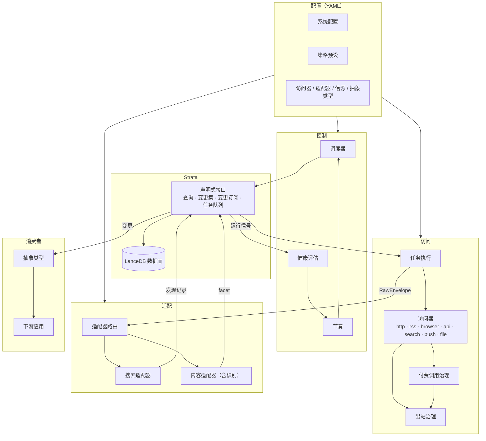
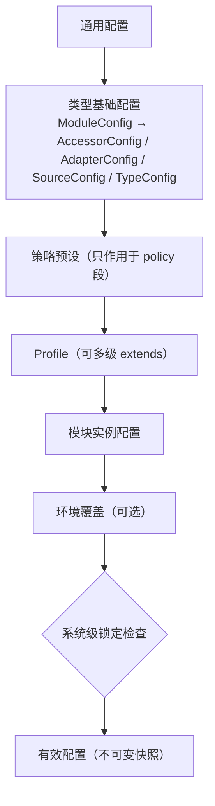

# ModalPrism 设计

ModalPrism 是一个多信源数据采集系统。它通过统一的**访问器（Accessor）**获取原始多模态数据，经**搜索适配器**与**内容适配器**加工，所有数据以统一的资源 ID 存入资源系统 **Strata**。

| 项 | 内容 |
|---|---|
| 仓库 | `MistLoom/ModalPrism` |
| 语言 | Rust |
| 能力运行时 | [LEAF](https://github.com/MistLoom/LEAF)，见第 11 节 |
| 资源系统 | Strata，基于 LanceDB，见第 5 节 |
| 配置 | YAML 文件，见第 10 节 |

---

## 1. 范围

### 1.1 目标

1. 用同一套模型接入异构信源，包括 RSS/Atom、网页列表与详情页、动态页面、开放 API、付费 API、搜索引擎、社交媒体和外部推送。
2. 采集得到的原始数据和派生数据都存入 Strata，用统一的资源 ID 标识。Strata 之外的模块不直接访问存储。
3. 是否保存原始数据由策略决定。保存下来的原始数据保持原样：结构化数据、非结构化数据和多媒体内容都不改写，可以重放。
4. 访问器和适配器可以各自扩展、自由组合。同一份原始数据可以由多个适配器加工成不同用途的资源。
5. 提供调度、自适应节奏、分类退避、出站治理、按需渲染、付费调用治理、游标一致性、去重和健康信号。
6. 信源声明和系统配置都用 YAML 文件表达，具备统一的配置层级、策略预设、校验和热加载。

### 1.2 非目标

1. 不预设业务场景。"新闻""热榜""舆情"等语义由抽象类型和下游应用定义。
2. 不承担打分、聚类、摘要、报告等业务加工，这些模块是 Strata 的消费者。
3. 不提供绕过访问控制、付费墙或验证码的能力。
4. 配置不存入数据库，系统也不提供配置编辑界面。

---

## 2. 设计原则

| # | 原则 | 含义 |
|---|---|---|
| P1 | 原始数据自由 | 访问器只负责取回数据，不解释内容。原始数据不强制 schema；保存范围和保留期由策略决定。 |
| P2 | 适配器按需定制 | 理解数据是适配器的职责，内容类型识别和分类也由适配器完成。适配器可以组合、串联、并行，同一份原始数据可以有多种解读。 |
| P3 | Strata 是唯一数据面 | 适配器之后的所有读写都通过 Strata 的声明式接口完成，以资源 ID 为锚点。 |
| P4 | 只增不改 | facet 以不可变版本追加；识别和分类结果以区间引用原文，不修改原文。 |
| P5 | 场景无关 | Strata 只提供资源、facet、关系和血缘等通用原语，场景语义由抽象类型维护。 |
| P6 | 声明优先 | 信源、访问器、适配器和策略用 YAML 声明；数据读写用查询和变更集声明。 |
| P7 | 能力驱动 | 访问器和适配器声明自身能力，调度和路由据此决策。 |
| P8 | 一致性随提交 | 游标、数据、付费回执与任务确认在同一次提交中生效；处理失败时游标不推进。 |
| P9 | 出站集中治理 | 所有对外请求都受统一的出站治理约束，浏览器内核产生的流量也包括在内。 |
| P10 | 可观测 | 每个信源、访问器和适配器都有健康状态和期望产出节奏。 |
| P11 | 策略可配置 | 需要取舍的行为（留存、合规、成本、证据、重算）都是配置项，由策略预设给出基线，可以逐层覆盖或在系统级锁定。 |
| P12 | 依赖单向 | 访问器不依赖适配器，适配器不依赖具体访问器，两者都不依赖 Strata 的存储实现。 |

---

## 3. 术语

| 术语 | 定义 |
|---|---|
| 资源（Resource） | 可寻址的实体，用资源 ID（RID）标识，例如一篇文章、一张图片、一次抓取的原始响应、一个信源、一页搜索结果。 |
| facet | 资源的一种表现形式，例如 `raw`、`md`、`html`、`text`、`image`、`struct`、`links`、`embedding`。一个资源可以同时有多种 facet。 |
| 变体（Variant） | facet 的细分标识，例如 `struct:article`、`image:cover`、`md:readable`。 |
| 访问器（Accessor） | 按某种协议获取原始数据的模块，输出原始信封。 |
| 原始信封（RawEnvelope） | 访问器的统一输出，由多个原始部件和传输元数据组成。 |
| 搜索适配器（Search Adapter） | 从原始数据或资源中发现候选条目和链接，产出发现记录，驱动后续访问。 |
| 内容适配器（Content Adapter） | 把原始数据或资源加工成目标 facet，也负责内容类型识别和分类。 |
| 识别器（Detector） | 内容适配器可以挂载的可插拔组件，用于判定数据的实际类型和区间分类。 |
| 抽象类型（Abstract Type） | 基于 Strata 定义的业务类型（例如 Article、HotList），自行维护 schema、状态和关系。 |
| 信源（Source） | YAML 中声明的采集入口，说明访问什么、使用哪些适配器、按什么节奏、采用哪套策略。 |
| 访问任务（AccessTask） | 调度器生成的一次访问请求。 |
| 变更集（ChangeSet） | 对 Strata 的一次声明式写入，整体生效。 |
| 快照（Snapshot） | Strata 中一次整体可见的数据状态。读取按快照进行。 |
| 策略预设（Policy Preset） | 一组策略配置的命名基线。 |

---

## 4. 架构

### 4.1 总览



### 4.2 组件职责

| 组件 | 职责 | 不负责 |
|---|---|---|
| 调度器 | 按信源配置、节奏与健康状态生成访问任务 | 执行访问 |
| 任务执行 | 领取任务，调用访问器和适配器，把结果组装成变更集提交 | 解释内容 |
| 访问器 | 按协议取回原始数据，输出原始信封 | 解析内容、去重 |
| 出站治理 | 限速、熔断、robots、SSRF 防护、会话与代理、请求身份 | 业务判断 |
| 付费调用治理 | 回执、预算、幂等、请求合并 | 计费结算 |
| 适配器路由 | 按部件角色、声明类型、识别结果和规则分发输入 | 加工数据 |
| 搜索适配器 | 产出发现记录 | 写入 Strata |
| 内容适配器 | 产出 facet、关系和质量反馈 | 写入 Strata |
| Strata | 资源、facet、关系、身份、血缘、状态和任务队列的存取；一致性与可见性 | 业务语义 |
| 抽象类型 | 定义业务视图，维护自身状态 | 采集 |

### 4.3 主数据流

1. 调度器根据信源配置和运行状态生成访问任务，任务进入 Strata 的任务队列。
2. 任务执行方领取任务，调用访问器。访问器在出站治理约束下取回原始数据，封装成原始信封。
3. 适配器路由分发信封中的部件。需要识别时，先运行识别，再按识别结果分发：
   - 搜索适配器产出发现记录，进而产生新的访问任务或资源占位；
   - 内容适配器产出各类 facet。
4. 任务执行方把原始信封（按策略决定是否保存）、适配器输出、游标和任务确认组装成一个变更集，提交给 Strata。
5. 变更可见后，Strata 向订阅方发布变更，抽象类型和下游消费者据此处理。

### 4.4 边界约束

1. 只有 Strata 访问 LanceDB 及其他存储。
2. 适配器没有写权限。适配器的输出由任务执行方转换为变更集，因此预览、测试、重放与正式运行走同一条写入路径。
3. 访问器的对外请求只能经由出站治理发出。
4. 配置是只读输入。运行期状态（游标、节奏、健康、回执）存放在 Strata，与配置分离。

---

## 5. 资源系统 Strata

Strata 由不断沉积的层组成：最底层是访问器取回的原始数据，只追加、不修改；适配器的产出作为新的 facet 版本叠加在上方；每一层都记录血缘，可以追溯到产生它的适配器、配置版本和输入。

### 5.1 资源 ID

| 要求 | 说明 |
|---|---|
| 不透明 | 调用方不解析 RID 的内部结构 |
| 全局唯一、永不复用 | 资源删除后 RID 也不再分配给其他资源 |
| 与内容无关 | 同一实体的内容变化不改变 RID；内容去重由 facet 内容哈希完成 |
| 与身份键分离 | 身份键（外部 ID、规范化 URL 等）是可计算的去重依据，由 Strata 映射到 RID，见 5.6 |
| 可在多处独立生成 | 多个进程或实例生成 RID 时不依赖中心协调 |
| 可引用 | 支持引用资源、资源的某个 facet（kind 与 variant）、facet 的某个版本，以及 facet 版本中的字节区间 |

RID 与各类引用的文本表示由实现确定，需在全系统统一，并保证可以无歧义解析。

### 5.2 资源模型

```text
Resource (RID)
 ├─ meta: 命名空间, 创建时间, 来源信源, 标签
 ├─ facets（按 kind[:variant] 分组，每组是一条版本链）
 │   ├─ raw            原始信封（多部件）
 │   ├─ html           原始 HTML
 │   ├─ md:readable    正文 Markdown
 │   ├─ text           纯文本
 │   ├─ struct:article 结构化字段
 │   ├─ struct:detect  识别结果
 │   ├─ regions:detect 区间分类结果（引用其他 facet 的区间）
 │   ├─ image:cover    图片
 │   ├─ links          外链集合
 │   └─ embedding:<模型> 向量
 └─ relations: discovered_by, derived_from, part_of …
```

**命名空间**区分数据用途：采集数据、系统状态（信源运行态、游标、健康）以及各抽象类型的私有数据。

**内置 facet 种类**（可扩展）：

| kind | 内容 |
|---|---|
| `raw` | 原始信封：多部件字节与传输元数据 |
| `html` / `xml` | 标记文本 |
| `md` | Markdown |
| `text` | 纯文本 |
| `json` / `yaml` | 原样保存的结构化文本 |
| `struct` | 规范化后的结构化对象，必须带 variant |
| `links` | 链接集合（URL、锚文本、在源 facet 中的区间） |
| `image` / `audio` / `video` / `file` | 二进制媒体及其元数据 |
| `embedding` | 向量，variant 为模型标识 |
| `regions` | 指向其他 facet 的区间分类结果，variant 标明产出者 |

### 5.3 不变量

1. facet 版本不可变。内容变化产生新版本；内容哈希与最新版本相同时不产生新版本。
2. 派生 facet 必须记录血缘：输入的 facet 版本或区间、产出模块的标识与版本、配置代际。
3. 识别、分类和抽取不修改源 facet，只通过区间引用或派生新 facet 表达。
4. 删除以墓碑表示。身份键映射保留，防止已删除或已拒绝的资源被再次创建。

### 5.4 声明式接口

Strata 对外提供两类核心操作：**查询**与**变更集**，另有一组便捷读取方法、变更订阅和任务队列。以下 Rust 代码只示意接口形态，不是最终签名。

```rust
// 示意：读取
trait StrataReader {
    async fn kinds(&self, rid: &Rid) -> Result<Vec<FacetSummary>>;     // 资源下的 facet 清单
    async fn get(&self, r: &FacetRef, lazy: bool) -> Result<Option<Facet>>;
    async fn slice(&self, r: &SpanRef) -> Result<Bytes>;               // 读取字节区间
    async fn resolve(&self, identity_key: &str) -> Result<Option<Rid>>;
    async fn history(&self, r: &FacetRef) -> Result<Vec<FacetVersion>>;
    async fn lineage(&self, r: &FacetRef, dir: LineageDir, depth: u32) -> Result<LineageGraph>;
    async fn related(&self, rid: &Rid, rel: Option<&str>, dir: EdgeDir) -> Result<Vec<Relation>>;
    fn query(&self, q: Query) -> impl Stream<Item = Result<Row>>;
    fn watch(&self, filter: WatchFilter, from: Option<SnapshotCursor>) -> impl Stream<Item = Result<CommitEvent>>;
}

// 示意：写入
trait StrataWriter {
    async fn apply(&self, cs: ChangeSet, opts: ApplyOpts) -> Result<CommitResult>;
}
```

**查询**以数据结构描述需要的数据，执行计划由 Strata 决定。查询可以组合：命名空间与字段过滤、要求具备的 facet、选取的字段或 facet、关系展开、全文与向量检索、按快照读取、排序与分页。过滤条件以结构化表达式给出，不接受拼接的查询字符串。

```yaml
# 示意：查询声明
from: resources
where: { all: [ { eq: [ns, data] }, { gte: [updated_at, "2026-10-18T00:00:00+08:00"] } ] }
hasFacets: [ { kind: struct, variant: article }, { kind: md, variant: readable } ]
select: [ rid, { kind: struct, variant: article, fields: [title, published_at] } ]
expand: [ { rel: discovered_by, dir: out } ]
limit: 50
```

**变更集**描述期望状态，由 Strata 负责幂等落地。一个变更集包含：

| 内容 | 说明 |
|---|---|
| 生产者 | 模块标识、版本、配置代际 |
| 幂等键 | 同一键重复提交时返回首次提交的结果 |
| 任务确认 | 与本变更集一同生效的访问任务确认 |
| 操作列表 | 见下表 |

| 操作 | 语义 |
|---|---|
| `ensure` | 按身份键解析或创建资源，并绑定变更集内的局部别名 |
| `putFacet` | 写入 facet；内容哈希与最新版本相同则不产生新版本 |
| `link` | 写入关系 |
| `label` | 设置或移除标签 |
| `setState` | 写入状态（游标、回执、渲染级别记忆等），支持基于期望版本的乐观并发。字段名是 `expectVersion` |
| `tombstone` | 写入墓碑 |

`ensure` 绑定的局部别名可以被同一变更集中的其他操作引用，适配器不需要先查询再写入。操作名和操作字段都使用 camelCase，例如 `mediaType`、`expectVersion`。

```yaml
# 示意：变更集
producer: { module: adapter/readability-md, version: 1.4.0, configGeneration: 37 }
idempotencyKey: task-01JA…/attempt-1
ack: task-01JA…
ops:
  - { op: ensure, identity: "url:https://example.com/post/1", as: post }
  - { op: putFacet, target: post, kind: md, variant: readable, body: { text: "…" },
      lineage: { inputs: ["<raw facet 版本的区间引用>"] } }
  - { op: link, src: post, rel: discovered_by, dst: "<信源 RID>" }
```

### 5.5 一致性契约

| 保证 | 说明 |
|---|---|
| 整体可见 | 一个变更集中的全部写入在同一个快照中可见，或都不可见 |
| 持久确认 | `apply` 返回已接收后，进程崩溃不会丢失该变更集 |
| 可选等待 | 调用方可以选择等待"已接收"或"已可见" |
| 单调读 | 同一读取句柄观察到的快照单调前进 |
| 快照读 | 一次查询读到的所有数据属于同一个快照 |
| 可回溯 | 在保留期或标签保护范围内，可以按快照重新读取 |
| 可续订 | 变更订阅以快照游标续接，订阅方中断后可以从上次位置继续，不漏读 |
| 幂等重放 | 同一变更集重复提交或崩溃后重放，不产生重复数据 |

### 5.6 关系、身份与血缘

**关系**（内置关系名，可扩展）：

| rel | 含义 |
|---|---|
| `discovered_by` | 资源由某个信源或搜索结果页发现 |
| `derived_from` | 资源派生自另一个资源，例如图片资源派生自文章 |
| `part_of` / `has_part` | 组成关系，例如页面中的条目、线程中的帖子 |
| `links_to` | 内容中的超链接 |
| `same_as` | 多个 RID 指向同一实体 |
| `duplicate_of` | 内容近似重复 |
| `fetched_as` | 业务资源与其原始抓取资源的对应 |

**身份键**按可靠性从高到低回退：

1. 外部稳定 ID，例如平台帖子 ID、DOI；
2. 规范化 URL，规范化规则（跟踪参数、片段处理等）由策略配置；
3. 信源内哈希，由信源标识与条目定位信息计算。

一个资源可以有多个身份键。不同身份键解析到不同 RID 时，写入 `same_as` 关系，主 RID 的选择规则由策略配置。

**墓碑**：被删除或被拒绝的资源保留身份键映射。再次发现同一身份时，`ensure` 返回带墓碑标记的结果，任务执行方据此跳过。

**血缘**记录产出模块、版本、输入引用、有效配置的哈希和提交标识：

```yaml
# 示意：血缘
lineage:
  producer: { module: adapter/readability-md, version: 1.4.0, configGeneration: 37 }
  inputs: ["<raw facet 版本的区间引用>"]
  paramsHash: 9f3c…
```

有效配置的哈希进入血缘后，可以检测到适配器配置的变化，并据此按策略触发重新加工。

### 5.7 多模态数据

| 要求 | 说明 |
|---|---|
| 统一存放 | 文本、结构化对象、二进制媒体和向量都存放在 Strata 中，以 RID 和 facet 引用 |
| 内容寻址去重 | 相同字节的二进制内容只存一份 |
| 惰性读取 | 大对象可以按句柄或区间读取，不要求整体读入内存 |
| 外部引用 | 策略选择只登记媒体的外部地址时，facet 记录引用而不保存字节 |
| 媒体元数据 | 宽高、时长、MIME 等与媒体 facet 一同保存 |
| 结构化字段 | `struct:*` 的 schema 由产出方定义；需要高频过滤的字段可以单独建立可过滤的存储形式 |
| 引用安全 | 清理二进制内容时，被保留快照或现存 facet 引用的内容不得被删除 |

### 5.8 LanceDB 基础

Strata 的数据面基于 LanceDB。以下特性来自 LanceDB / Lance 的官方文档，是 Strata 实现时必须遵守的前提：

| 特性 | 内容 | 来源 |
|---|---|---|
| 单表事务 | Lance 用 MVCC 提供 ACID 保证，每次提交原子地生成一个不可变的新表版本，并发写采用乐观并发控制与冲突重试 | [A1] |
| 写入即版本 | update、delete、add 等写操作都会生成新版本，影响 0 行的写入也会推进版本 | [A2][A3] |
| 版本访问 | `checkout` 只读访问旧版本；`restore` 以旧版本内容生成新版本，不复制数据；标签保护的版本在清理时保留；支持可写的分支 | [A2] |
| 主键 | 主键是供 `merge_insert` 使用的元数据，普通写入不强制唯一 | [A3] |
| 写入粒度 | 官方建议避免逐行插入，每次插入都会在磁盘上生成新的数据 fragment | [A4] |
| 并发写 | 支持并发写，但写者过多时会因提交重试次数有限而失败 | [A4] |
| 多模态 | 原始数据、元数据和向量可以存放在同一张表 | [A4] |
| Blob 列 | Blob 列支持完整读取和按文件方式的惰性访问；Blob v2 需要 Lance 文件格式 2.2 及以上 | [A5] |

由此得到 Strata 的实现要求：

1. **跨表可见性**。LanceDB 的提交以单表为单位，Strata 需要在其上实现 5.5 的"整体可见"和"快照读"，不能依赖 LanceDB 提供跨表事务。
2. **写入批量化**。高频的小粒度写入需要在 Strata 内部聚合后批量提交，避免版本和 fragment 数量过快增长。
3. **写者协调**。Strata 需要控制同时写同一张表的写者数量，使提交冲突不会导致写入失败。
4. **高频可变状态**。任务队列、租约、计数器、令牌桶这类高频更新的状态需要合适的承载方式，并满足 9.1 与 5.5 的契约。承载方式对 Strata 之外的模块不可见。
5. **唯一性**。RID、身份键、内容寻址键的唯一性由 Strata 自行保证。
6. **维护**。数据整理、索引更新、旧版本清理由 Strata 负责调度，不得破坏正在进行的读取与写入，旧版本保留期由策略配置。
7. **恢复**。进程在提交过程中崩溃后，Strata 恢复到一致状态，并完成已接收但尚未可见的变更集。

表结构、索引类型、全文分词器、存储后端和存储位置由实现确定，并通过系统配置声明。

---

## 6. 访问器

### 6.1 职责

- **负责**：按协议获取数据，处理连接、重定向、压缩、字符集声明、条件请求、分页协议、会话和渲染等传输层细节，输出原始数据。
- **不负责**：解析业务内容、抽取字段、判断去重。HTML 不转换为 Markdown，JSON 不做映射，Feed 不拆分条目。

### 6.2 接口契约

| 契约 | 说明 |
|---|---|
| 标识与版本 | 每个访问器有稳定标识和版本，进入原始信封与血缘 |
| 能力声明 | 声明支持的协议与能力，见下表；调度和路由只依据能力声明决策 |
| 配置校验 | 校验信源中该访问器专属的 `spec`，错误在配置加载时报告 |
| 访问 | 一次访问可以产出多个信封（分页、推送批次、浏览器的多个网络响应），以流式方式返回 |
| 错误分类 | 返回的错误携带类别，见 9.4 |
| 取消与截止 | 响应取消信号和截止时间 |
| 出站约束 | 只能经由注入的出站治理接口发起对外请求 |

| 能力 | 含义 |
|---|---|
| `conditional` | 支持 ETag / Last-Modified 条件请求 |
| `render` | 执行脚本、生成 DOM |
| `layout` | 可按需布局：截图、PDF、坐标输入 |
| `captureNetwork` | 可观察页面的网络请求与响应 |
| `interact` | 可执行交互脚本或自动化会话 |
| `paid` | 调用按次计费，经付费调用治理 |
| `batchable` | 多个请求可以合并为一次调用 |
| `inbound` | 被动接收推送 |

```rust
// 示意：访问器接口形态
trait Accessor {
    fn id(&self) -> &str;
    fn version(&self) -> &str;
    fn capabilities(&self) -> &AccessorCapabilities;
    fn validate(&self, spec: &Value) -> ValidationResult;
    fn access(&self, req: AccessRequest, ctx: &AccessContext)
        -> impl Stream<Item = Result<RawEnvelope, AccessError>>;
}
```

访问请求包含：任务标识、信源标识、定位符（URL、查询、API 端点或推送通道）、访问器 `spec`、上次成功的游标、访问提示（条件请求验证器、渲染级别）、生效策略和截止时间。

### 6.3 原始信封

一次访问可能得到多种模态的数据：页面 HTML、页面发出的接口响应、截图、附件和媒体文件。信封以**多部件**形式保存这些数据，任何部件都不丢失。

| 字段 | 说明 |
|---|---|
| 定位符 | 请求目标，以及重定向后的最终目标 |
| 传输元数据 | 协议、状态码、响应头（保留顺序和重复项）、起止时间、字节数、条件请求是否命中、实际渲染级别、浏览器内核及版本、付费回执 |
| 部件列表 | 每个部件包含角色、声明的媒体类型、字符集、子资源地址、字节引用和部件元数据 |
| 候选游标 | 访问器建议的下一游标（例如分页 token），是否生效由提交决定，见 9.5 |
| 源站信号 | `Retry-After`、Feed `ttl`、缓存时长等 |

**部件角色**：`document`、`subresource`、`network-response`、`network-trace`、`screenshot`、`print`、`rendition`、`attachment`、`media`、`metadata`，可扩展。

- 部件的媒体类型以服务端声明为准；实际类型由识别得出，记录在 `struct:detect`，不回写信封。
- `rendition` 是浏览器内核直接给出的派生形式（例如 Markdown、语义树），由策略决定是否保存，元数据中标明产出内核。它不替代 `document`。
- 请求头和 Cookie 中的敏感字段按策略在保存前脱敏。
- 信封保存后成为资源的 `raw` facet。策略决定不保存时，信封只在本次处理期间存在。

### 6.4 内置访问器

| 访问器 | 协议与能力 | 原始输出 |
|---|---|---|
| `http` | HTTP/1.1、HTTP/2；条件请求；重定向策略；压缩 | `document`（响应体）与传输元数据 |
| `rss` | 在 `http` 之上增加 Feed 协议能力：条件请求、分页归档（RFC 5005）、WebSub 订阅回调 | 一份或多份 Feed 原文 |
| `browser` | 执行 JavaScript 的无头浏览器访问，见 6.5 | `document`、`metadata`、`network-response`、`network-trace`、`screenshot`、`print`、`rendition` |
| `api` | 通用 HTTP API：方法、请求体、认证引用、分页模板（offset、cursor、link） | 每页一个 `document` |
| `search` | 调用搜索 API 或元搜索服务，或经 `browser` 访问搜索结果页 | 搜索结果原文 |
| `push` | 被动接收 webhook 等推送，按来源鉴权、限流，支持幂等键 | 每个推送批次一个信封 |
| `file` | 本地文件或对象存储，用于导入与回放 | 文件原文 |

付费 API 不是单独的访问器，而是 `api` 或其他访问器声明 `paid` 能力并关联付费调用治理（6.8）。

### 6.5 浏览器访问器

#### 6.5.1 moli

浏览器访问器的默认内核为 [lexmount/moli](https://github.com/lexmount/moli)。以下内容来自 moli 的官方文档 [B1][B2]：

| 维度 | 内容 |
|---|---|
| 许可 | Apache-2.0 或 MIT 双许可 |
| 定位 | 面向 AI Agent 的无头浏览器，独立内核，不是 Chromium 封装；网络使用 libcurl，JavaScript 使用 V8，布局使用 Taffy 与 Parley |
| 接入方式 | CLI 单次抓取 `moli fetch`；自动化服务 `moli serve`，同一端点提供 CDP、WebDriver Classic 和 WebDriver BiDi，Playwright 可以通过 `connectOverCDP` 连接 |
| 成本控制 | 默认 `LayoutPolicy::Mock`，不做真实布局和绘制；`--layout` 启用真实布局、命中测试、坐标输入和截图；图片、字体、音视频等可选资源默认不加载，可用 `--resource` 或 `--image`、`--font` 等逐类开启 |
| 输出 | HTML、Markdown、JSON、语义树文本；开启布局后可输出截图和 PDF |
| 就绪与观察 | 支持按选择器、脚本、响应等待；`--trace-network` 输出网络追踪 |
| 会话与网络 | `--cookie-file`、`--profile-dir`、`--http-proxy`、`--http-no-proxy`、UA 覆盖、`--block-private-networks` 与 `--block-cidrs`、Web Bot Auth 请求签名 |
| 边界 | 没有 GUI 和 GPU 合成；不追求与 Chrome 像素一致，不提供高保真 Canvas/WebGL/媒体播放；不支持的协议路径返回明确错误，不伪造结果 |
| 分发 | 通过 GitHub Releases 提供预编译二进制与安装脚本 |

#### 6.5.2 要求

| 要求 | 说明 |
|---|---|
| 默认结构优先 | 只需 DOM 时不开启布局和可选资源 |
| 按需开启 | 截图、PDF、坐标交互、网络捕获由信源声明或策略触发 |
| 输出映射 | moli 的各类输出映射为对应角色的部件；内核名称与版本写入传输元数据和血缘，便于内核升级后筛选需要重新加工的数据 |
| 流量治理 | 浏览器内核发起的全部请求受出站治理约束（6.7）；moli 的代理与私网阻断选项可以用于实现这一要求 |
| 资源隔离 | 浏览器进程的并发、排队、单任务超时、回收和健康检查可配置，崩溃或挂起不影响其他任务 |
| 可替换内核 | 内核通过统一的浏览器访问契约接入；是否配置兼容性回退内核由策略决定 |
| 不承担反检测 | 拦截页、登录墙、空壳页按失败或劣化处理 |

单次抓取与自动化服务两种接入方式的选择规则、进程池参数，以及 moli 在目标信源上的覆盖度，见第 12 节。

### 6.6 按需渲染

渲染是访问层的策略，不是信源的固定属性。信源声明 `render: auto | never | always`，可达到的最高级别由策略限制。

渲染级别是一组从低成本到高成本的有序能力层级：

| 层级 | 能力 |
|---|---|
| 直连 | 不执行脚本的 HTTP 访问 |
| 会话 | 带 Cookie、条件请求与 UA 策略的 HTTP 访问 |
| 结构 | 执行脚本，只生成 DOM |
| 交互 | 在"结构"之上增加响应等待、网络捕获、交互脚本，按需布局 |
| 兼容 | 由兼容性回退内核处理（若配置） |

- **升级依据**：适配器反馈（内容质量为空、过薄或被拦截，关键字段缺失，并给出所需级别）；内核的不支持信号。
- **级别记忆**：按信源与主机记录最近成功的最低级别，存放在 Strata 的状态中，下次从该级别开始；按策略定期尝试降级。
- **截图与级别无关**：是否截图由策略决定，需要时在当前级别开启布局。

### 6.7 出站治理

所有访问器的对外请求都必须经过出站治理，包括浏览器内核产生的子请求。

| 能力 | 要求 |
|---|---|
| SSRF 防护 | 每一跳都校验解析后的地址，默认拒绝私网和保留地址，是否放开由策略决定；携带凭据的请求只允许同源重定向 |
| 按域限速 | 以注册域为键限速和限并发，可以按主机覆盖；具体速率由配置给出 |
| 自适应节流 | 按响应延迟与 429/503 比例动态调整速率 |
| 主机熔断 | 连续失败或错误率超过阈值时熔断，冷却时间逐次增长 |
| robots.txt | 行为由策略决定，见 10.5.3 |
| Retry-After | 写入该域的冷却时间和信源的节奏信号 |
| 会话 | Cookie、代理、UA 作为会话对象按域绑定与轮换；浏览器会话映射为内核的会话目录或 Cookie 文件；被封禁的会话退役 |
| 请求身份 | UA 与联系信息由策略配置；可选启用 Web Bot Auth 签名 |
| 预算 | 渲染次数、出站字节等可以设置预算 |

出站治理的状态（令牌桶、熔断、会话）需要在同一部署的多个执行方之间共享。浏览器子请求的治理方式（例如经代理接入）由实现确定，但必须满足上表要求。

### 6.8 付费调用治理

适用于按调用计费的 API、渲染服务和模型服务：

1. **逻辑请求键**：由服务、端点、规范化参数和时间窗口计算。同一键在窗口内最多真实发送一次，重复请求返回已保存的响应。
2. **调用前占位**：发起调用前先持久化"进行中"回执，再发起调用；响应原文作为原始数据进入后续流程。
3. **结果未知不重发**：超时或连接中断导致结果未知时，回执标记为"未知"，处理方式由策略决定（冷却后放行一次，或等待人工）。
4. **预算**：按服务设置多级时间窗口的上限。预算耗尽不计入信源失败，任务延后执行。
5. **请求合并**：声明 `batchable` 的访问器可以把多个信源的请求合并为一次调用，结果按归属规则拆回各信源。
6. **回执随数据可见**：完成回执作为状态写入同一个变更集，与数据在同一个快照中可见。

---

## 7. 适配器

### 7.1 分类

| 类别 | 输入 | 输出 | 典型实现 |
|---|---|---|---|
| 搜索适配器 | `raw` facet 或已有资源的 facet | 发现记录：候选条目（定位符、提示字段、身份键）、分页或下一页定位、可选的资源占位 | Feed 条目拆分、网页列表选择器、JSON 列表映射、搜索结果解析、站点地图、热榜列表 |
| 内容适配器 | `raw` facet 或已有资源的 facet | 目标 facet（md、text、struct:*、image、links、regions 等）、关系、质量反馈 | 内容识别、正文抽取、HTML 转 Markdown、JSON-LD 抽取、媒体登记、区间分类、结构映射 |

两类适配器共用同一套运行时和配置基类，区别在于输出契约。

### 7.2 接口契约

| 契约 | 说明 |
|---|---|
| 标识、版本、角色 | 角色为搜索或内容 |
| 输入声明 | 接受的 facet kind、部件角色、声明或识别出的媒体类型 |
| 输出声明 | 搜索适配器声明产出发现记录；内容适配器声明产出的 facet kind:variant |
| 确定性声明 | 默认确定性：相同输入与相同配置得到相同输出 |
| 探测（可选） | 低成本判断能否处理某个输入，用于声明类型不可靠的情况 |
| 配置校验 | 校验适配器 `spec` |
| 只读输入 | 输入以只读视图提供，适配器不得修改；区间引用不复制原文 |

```rust
// 示意：适配器接口形态
trait SearchAdapter {
    fn discover(&self, input: &AdapterInput, spec: &Value, ctx: &AdapterContext)
        -> impl Stream<Item = Result<Discovery, AdapterError>>;
}

trait ContentAdapter {
    async fn adapt(&self, input: &AdapterInput, spec: &Value, ctx: &AdapterContext)
        -> Result<ContentOutput, AdapterError>;
}
```

- **发现记录**：下一步要访问的定位符、多级身份键、提示字段（标题、发布时间、作者、摘要、排名等）、条目在输入中的区间、是否跟进（以及使用的访问器、渲染级别、优先级）、条目自带内容时直接产出的 facet。
- **内容输出**：facet 草稿（kind、variant、内容、媒体类型、来源区间）、关系草稿、质量反馈（所需渲染级别、内容质量、缺失字段）。

### 7.3 约束

1. 适配器没有写权限，输出由任务执行方转换为变更集提交。
2. 适配器可以通过只读接口查询 Strata，例如判断某个身份是否已存在。
3. 非确定性适配器（例如调用模型的抽取）必须声明非确定性；若调用计费服务，必须经付费调用治理。

### 7.4 内容识别与分类

内容类型识别和分类是内容适配器的职责。系统提供可插拔的**识别器**接口，内容适配器可以挂载一个或多个识别器，也可以自行实现。

| 能力 | 说明 |
|---|---|
| 类型判定 | 基于只读视图与声明信息（媒体类型、字符集、部件角色），给出实际媒体类型、字符集、置信度和特征标记（例如空壳页、拦截页、含 JSON-LD） |
| 区间分类（可选） | 以字节区间标出正文、JSON-LD、内嵌脚本数据、图片引用等 |

识别作为一个普通的内容适配器运行，产出 `struct:detect` 与可选的 `regions:detect`。识别结果持久化后，重放时直接复用。识别器的选择由策略配置。特征标记同时作为渲染升级和健康评估的依据。

### 7.5 路由与组合

同一份原始数据可以有多种用途，例如 Feed 原文同时交给"条目拆分"（搜索）和"全文提取"（内容），页面 HTML 同时交给"正文抽取""JSON-LD 抽取"和"外链发现"。

路由依据由低成本到高成本依次为：

1. **部件角色与声明类型**：直接来自信封。
2. **识别结果**：规则引用识别结果时，先运行识别再分发；没有规则引用时不运行识别。
3. **适配器探测**：规则可以要求由候选适配器自行判断是否处理。

```yaml
# 示意：路由规则
pipeline:
  - when: { part_role: document, detected: [application/rss+xml, application/atom+xml] }
    run: [adapter/feed-items, adapter/feed-fulltext]
  - when: { part_role: document, detected: [text/html] }
    run: [adapter/readability-md, adapter/jsonld-struct, adapter/link-discovery]
  - when: { part_role: network-response, declared: [application/json] }
    run: [adapter/json-list]
  - when: { part_role: document }
    run_if_accepts: [adapter/site-specific]
```

- 同一 `raw` facet 只识别一次，结果供所有适配器共享。
- 适配器可以串联，以前一个适配器的输出 facet 作为输入。运行时按依赖关系构建有向无环图，无依赖的适配器可以并行执行。

### 7.6 发现语义

1. 每条发现记录先经过信源的**准入规则**：URL 前缀、噪声规则、发布时间窗口、首次导入上限。
2. 再按身份键执行 `ensure`：
   - 新身份：创建资源占位，并在需要跟进时生成访问任务；
   - 已有身份：写入 `discovered_by` 关系，必要时更新提示字段；
   - 墓碑身份：跳过。
3. 条目自带全文时（例如 Feed 的 `content:encoded`），直接产出 facet，不再访问原文。

---

## 8. 抽象类型

### 8.1 定位

抽象类型是基于 Strata 实现的业务抽象，例如 `Article`、`Post`、`HotList`、`SearchResult`、`Video`。系统不限制抽象类型的表达方式。抽象类型：

- 自行维护 schema、状态和关系；
- 数据全部存放在 Strata，以 `struct:<type>` facet、私有命名空间中的资源和关系表达；
- 通过已可见快照获取输入，通过变更集写入输出。类型实现不调用 `apply`。组合根在快照可见之后调用 `on_commit`，并把返回的变更集交给 Strata。

### 8.2 接口契约

| 契约 | 说明 |
|---|---|
| 名称与版本 | 类型的稳定名称与版本 |
| schema | 由类型自行定义 |
| 选择器 | 一个查询，描述哪些资源属于该类型 |
| 投影 | 从资源的 facet 投影出类型视图，只读，可以缓存 |
| 变更响应 | 响应已可见的变更，维护自身状态（例如聚合、计数、排名快照），返回变更集。组合根负责 `apply` |

```yaml
# 示意：抽象类型声明
id: type/hotlist
kind: type
name: 热榜快照
spec:
  selector: { hasFacets: [ { kind: struct, variant: hotlist.snapshot } ] }
  schema: schemas/hotlist.json
  keepSnapshots: 288
  derive: [ rank_delta, new_entries ]
```

`spec.keepSnapshots` 是正整数。缺省、0 或非正数时不裁剪。超出份数的最旧快照以墓碑原因 `keepSnapshots` 删除。

`HotList` 可以用"每期一个快照资源 + `part_of` 指向榜单资源 + 条目关系"表达排名变化；`Article` 可以用 `struct:article`、`md:readable` 和 `image:cover` 的投影表达。两者的存储形态不同，Strata 不需要理解它们的语义。

---

## 9. 调度与可靠性

### 9.1 任务模型

访问任务包含：任务标识、信源、访问器、定位符、访问器 `spec`、触发原因（定时、跟进、渲染升级、详情补齐、手动、重放）、优先级、所属队列、尝试次数、合并分组键和派发时的配置代际。

任务队列由 Strata 提供，满足以下契约：

| 契约 | 说明 |
|---|---|
| 租约 | 领取的任务在租约期内不会被再次派发；租约可以续期；执行方失联后任务在租约到期后重新可领 |
| 至少一次 | 任务至少执行一次，重复执行由幂等键和内容去重消化 |
| 确认随提交 | 任务成功的确认与结果变更集一同生效 |
| 失败回退 | 失败任务按错误类别设定下次可执行时间 |
| 多队列 | 免费、付费、渲染、推送等队列分别设置并发、速率和预算 |
| 多执行方 | 同一部署中的多个执行方可以并发领取任务 |

### 9.2 调度

1. **到期派发**：周期性选出到期的信源，按优先级和到期时间排序，受各队列容量约束。
2. **防重派发**：派发时推迟信源的下次时间，任务完成后写入实际的下次时间。
3. **合并**：同一合并分组中任一成员到期时整组派发。
4. **跟进任务**：搜索适配器产出的 `follows` 在信源声明 `detail.maxFetches` 时入队。每轮入队不超过该上限。跟进任务不改写信源的下次时间和游标。

扫描周期、租约时长等参数由配置给出。

### 9.3 自适应节奏

信源的下次访问间隔由三项取最大值，再限定在信源声明的上下限之内：

- **产出自适应**：按近期新增资源数（只计首次发现，回填不计）计算的间隔；
- **源站信号**：Feed `ttl`、`Retry-After`、`Cache-Control: max-age`、`Expires`；
- **下限**：按信源类型与是否付费设定。

节奏计算的具体公式和系数由实现确定，并作为配置项暴露。

### 9.4 错误类别

| 类别 | 判定 | 处理 | 健康状态 |
|---|---|---|---|
| 瞬时 | 网络错误、超时、5xx、429 | 有限次重试后按指数退避，遵守 `Retry-After` | `degraded` |
| 永久 | 404、410、401、403、DNS 不存在、不可恢复的 TLS 错误 | 不重试；节奏降到上限；等待人工确认或按配置周期探测 | `failing` |
| 配置 | 配置校验失败、`spec` 不合法 | 不派发，配置修复后自动恢复 | `misconfigured` |
| 劣化 | 访问成功但产出为空、选择器未命中、内容质量不足 | 不退避；累计计数，超过阈值告警，并触发渲染升级判定 | `suspect` |
| 预算 | 付费预算耗尽 | 延后到预算窗口恢复，不计失败 | 不变 |
| 停机 | 进程停止 | 释放租约，不计失败 | 不变 |

访问器和适配器返回的错误携带类别，未分类的错误按瞬时处理。重试次数、退避上限和探测周期由配置给出。

### 9.5 游标与数据一致性

- 游标属于信源状态，存放在 Strata。
- 访问器只提供候选游标。任务执行方在所有适配器成功之后，才把候选游标作为 `setState` 放入结果变更集，与数据一起提交。
- 任一环节失败时不提交变更集，游标不变，下次从相同位置继续。
- 调度器以"已接收"的游标推进下一次访问，避免已接收但尚未可见的数据被重复抓取；对外读取以"已可见"为准。
- 条件请求的验证器（ETag、Last-Modified）与信源配置哈希绑定：信源配置变化时丢弃验证器，完整读取一次。

### 9.6 去重

| 层级 | 机制 |
|---|---|
| 任务级 | 同一信源与定位符在租约期内只派发一次 |
| 请求级 | 付费调用的逻辑请求键；可选的 HTTP 缓存 |
| 身份级 | 多级身份键映射；`same_as` 合并；墓碑防止复活 |
| 内容级 | facet 内容哈希相同不产生新版本；二进制内容寻址 |
| 近似重复 | 由策略选择是否启用及方法，结果以 `duplicate_of` 关系表达，不删除数据 |

### 9.7 健康信号

每个信源、访问器和适配器维护以下健康信号，存放在 Strata：

| 信号 | 说明 |
|---|---|
| `status` | `ok` / `degraded` / `failing` / `suspect` / `misconfigured` / `paused` |
| `consecutive_failures` | 按错误类别分别计数的连续失败次数 |
| `last_ok_at` / `last_error` | 最近成功时间和最近错误 |
| `expected_period` | 期望多久至少有一次新增，超过即 `suspect` |
| `yield_trend` | 近期产出与长期均值之比，骤降即 `suspect` |
| `selector_miss` | 搜索适配器关键规则连续未命中次数 |
| `blocked_rate` | 识别结果带拦截页或空壳页特征的比例 |
| `render_level` | 当前记忆的渲染级别与内核 |
| `cost` | 付费与渲染成本 |

健康阈值由策略配置。健康结果反馈给调度器，用于调整节奏和熔断，并作为事件对外发布。

---

## 10. 配置体系

### 10.1 原则

1. 信源声明和系统配置都是 YAML 文件，不存数据库。运行期状态存放在 Strata，与配置严格分离。
2. **统一字段，统一位置**：所有模块配置都继承基础配置类。基础配置中的字段只在顶层出现，名称固定；模块独有字段放在 `spec` 段；策略字段统一放在 `policy` 段。
3. 默认值来自通用配置与策略预设，可以通过 profile 复用，逐层覆盖；合规类字段可以在系统级锁定。
4. 严格校验：未知字段报错，类型与取值范围按 schema 检查，引用必须存在。

### 10.2 配置层级



### 10.3 基础配置类

所有模块配置共有的字段：

| 字段 | 说明 |
|---|---|
| `id` | 全局唯一，形如 `<kind>/<name>`，与文件名无关 |
| `kind` | `accessor` / `adapter` / `source` / `type` / `profile` / `preset` / `system` |
| `name` | 人类可读名称 |
| `description` | 说明 |
| `enabled` | 是否启用 |
| `labels` | 批量管理用的标签 |
| `extends` | 继承的 profile，按顺序合并 |
| `policy` | 策略段，只写需要覆盖的键 |
| `spec` | 模块独有字段，只能放在这里 |

派生基础类在此之上增加本类公共字段：

| 基础类 | 增加的字段 |
|---|---|
| `AccessorConfig` | 实现标识、运行限制（超时、并发、重试）、出站治理引用、付费服务与预算引用 |
| `AdapterConfig` | 实现标识、角色、运行限制、输入声明、输出声明 |
| `SourceConfig` | 访问声明（访问器、定位符、访问器 `spec`、渲染模式）、路由规则、调度声明（间隔、上下限、自适应、期望周期、合并分组键）、准入规则 |
| `TypeConfig` | 实现标识、选择器、schema 引用 |

```rust
// 示意：基础配置类的组织方式
struct ModuleConfig {
    id: String,
    kind: ModuleKind,
    name: String,
    description: Option<String>,
    enabled: bool,
    labels: BTreeMap<String, String>,
    extends: Vec<String>,
    policy: Option<PolicyConfig>,
    spec: Map<String, Value>,
}

struct AdapterConfig {
    base: ModuleConfig,          // 展开到顶层
    implementation: String,
    role: AdapterRole,
    limits: RuntimeLimits,
    consumes: Vec<InputSelector>,
    produces: Vec<OutputDecl>,
}
```

`spec` 的 schema 由模块实现提供。`spec` 中出现与基础字段或 `policy` 顶层键同名的键时，校验失败。

### 10.4 合并与覆盖

| 类型 | 规则 |
|---|---|
| 标量 | 后层覆盖前层 |
| 映射 | 深度合并 |
| 列表 | 默认整体替换；支持显式的追加、前插、按值删除 |
| 删除 | 显式写 `null` 删除继承的键，必填字段不可删除 |
| 冲突 | 同一层中同一 `id` 出现两次时报错 |
| 引用 | 支持引用环境变量、密钥提供方和其他配置的值，在解析期完成，不允许循环 |

**预设的选择与覆盖**：

1. **选择**：`policy.preset` 可以写在系统配置、profile 或模块实例中，取最靠近模块的一处；环境覆盖也可以改写它。
2. **位置**：选中的预设在合并链中位于类型基础配置之后、profile 之前，因此 profile 与实例中显式写出的策略键总是覆盖预设。
3. **范围**：预设只包含 `policy` 段。
4. **继承**：预设可以继承另一个预设，继承链先合并为一个整体。
5. **锁定**：系统配置列出被锁定的策略路径。合并完成后，若某模块对锁定路径的取值与系统配置不同，整个配置快照校验失败。
6. **作用域**：每个策略键有允许出现的最低层级。系统作用域的键写在信源、访问器或 profile 中时报错；预设中的系统作用域键只在该预设被系统配置选中时生效。
7. **溯源**：提供查询每个配置键最终取值及其来源（预设、文件、行号）的能力。

### 10.5 策略与预设

#### 10.5.1 策略域

| 域 | 内容 | 典型作用域 |
|---|---|---|
| `raw` | 原始信封是否保存（全部、仅失败或劣化时、抽样、不保存）、抽样比例、保留期、单部件大小上限、脱敏字段 | 信源 |
| `media` | 只登记外部引用或下载保存、允许的媒体种类、单个媒体大小上限 | 信源 |
| `versions` | facet 版本保留、快照可回溯窗口、审计标签 | 信源 / 系统 |
| `robots` | 遵守模式、豁免类别、缓存时长、robots.txt 不可达时的处理、Crawl-delay 口径 | 信源 / 系统 |
| `render` | 最高渲染级别、兼容性回退、降级探测周期 | 信源 |
| `capture` | 截图时机、网络捕获粒度、是否保存内核派生形式 | 信源 |
| `egress` | 是否允许私网、请求身份 | 系统 |
| `paid` | 结果未知的付费调用如何处理 | 访问器 |
| `reprocess` | 适配器配置或内核版本变化后的重新加工范围 | 适配器 / 信源 |
| `identity` | `same_as` 主 RID 的选择规则、URL 规范化口径 | 系统 |
| `dedupe` | 近似重复检测方式 | 信源 |
| `backfill` | 首次导入上限 | 信源 |
| `classify` | 识别器选择 | 适配器 / 信源 |
| `health` | 健康阈值 | 信源 |
| `commit` | Strata 写入的可见延迟与批量参数 | 系统 |

各策略键的完整列表、取值与 schema 随实现发布。

#### 10.5.2 内置预设

| 预设 | 定位 |
|---|---|
| `minimal` | 资源受限，只保留结果：原始数据仅在失败时保存，媒体只登记引用，版本只保留最新，不开启证据采集 |
| `standard` | 生产常规，作为默认预设：保存原始数据并设保留期，下载图片，开启基础去重 |
| `archive` | 完整留存，可审计、可重放：长期保存原始数据与媒体，保留全部版本，定期打审计标签，失败与渲染时保留截图证据 |
| `debug` | 开发与排障：保存全部原始数据与网络捕获，始终截图，保留期短 |

预设以 YAML 文件提供，可以复制修改或新增。各预设的具体取值随实现发布。原始数据未保存时无法重放，重新加工只能作用于已保存的输入。

#### 10.5.3 robots 模式

| 模式 | 行为 |
|---|---|
| `obey` | 所有请求都检查 robots.txt，不允许豁免 |
| `obey-with-exemptions` | 默认遵守；属于已定义豁免类别的请求可以豁免，信源必须写明理由，每次豁免访问记入审计 |
| `ignore` | 不检查 robots.txt；必须写明理由；可以被系统级锁定禁止 |

豁免类别在系统配置中定义，信源只能引用已定义的类别，例如：

| 类别 | 口径 |
|---|---|
| `feed` | 发布方公开声明的 Feed 地址 |
| `api` | 发布方提供并有使用条款的公开 API，或已获授权的接口 |
| `user-requested` | 用户逐条手动提交的单个 URL，不跟进链接 |
| `authorized` | 持有书面授权的站点 |

robots.txt 不可达时的默认处理遵循 RFC 9309：返回 4xx 视为不存在限制；返回 5xx 或网络不可达时视为完全禁止 [D1]。浏览器子请求是否单独检查 robots.txt 由策略决定。

### 10.6 校验

1. **解析**：只使用 YAML 的安全子集，禁用自定义标签和任意对象构造。
2. **结构**：由基础类、`policy` 和模块 `spec` 的 schema 合成整体 schema，拒绝未知字段。
3. **语义**：引用存在、ID 唯一、角色与输出声明匹配、时长与 URL 合法；`robots` 为 `ignore` 或使用豁免时必须写明理由，豁免类别必须已定义；付费访问器必须关联预算；策略键不得出现在低于其作用域的层级；锁定路径不得被改写。
4. **整体校验**：一次加载的所有文件作为一个整体校验，任一错误都使整个新快照无效。
5. **工具**：提供校验、差异比较和溯源三项能力。

### 10.7 热加载

1. **触发**：监听配置目录的文件变化（带防抖），也支持手动触发。
2. **构建快照**：解析全部文件，合并，整体校验，生成不可变快照，配置代际加一。
3. **原子切换**：校验通过后原子替换当前快照；校验失败时保留旧快照，记录错误并告警。
4. **在途任务**：已派发的任务继续使用派发时的快照（任务携带配置代际），新任务使用新快照。
5. **变更分级**：信源、适配器 `spec`、节奏、准入规则、限速参数以及信源与适配器作用域的策略可以热更新；影响已装配实例集合或实例绑定期配置的变更（Strata 连接、存储参数、访问器实现、浏览器内核版本）按 11.4 的方式生效。
6. **副作用**：信源配置哈希变化时，相关信源的条件请求验证器失效；适配器配置哈希或浏览器内核版本变化时，按策略触发重新加工。
7. **审计**：每个配置代际的差异摘要写入 Strata 的系统命名空间，血缘中记录配置代际。

### 10.8 配置示例

以下示例只示意字段的组织方式，键名与取值随实现确定。

```yaml
# 系统配置（节选）
kind: system
strata:
  # Strata 的存储位置与实现参数，由实现定义
policy:
  preset: standard
  locks: [robots.mode, egress.private_networks]
  robots:
    mode: obey-with-exemptions
    exemptions: [feed, api, user-requested, authorized]
  egress:
    private_networks: deny
    identity: { user_agent: "ModalPrismBot (+https://example.org/bot)" }
```

```yaml
# 预设
id: preset/archive
kind: preset
name: 归档
extends: [preset/standard]
policy:
  raw: { store: all, retain: forever }
  versions: { audit_tag: daily }
  capture: { screenshot: on-render }
```

```yaml
# 信源
id: source/example-blog
kind: source
name: Example 官方博客
labels: { tier: T1, lang: en }
extends: [profile/gentle-crawl]
policy:
  preset: archive
  raw: { retain: 180d }
access:
  accessor: accessor/http
  locator: { url: "https://example.com/blog/" }
  render: auto
pipeline:
  - when: { part_role: document, detected: [text/html] }
    run: [adapter/html-list]
    spec:
      adapter/html-list: { item: "article.post-card", link: "a.post-link", title: "h2" }
  - for: follow
    run: [adapter/readability-md, adapter/jsonld-struct]
schedule:
  adaptive: true
  floor: 15m
  ceiling: 2h
admission:
  allowUrlPrefixes: ["https://example.com/blog/"]
  initialBackfill: { limit: 30 }
```

```yaml
# 使用 robots 豁免的信源
id: source/example-feed
kind: source
name: Example Feed
policy:
  robots: { mode: obey-with-exemptions, exempt_as: feed,
            robots_reason: "站点首页 <link rel=alternate> 公开声明的 Feed 地址" }
access:
  accessor: accessor/rss
  locator: { url: "https://example.com/feed.xml" }
pipeline:
  - run: [adapter/feed-items]
```

---

## 11. 基于 LEAF 的实现

### 11.1 LEAF 概览

[LEAF](https://github.com/MistLoom/LEAF) 是以 Rust 构建的 AI 能力层运行时。ModalPrism 钉死提交 `ffabb6128ae6e006c6c3cee3a706532501f26219`。使用的概念如下：

| 概念 | 内容 | 来源 |
|---|---|---|
| Ability | 实现具体能力，协议无关。每个 Ability 包以 `ability.yml` 声明 `framework_version`、`id`、`open`、`depends`（可带 alias 与 optional）、`stateful`、`config_schema`、`methods`（每个方法的 `input`/`output` 为 `type: object` 的 JSON Schema）、`events`、`factory` 与 `protocols` | [C1][C4][C7] |
| Handler 与 Factory | Handler 模式下每个方法对应 `src/logic/<method>.rs`；Factory 模式（`factory: true`）由绑定期配置构造自定义 `Ability` 实例 | [C4] |
| App | 场景应用，位于 `apps/<app>`，拥有 `apps/<app>/ability/<name>` 下的 Ability；决定加载哪些 Ability、绑定什么配置、暴露哪些协议端口 | [C1][C2] |
| `common` 能力 | `common/ability/*` 下的通用能力，对入口应用开放，可被调用、监听与拦截 | [C2][C3] |
| 可见性 | `open` 默认为 false，仅属主应用可调用；其他应用只能调用 `open: true` 的 Ability | [C2][C4] |
| Gateway | 统一调用管道，所有调用的形式为 `instance + method + args`，`args` 为 JSON 值；Port 只依赖 Gateway | [C1][C2][C5] |
| Port | 协议端口：`frame/port-cli`、`port-http`、`port-mcp`、`port-fun`、`port-grpc`。可声明的协议为 `tools`、`mcp`、`cli`、`grpc`、`http`、`fun`。该提交没有 Skill Port。`tools` 没有独立 Port | [C3][C8] |
| `WorkspaceCatalog` | 扫描 `common/ability/*/ability.yml` 与 `apps/<app>/ability/*/ability.yml`，得到每个源的 `id`、属主应用、`open`、路径和 `linked`（当前二进制是否链入 Provider） | [C3][C9] |
| `AbilityExpose` | 以实例为单位控制加载、禁用与绑定期 `config`（`unknown`、`defaults`、`abilities.<id>.enabled/config`）；只裁剪 Port → Gateway，不授予跨应用调用 | [C2][C3] |
| `AppBuilder` / `AppHandle` | `AppBuilder::new().app("<入口应用>").catalog(..).expose(..).bootstrap().await` 得到 `AppHandle`，提供 `gateway`、`host`、`expose`、`catalog` 与 `control()`；`AppHandle` 还提供 `apply_expose_delta` 与 `reload_all` | [C5][C10] |
| 能力上下文 | Ability 只通过 `AbilityCtx` 接触引擎：`call`（按 depends 键调用）、`emit`（仅限声明为 emit 的事件）、`subscribe` / `handle`（订阅或登记事件处理）、`load` / `unload`、`local_get` / `local_set`；跨能力调用可使用对方的 typed client（如 `ctx.echo().run(args)`） | [C4][C11] |
| 事件 | Ability 在 `events` 中声明事件；入口应用通过 `AppControl` 登记监听和拦截，拦截只作用于本应用与 `common` 的 Ability，监听还可以收到其他应用已开放 Ability 的事件 | [C2][C5] |
| 生命周期 | 相位为 `discovered`、`loaded`、`bound`、`started`、`ready`、`stopping`、`stopped`、`unloaded`、`failed`，由引擎推进，能力实现 `on_lifecycle` | [C12] |
| 远程 Ability | 子进程或 WASM 作为远程 Ability 的传输，帧格式为一行一帧 JSON；能力实现仍只面对 `Ability` / `AbilityCtx` | [C13] |
| 运行时范围 | LEAF 的范围是能力层运行时，应用主循环由使用方管理 | [C1] |

LEAF 的架构约束 [C2]：Port 只依赖 Gateway，不直接调用 Ability crate；Ability 不按调用来自 MCP、CLI 或 LLM tools 分支；Expose 只裁剪 Port → Gateway；跨应用调用要求目标 `open: true`；协议身份属于声明与 Port。

依赖边界：领域库不依赖 `frame-core`、`ability-core`、`ability-support` 与任一 port。Ability crate 只依赖 `ability-support`。钉死的工作区排除 `ability-sdk`。组合根依赖 `frame-core` 与 `ability-core`。采集进程使用 `frame-port-http`。只读进程使用 `frame-port-mcp`，stdio 上的工具名是 `instance.method`。

### 11.2 映射

| ModalPrism 元素 | LEAF 表达 | 依据 |
|---|---|---|
| ModalPrism 的模块（Strata 读、Strata 写、任务队列、调度、任务执行、健康、配置、出站治理、付费调用治理、各访问器、各适配器、识别器、抽象类型） | 各自实现为 Ability，方法契约在 `ability.yml` 中以 JSON Schema 声明 | Ability 协议无关，由 App 装配 [C1] |
| 持有连接、进程或缓存的模块（Strata、出站治理、浏览器访问器等） | `factory: true`、`stateful: true`，绑定期参数由 `config_schema` 约束，经 `AbilityExpose` 的 `abilities.<id>.config` 传入 | `common/ability/store` 采用相同组合 [C6] |
| 无状态的模块（多数适配器） | Handler 模式 | [C4] |
| 同一角色的模块 | 使用相同的方法 id 与输入、输出 schema，例如所有访问器提供相同的访问方法 | 调用方按实例 id 选择实现，`ctx.call` 以实例 id 或 depends 键寻址 [C11] |
| 配置中的实现标识 | 解析为 Ability 实例 id；动态选择的访问器与适配器经 `ctx.call` 或 Gateway 以实例 id 调用；固定依赖在 `depends` 中声明并使用 typed client | [C4][C11] |
| ModalPrism 的应用 | 一个或多个 LEAF App，ModalPrism 的 Ability 归属这些 App | [C2] |
| 供其他应用使用的只读能力（Strata 查询、健康、配置溯源、抽象类型投影） | 拆分为独立 Ability 并设为 `open: true`；写入与控制类 Ability 保持 `open: false` | `open` 以 Ability 为粒度，Expose 不裁剪方法 [C2][C3] |
| Strata 变更 | 组合根在快照可见之后调用 `on_commit`，取得返回的变更集并 `apply` | 见 11.4 |
| 对外表面 | 各 Ability 在 `protocols` 中声明需要投影的协议；App 通过 Expose 选择加载的实例，Port 上可见的实例为"已加载且登记了该协议"的实例 | [C3] |

### 11.3 装配形态

| 形态 | 加载的能力 | 对外表面 |
|---|---|---|
| 采集运行时 | Strata、调度、任务执行、健康、配置、出站治理、付费调用治理，以及内置访问器与适配器 | 环回 HTTP 运维入口。目录只含 `strata_read`、`planner`、`health` |
| 只读查询表面 | Strata 只读能力、健康、配置溯源、抽象类型投影 | MCP stdio。工具名是 `instance.method`。没有 Skill 入口 |

组合根直接构造 `AbilityHost`，对本仓库的 Provider `install` 后再 `load`。不调用 `AppBuilder::bootstrap`，不运行 codegen，不放置 `info.yml`。Host 不设置单一的 `access_gate`。进程内调用直接使用 `AbilityHost`。运维端口的目录过滤在组合根的 Gateway 上完成。

### 11.4 实现要求

| 事项 | 要求 |
|---|---|
| 工程接入方式 | Ability 放在本仓库 `ability/`。组合根在进程内 `install` 再 `load`。`WorkspaceCatalog::discover` 只扫描 LEAF 工作区的 `common/ability` 与 `apps/*/ability`，不承载本仓库的 Ability。LEAF 提交固定为 `ffabb6128ae6e006c6c3cee3a706532501f26219`。领域库不依赖 `frame-core`、`ability-core` 与 port。Ability crate 只依赖 `ability-support`。组合根依赖 `frame-core` 与 `ability-core`。 |
| 二进制与大数据传递 | Gateway 的 `args` 为 JSON 值。原始部件与大文本以暂存引用传递。引用它的变更集可见之后才删除暂存文件。 |
| 流式结果 | 访问器在一次调用中返回 `Vec<RawEnvelope>`。同一进程内传递，不经 Gateway 分帧。 |
| 后台循环 | 调度节拍、任务执行、刷写、健康评估和配置监听由组合根驱动。进程收到中断或 `SIGTERM` 时调用 `Planner::shutdown`，释放租约。 |
| 事件语义 | 抽象类型不订阅 LEAF 事件。组合根在快照可见之后调用 `on_commit`，再 `apply` 返回的变更集。 |
| 实例集合变更 | 热加载切换已校验的快照。`implementation`、数据目录和 Lance 建表参数保持进程打开时的值。新增访问器不进入已应用快照。在途任务保持派发时的配置代际。这些项变化时重启进程。 |
| 进程隔离 | 浏览器访问器与 Strata 写在同一采集进程。moli 作为外部程序调用。进程级隔离未实现。 |
| 单写者与多实例 | 同一进程的写者由句柄互斥。控制库保留 `committer_lease` 表，本实现不写多实例租约。两个句柄打开同一目录时没有额外的文件锁。PostgreSQL 与多实例选主未实现。 |
| Port 的监听与鉴权 | 运维 HTTP、正向代理和推送只绑定环回地址。端口没有 TLS，也没有鉴权协议。监听地址以外的访问控制未规定。推送由组合根自己的 HTTP 监听接收原始正文，不使用 HTTP Port 的 invoke 路由。只读进程使用 MCP stdio。 |

---

## 12. 未闭合要求

| 事项 | 要求 |
|---|---|
| Strata 跨表可见性 | 一次刷写使该批变更集同时可见。变更集要么全部可见，要么全部不可见 |
| 高频可变状态 | 任务队列、租约、令牌桶和预算计数放在控制库，不进入可见快照。多实例部署与选主使用 PostgreSQL |
| 全文检索 | 查询按规格中的表达式在已可见行上过滤，并提供中文分词与标量索引 |
| 二进制内容 | 内容寻址去重。`get(lazy=true)` 不返回 blob 字节。`lance` 13.0.0 上，`blobs.data` 以 `merge_insert` 写入，相同 `sha256` 不新增行 |
| embedding | 种类 `embedding` 的正文形态和向量维度未规定。存储不接收该种类 |
| 外部引用 | `Body::External` 的内容哈希未规定。存储不接收该正文 |
| moli | 浏览器访问器经 `BrowserEngine` 调用外部程序。网络响应体覆盖、长时间运行、代理下子请求和兼容性回退的实测结果未作为通过条件 |
| 浏览器进程池 | 单次抓取与自动化服务的选择规则和进程池参数未规定 |
| 节奏参数 | 产量下降比 0.3，连续失败阈值 5。健康快照间隔取 `state.snapshot_interval`。配置里没有单独的产量键 |
| 预设 | 标准预设的取值在 `config/presets/standard.yaml` |
| 配置 schema | 使用 JSON Schema。不读取 CUE |
| 多租户与权限 | 在 Strata 接口层提供命名空间级授权 |
| 端口访问控制 | 监听地址以外的 TLS 与鉴权未规定。端口上不增加鉴权协议 |
| 付费响应合并 | 多次付费响应如何合并未规定 |
| 对象存储 | 对象存储的归属未规定。数据目录是本地路径 |
| Web Bot Auth 与会话 | 不签名，不轮换会话。访问器请求会话时类别为 `config`，消息 `session` |
| Skill | 钉死的 LEAF 提交没有 Skill Port。只读表面不打开 Skill |
| LEAF 接入 | 见 11.4 |

---

## 参考资料

### A. LanceDB / Lance

| 编号 | 主题 | 链接 |
|---|---|---|
| A1 | 事务规范：MVCC、ACID、提交与冲突处理 | https://lance.org/format/table/transaction/ |
| A2 | 版本、checkout、restore、标签、分支 | https://docs.lancedb.com/tables/versioning |
| A3 | update、merge_insert、主键语义、写入推进版本 | https://docs.lancedb.com/tables/update |
| A4 | OSS FAQ：并发写、写入批量化、多模态存储 | https://docs.lancedb.com/faq/faq-oss |
| A5 | Blob 列与 Blob v2 | https://lance.org/guide/blob/ |

### B. moli

| 编号 | 主题 | 链接 |
|---|---|---|
| B1 | README：定位、架构、成本控制、接入方式、边界、许可 | https://github.com/lexmount/moli |
| B2 | 抓取配方：网络追踪、会话、代理、私网阻断、Web Bot Auth | https://github.com/lexmount/moli/blob/main/skills/moli-webfetch/references/fetch-recipes.md |

### C. LEAF

| 编号 | 主题 | 路径 |
|---|---|---|
| C1 | 定位、核心结构、运行时范围、项目状态 | [`README.zh-CN.md`](https://github.com/MistLoom/LEAF/blob/main/README.zh-CN.md) |
| C2 | 架构：模型、分层、归属、约束 | [`manual/architecture.zh-CN.md`](https://github.com/MistLoom/LEAF/blob/main/manual/architecture.zh-CN.md) |
| C3 | 清单、协议声明与 Expose | [`manual/catalog-and-expose.zh-CN.md`](https://github.com/MistLoom/LEAF/blob/main/manual/catalog-and-expose.zh-CN.md) |
| C4 | 编写 Ability：包布局、Handler 与 Factory、可见性、跨能力调用 | [`manual/writing-abilities.zh-CN.md`](https://github.com/MistLoom/LEAF/blob/main/manual/writing-abilities.zh-CN.md) |
| C5 | 快速开始：创建应用、调用、订阅事件 | [`manual/getting-started.zh-CN.md`](https://github.com/MistLoom/LEAF/blob/main/manual/getting-started.zh-CN.md) |
| C6 | 有状态 Factory 能力的声明示例 | [`common/ability/store/ability.yml`](https://github.com/MistLoom/LEAF/blob/main/common/ability/store/ability.yml) |
| C7 | `ability.yml` 的声明结构 | [`frame/support/src/decl/ability.rs`](https://github.com/MistLoom/LEAF/blob/main/frame/support/src/decl/ability.rs) |
| C8 | 工作区成员与 Port crate | [`Cargo.toml`](https://github.com/MistLoom/LEAF/blob/main/Cargo.toml) |
| C9 | `WorkspaceCatalog` 的发现规则 | [`frame/compose/src/catalog.rs`](https://github.com/MistLoom/LEAF/blob/main/frame/compose/src/catalog.rs) |
| C10 | `AppBuilder` 与 `AppHandle` | [`frame/compose/src/bootstrap.rs`](https://github.com/MistLoom/LEAF/blob/main/frame/compose/src/bootstrap.rs) |
| C11 | `AbilityCtx` | [`frame/support/src/context.rs`](https://github.com/MistLoom/LEAF/blob/main/frame/support/src/context.rs) |
| C12 | 生命周期相位 | [`frame/support/src/lifecycle.rs`](https://github.com/MistLoom/LEAF/blob/main/frame/support/src/lifecycle.rs) |
| C13 | 远程 Ability 帧协议 | [`frame/support/src/remote.rs`](https://github.com/MistLoom/LEAF/blob/main/frame/support/src/remote.rs) |

### D. 标准

| 编号 | 主题 | 链接 |
|---|---|---|
| D1 | RFC 9309 Robots Exclusion Protocol | https://www.rfc-editor.org/rfc/rfc9309 |
